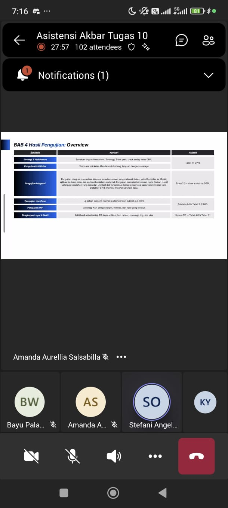

# Form Asistensi

## Tugas Besar IF2150 - Rekayasa Perangkat Lunak

| Informasi | Keterangan |
| --- | --- |
| **Hari** | *\[Senin\]* |
| **Tanggal** | *\[16/11/2026\]* |
| **Kelas** | *\[K01\]* |
| **Nomor Kelompok** | *\[5\]*  |
| **Nama Kelompok** | *\[Furina: Forum RPL Indonesia Jaya\]*  |
| **Nama Perangkat Lunak** | *\[APATIS: Aplikasi Pelaporan Air dan Sanitasi\]*  |
| **Dokumen** | *\[K01_G05_HIUPL.md\]*  |

### Anggota Kelompok

| NIM | Nama |
|---|---|
| *13525016* | *Kenzo Yo* |
| *13525112* | *Justin Sepvian* |
| *13525142* | *Jessica Audrey Tjahjadi* |
| *13525073* | *Nadia Layla Safira* |
| *13525097* | *Arini Karimatunnikmah* |

### Catatan

Asistensi akbar:

Bab 1: bisa copas, menyesuaikan aja
Bab 2: Menyesuaikan aja, referensi minimal ada DPPL dan SKPL
Bab 3: Menyesuaikan aja
Bab 4: 
- 4.1: Klasifikasi tingkat tes, kategori, tes harus sejauh apa (mendalam, sedang, tidak perlu)

mendalam: business logic, 
sedang: hanya delegasi, controller tipis, operasi CRUD standar

tidak perlu: misal, kelas data-data, setter / getter

- 4.2: Unit tests

untuk kelas mendalam, tulis algoritma yang mencakup, coverage

- 4.3: Pengujian integrasi (antarkomponen bisa bekerja sama, misal aplikasi dan database)

- 4.4: Pengujian use case:
Setiap skenario normal dan alternatif berjalan sesuai harapan

- 4.5: Pengujian KNF (profiling, performance, security, dll, apakah sesuai dengan yang udah didefinisikan)
-> dibuat berdasarkan yang ditulis, alat dan metode terserah

- 4.6: Bukti aja (screenshot)

Software testing: proses evaluasi dan verifikasi keberjalanan software dan kesesuaian dengan yang sudah kita ddefinisikan
-> bisa manual / otomatis (unit dan integrasi)

tingkatan testing:
- Unit: satu bagian aja
- Integration: berbagai komponen
- System testing: sistem secara keseluruhan berjalan (end to end), alur dari login ke checkout ke konfirmasi misalnya
- acceptance testing (verifikasi apakah sudah memenuhi kebutuhan dan kriteria yang didefinisikan)

Functional testing: fokus ke evaluasi fitur (whitebox, blackbox, exploratory, user acceptance, dll)

Non functional: fokus ke kualitas sistem (berapa detik, kecepatan respons, keamanan sistem, dll)

Bab 5:
Traceability, liat spek, pemetaan seperti biasa

QnA:
Integration test: pakai data dummy atau gimana?
Best practice: datanya pakai data testing (data yang dibuat-buat / dummy)
Semisal malas atau mau pakai database utama, harus flush database utama
Data dummy tanpa database juga boleh

Coverage: kalau pas kemarin M10 ga sempat bikin test berlebih sehingga coveragenya kurang, apa boleh nambahin test case?
-> Boleh, buat ningkatin boleh banyakin uji coba test

Perombakan implementasi: misal kelasnya terlalu kecil / mau digabungin / fungsinya kurang, rombaknya gimana? Rombak yang diimplementasi aja

KNF ga terjangkau: misal KnF kemarin tidak masuk akal / impossible, itu di skip atau gimana? 
-> Nanti dikabarin lagi oleh masing-masing asisten / Coba selipin justifikasi atau kendala pas implementasi di dokumen M10
-> Apa pun yang beda tulis aja di M10 biar terdokumentasi

## Dokumentasi

<!--  -->

  

  <i>Gambar 1. Dokumentasi kegiatan asistensi.</i>

