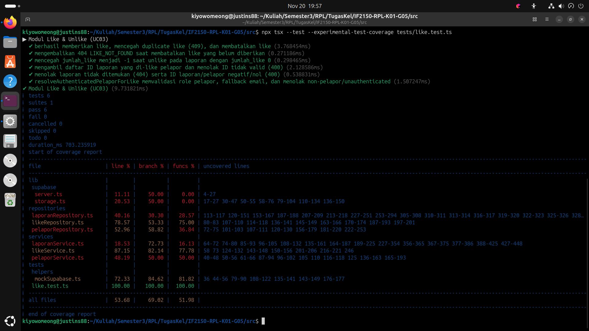
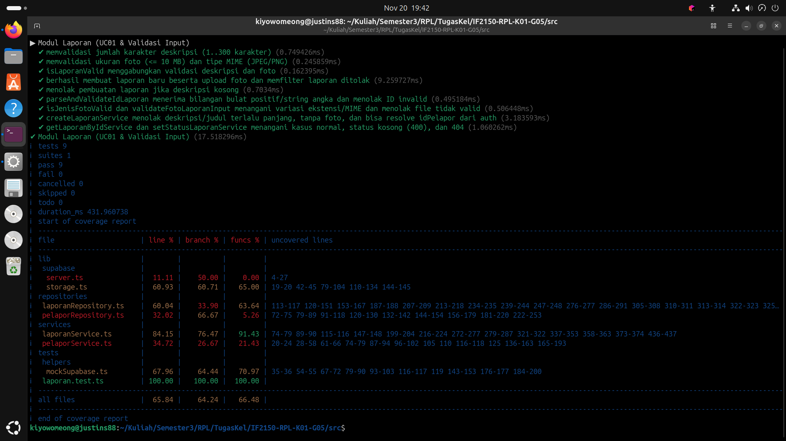
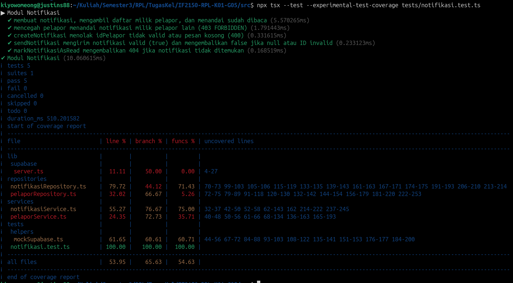
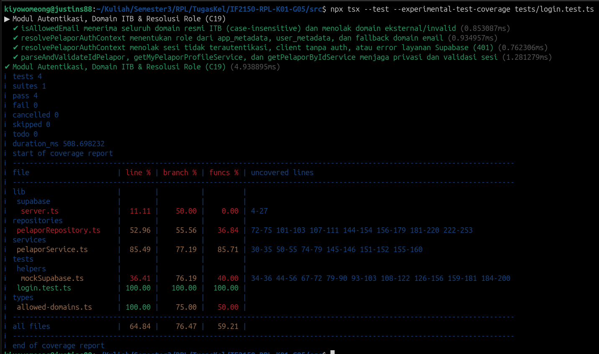

<h1>
IF2150 REKAYASA PERANGKAT LUNAK
 
TUGAS 10
 
HASIL IMPLEMENTASI DAN UJI PERANGKAT LUNAK (HIUPL)
</h1>
 

## *APATIS: Aplikasi Pelaporan Air dan Sanitasi*
### 

### Untuk: *Made Branenda Jordhy*

Dipersiapkan oleh:
| Informasi | Keterangan |
| --- | --- |
| Kelas | *\[K01\]* |
| Kelompok | *\[5\]*  |

| NIM | Nama |
|---|---|
| *13525016* | *Kenzo Yo* |
| *13525112* | *Justin Sepvian* |
| *13525142* | *Jessica Audrey Tjahjadi* |
| *13525073* | *Nadia Layla Safira* |
| *13525097* | *Arini Karimatunnikmah* |

## Daftar Isi

- [BAB 1: Pendahuluan](#bab-1-pendahuluan)
  - [1.1 Tujuan Penulisan Dokumen](#11-tujuan-penulisan-dokumen)
  - [1.2 Lingkup Masalah](#12-lingkup-masalah)
  - [1.3 Definisi, Istilah, dan Singkatan](#13-definisi-istilah-dan-singkatan)
  - [1.4 Aturan Penomoran](#14-aturan-penomoran)
  - [1.5 Referensi](#15-referensi)
  - [1.6 Deskripsi Umum Dokumen (Ikhtisar)](#16-deskripsi-umum-dokumen-ikhtisar)
- [BAB 2: Deskripsi Umum Perangkat Lunak](#bab-2-deskripsi-umum-perangkat-lunak)
- [BAB 3: Implementasi](#bab-3-implementasi)
  - [3.1 Lingkungan Implementasi](#31-lingkungan-implementasi)
  - [3.2 Implementasi Modul](#32-implementasi-modul)
  - [3.3 Implementasi Antarmuka](#33-implementasi-antarmuka)
  - [3.4 File Lain](#34-file-lain)
- [BAB 4: Hasil Pengujian](#bab-4-hasil-pengujian)
  - [4.1 Strategi dan Kedalaman Pengujian Kelas](#41-strategi-dan-kedalaman-pengujian-kelas)
  - [4.2 Pengujian Unit Kelas](#42-pengujian-unit-kelas)
  - [4.3 Pengujian Integrasi](#43-pengujian-integrasi)
  - [4.4 Pengujian Use Case](#44-pengujian-use-case)
  - [4.5 Pengujian Kebutuhan Non-Fungsional (KNF)](#45-pengujian-kebutuhan-non-fungsional-knf)
  - [4.6 Tangkapan Layar dan Bukti Hasil Pengujian](#46-tangkapan-layar-dan-bukti-hasil-pengujian)
- [BAB 5: Traceability](#bab-5-traceability)

---

## Daftar Perubahan

| Revisi | Deskripsi |
| :--- | :--- |
| *A* | *Deskripsikan perubahan yang dilakukan dari dokumen sebelumnya pada dokumen ini. Jika tidak terdapat perubahan, harap kosongkan tabel.* |
| *B* |  |
| *C* |  |
| ... |  |

---

# BAB 1: Pendahuluan

## 1.1 Tujuan Penulisan Dokumen

Penulisan HIUPL APATIS ini bertujuan untuk menunjukkan bagaimana hasil implementasi dari desain website dan mengetahui bagaimana pengujian dari fungsionalitas pada website tersebut. Dokumen ini juga menjelaskan ruang lingkup pembuatan website dan batasan dari pembuatan website. Dokumen ini menjadi acuan selama proses implementasi perangkat lunak Proyek APATIS berbasis Web Application dan merupakan kelengkapan dokumentasi proyek.

## 1.2 Lingkup Masalah
Fasilitas air bersih dan sanitasi penting untuk mendukung kegiatan di lingkungan kampus dan berkaitan dengan SDG 6. Namun, proses pelaporan masalah fasilitas masih dapat terkendala karena belum dilakukan secara terpusat, informasi lokasi dapat kurang lengkap, dan pelapor sulit mengetahui apakah suatu masalah sudah pernah dilaporkan. Untuk membantu mengatasi masalah tersebut, APATIS menyediakan pelaporan terpusat yang memungkinkan pengguna mencantumkan foto, deskripsi, dan lokasi masalah, melihat laporan pengguna lain, memberikan like, serta memantau perkembangan penanganan melalui status laporan. Pengguna yang mengirimkan laporan valid akan memperoleh poin yang digunakan untuk menentukan peringkat pada leaderboard, sedangkan pengguna dalam 20 peringkat teratas dapat menjadi calon penerima merchandise apabila hadiah tersedia.

## 1.3 Definisi, Istilah, dan Singkatan
Semua definisi dan singkatan yang digunakan dalam dokumen ini beserta penjelasannya.

Tabel 1.3. Definisi Istilah dan Singkatan

| Singkatan, Akronim, atau Istilah | Penjelasan |
| :--- | :--- |
| *P/L* | *Singkatan dari Perangkat Lunak, yaitu aplikasi yang memberikan perintah kepada komputer untuk menjalankan tugas tertentu.* |
| *SKPL* | *Singkatan dari Spesifikasi Kebutuhan Perangkat Lunak, yaitu dokumen yang merangkum kriteria-kriteria yang diperlukan untuk membangun aplikasi menjalankan tugasnya.* |
| *APL* | *Arsitektur Perangkat Lunak* |
| *DPPL* | *Singkatan dari Deskripsi Perancangan Perangkat Lunak, yaitu dokumen yang menjelaskan rancangan arsitektur, kelas, dan antarmuka P/L.* |
| *HIUPL* | *Singkatan dari Hasil Implementasi dan Uji Perangkat Lunak, yaitu dokumen yang melaporkan hasil implementasi dan pengujian P/L.* |
| *KF* | *Singkatan dari Kebutuhan Fungsional.* |
| *KNF* | *Singkatan dari Kebutuhan Non-Fungsional.* |
| *UC* | *Singkatan dari Use Case.* |
| *TC* | *Singkatan dari Test Case, yaitu satu kasus uji untuk skenario tertentu.* |
| *UT* | *Singkatan dari Unit Test, yaitu test case tingkat kelas/operasi.* |
| *INT* | *Singkatan dari Integration Test, yaitu test case yang menguji interaksi antarkomponen.* |
| *Boundary* | *Kasus uji pada nilai batas masukan, misalnya nilai minimum, maksimum, atau tepat di ambang aturan.* |
| *Coverage* | *Persentase baris/cabang kode yang dieksekusi oleh pengujian.* |
| *SDG* | *Sustainable Development Goals atau Tujuan Pembangunan Berkelanjutan.* |
| *OTP* | *One Time Password, yaitu kode sekali pakai yang digunakan dalam proses autentikasi.* |
| *DBMS* | *Database Management System, yaitu sistem yang digunakan untuk mengelola basis data.* |
| *APATIS* | *Aplikasi Pelaporan Air dan Sanitasi* |

## 1.4 Aturan Penomoran
Tuliskan aturan penomoran (ID) yang digunakan dalam dokumen ini. Gunakan pola ID yang **sama** dengan yang sudah dipakai pada dokumen-dokumen sebelumnya (SKPL, APL, DPPL), kecuali untuk ID pengujian yang baru diperkenalkan pada dokumen ini.

Tabel 1.4. Aturan Penomoran

| Hal/Bagian | Penomoran | Keterangan |
| :--- | :--- | :--- |
| *Kebutuhan Fungsional* | *KFXX* | *Menunjukkan kebutuhan fungsional perangkat lunak.* |
| *Kebutuhan Non-Fungsional* | *KNFXX* | *Menunjukkan kebutuhan non-fungsional perangkat.* |
| *Use Case* | *UCXX* | *Menunjukkan kegunaan perangkat lunak dari perspektif pengguna.* |
| *Kelas* | *CXX* | *Menunjukkan kelas-kelas pada perangkat lunak.* |
| *Antarmuka* | *I-XX* | *Sesuai DPPL* |
| *Test Case Unit* | *CXX-UTYY* | *XX adalah nomor kelas, YY adalah nomor urut test case unit pada kelas tersebut* |
| *Test Case Integrasi* | *INT-TCYY* | *YY adalah nomor urut test case integrasi* |
| *Test Case Use Case* | *UCXX-TCYY* | *XX adalah nomor use case, YY adalah nomor urut test case pada use case tersebut* |
| *Test Case KNF* | *KNFXX-TCYY* | *XX adalah nomor KNF, YY adalah nomor urut test case pada KNF tersebut* |

## 1.5 Referensi
Cantumkan daftar buku, panduan, atau dokumentasi lain yang dirujuk dalam pembuatan dokumen dan pengembangan P/L, **minimal dokumen SKPL, APL, DPPL, dan Implementasi (Tugas 9)**. Tambahkan dokumentasi *framework*/*library*/*testing tool* atau referensi lain apabila digunakan.

Kelompok Furina: Forum RPL Indonesia Jaya, *K01_G05_SKPL*, Institut Teknologi Bandung, Semester 1, Tahun Ajaran 2026/2027.

Kelompok Furina: Forum RPL Indonesia Jaya, *K01_G05_APL*, Institut Teknologi Bandung, Semester 1, Tahun Ajaran 2026/2027.

Kelompok Furina: Forum RPL Indonesia Jaya, *K01_G05_DPPL*, Institut Teknologi Bandung, Semester 1, Tahun Ajaran 2026/2027.

Kelompok Furina: Forum RPL Indonesia Jaya, *K01_G05_Implementasi*, Institut Teknologi Bandung, Semester 1, Tahun Ajaran 2026/2027.

Tim Asisten IF2150, *Hasil Implementasi dan Uji Perangkat Lunak*, Institut Teknologi Bandung, Semester 1, Tahun Ajaran 2026/2027.

Tim Pengajar IF2150, *Perancangan Test Case: Partisi, Batas, dan Jalur*, Institut Teknologi Bandung, Semester 1, Tahun Ajaran 2026/2027.

Tim Pengajar IF2150, *Teknik Pengujian Unit: Test Double dan Pembangkitan Test Otomatis*, Institut Teknologi Bandung, Semester 1, Tahun Ajaran 2026/2027.

## 1.6 Deskripsi Umum Dokumen (Ikhtisar)
Dokumen HIUPL APATIS ini terdiri atas lima bab. BAB 1 berisi tujuan penulisan dokumen, lingkup masalah, definisi, istilah dan singkatan, aturan penomoran, serta referensi. BAB 2 menjelaskan deskripsi umum perangkat lunak APATIS. BAB 3 berisi informasi tentang elemen P/L yang diimplementasikan. BAB 4 melaporkan hasil pengujian P/L pada level unit, integrasi, dan sistem. Terakhir, BAB 5 berisi kerunutan antara implementasi dan pengujian serta kerunutan antara KNF dan Pengujian.

 

---

# BAB 2: Deskripsi Umum Perangkat Lunak

APATIS merupakan sistem yang membantu pengguna melaporkan masalah fasilitas air dan sanitasi di lingkungan ITB, seperti kebocoran air, kondisi air yang tidak wajar, serta perlengkapan kamar mandi yang kurang. Melalui sistem ini, proses pelaporan diharapkan menjadi lebih mudah, terpusat, dan transparan.

APATIS melibatkan tiga jenis pengguna, yaitu Pelapor, Petugas, dan Admin. Pelapor membuat laporan mengenai masalah fasilitas air dan sanitasi. Admin melakukan validasi atau moderasi administratif terhadap laporan, sedangkan Petugas memeriksa laporan dan memperbarui status penanganannya.

Penerapan APATIS diharapkan dapat membantu memusatkan proses pelaporan dan mempercepat penyampaian informasi mengenai masalah fasilitas air dan sanitasi. Sistem ini juga mendukung pelaksanaan SDG 6 di lingkungan ITB, khususnya dalam pengelolaan fasilitas air bersih dan sanitasi.

<i>Gambar 1. Swimlane Diagram APATIS</i>

Sistem perangkat lunak ini akan menggunakan layanan eksternal _hosting server_, seperti Cloudflare, agar banyak pengguna, baik pelapor, petugas, maupun admin, dapat mengaksesnya secara sekaligus. Kemudian, sistem juga akan berinteraksi dengan sistem basis data relasional eksternal untuk menyimpan, mengambil, serta melakukan pembaruan terhadap data-data relasional sederhana, seperti data akun pelapor, petugas, admin, data laporan, dan sebagainya. Sistem akan berinteraksi dengan layanan ini setiap kali terdapat perubahan data, seperti pelapor membuat laporan, petugas memberi tanggapan, dan seterusnya. Sistem juga akan berinteraksi dengan layanan eksternal _object storage_ atau penyimpanan objek untuk menyimpan serta mengambil data berukuran besar seperti foto yang dilampirkan pada laporan. Terakhir, sistem juga akan menggunakan layanan autentikasi eksternal untuk melakukan validasi akun pengguna ketika pengguna melakukan login.

---

# BAB 3: Implementasi

Bagian ini diisi dengan informasi tentang elemen P/L yang dikembangkan (*executable files*, *configuration files*, *data files*, dan sebagainya) serta perubahannya terhadap rancangan pada DPPL (jika ada).

## 3.1 Lingkungan Implementasi

Tuliskan *hardware* dan *software* yang digunakan untuk implementasi, mencakup *operating system*, bahasa pemrograman beserta versinya, *framework*/*library*, DBMS, *development tools*, dan *version control*. Lingkungan ini harus konsisten dengan **Subbab 2.1 DPPL**; jelaskan jika ada perubahan. Cantumkan juga *framework* dan alat pengujian yang dipakai.

Tabel 3.1. Lingkungan Implementasi

| Aspek | Keterangan |
| :--- | :--- |
| *Hardware* | *Laptop pengembang dan penguji unit: Intel Core i7-13620H (8 thread), RAM 10 GB. Sisi server berjalan serverless di Cloudflare Workers sehingga tidak memerlukan server fisik.* |
| *Operating System* | *Pengembangan dan pengujian unit: Ubuntu 26.04.1 LTS (kernel Linux 7.0.0). Aplikasi dapat diakses lintas platform melalui browser modern sesuai DPPL 2.1.* |
| *Bahasa Pemrograman* | *TypeScript 5.9.3 (`strict: true`, target ES2017) di atas Node.js v22.14.0 (npm 10.9.2)* |
| *Framework/Library* | *Next.js 16.4 (App Router, `package.json`: `^16.4.5`), React 19.3.0, Tailwind CSS 4.3.3, `@supabase/supabase-js` 2.118.0, `@supabase/ssr` 0.12.7, `@opennextjs/cloudflare` `^1.20.16`, Wrangler `^4.158.0`, ESLint 9.39.5* |
| *DBMS* | *Supabase dengan PostgreSQL 15 (sesuai DPPL 2.1), beserta Supabase Auth dan Supabase Storage (bucket `laporan-foto`) sebagai object storage* |
| *Development Tools* | *WebStorm sebagai IDE, Git 2.53.0 sebagai version control, GitHub sebagai repositori dan Pull Request, npm 10.9.2 sebagai package manager, Supabase Dashboard untuk pengelolaan basis data* |
| *Testing Tools* | *Test runner bawaan Node.js (`node:test` dan `node:assert/strict`) yang dijalankan melalui `tsx` v4.23.15 dengan perintah `npm test`. Alat coverage: V8 code coverage bawaan Node.js v22 (`--experimental-test-coverage`) yang melaporkan `% line`, `% branch`, dan `% funcs`. Database dan Supabase Storage pada unit test disimulasikan dengan `tests/helpers/mockSupabase.ts`.* |

## 3.2 Implementasi Modul

Daftar modul/kelas yang **TELAH** diimplementasikan. Gunakan nama dan ID kelas yang sama dengan DPPL, dan konsisten dengan Tabel B.5 pada dokumen Implementasi (Tugas 9).

Tabel 3.2. Implementasi Modul

| No | ID Kelas | Nama Modul/Kelas | Nama File Fisik | Nama File Executable |
| :--- | :--- | :--- | :--- | :--- |
| 1 | *[C01]* | *[Nama modul/kelas]* | *[path/ke/file]* | *[Nama file executable, atau - jika tidak ada]* |
| 2 | *[C02]* | *[Nama modul/kelas]* | *[path/ke/file]* | *[...]* |
| ... | *...* | *...* | *...* | *...* |

## 3.3 Implementasi Antarmuka

Daftar antarmuka yang telah diimplementasikan. Gunakan ID dan nama layar yang sama dengan ID dan nama layar pada tugas DPPL.

Tabel 3.3. Implementasi Antarmuka

| No | ID Antarmuka | Nama Antarmuka | Nama File Fisik | Nama File Executable |
| :--- | :--- | :--- | :--- | :--- |
| 1 | *[I-01]* | *[Nama layar]* | *[path/ke/file]* | *[Nama file executable, atau - jika tidak ada]* |
| 2 | *[I-02]* | *[Nama layar]* | *[path/ke/file]* | *[...]* |
| ... | *...* | *...* | *...* | *...* |

## 3.4 File Lain

Daftar file lain yang dibuat selain file kelas dan antarmuka, misalnya file *utility*, *configuration*, *database schema/seed*, *file test*, atau *data*.

Tabel 3.4. File Lain

| No | Nama File | Keterangan |
| :--- | :--- | :--- |
| 1 | *[Nama file]* | *[Fungsi file]* |
| ... | *...* | *...* |

 

---

# BAB 4: Hasil Pengujian

Bab ini melaporkan hasil pengujian P/L pada level unit, integrasi, dan sistem. Pengujian dilakukan pada tag release terakhir Tugas 9. Hasil aktual diisi berdasarkan pengamatan saat pengujian. Kesimpulan diisi `Pass` atau `Fail`, dan untuk `Fail` dilengkapi penyebab serta usulan perbaikan.

## 4.1 Strategi dan Kedalaman Pengujian Kelas

Setiap kelas perancangan pada Tabel 4.1 DPPL diklasifikasikan ke dalam tiga tingkat kedalaman pengujian. Tingkat **Mendalam** diberikan pada kelas yang memuat logika bisnis, perhitungan, validasi, aturan status, algoritma, integrasi eksternal, atau keamanan. Tingkat **Sedang** diberikan pada kelas yang hanya mengoordinasikan atau mendelegasikan proses. Tingkat **Tidak perlu** diberikan pada kelas tanpa logika, seperti *entity/DTO* dan kelas konfigurasi, yang teruji secara tidak langsung melalui test case use case. Seluruh kelas wajib dicantumkan beserta alasan penentuan tingkatnya.

Tabel 4.1.1. Identifikasi Tingkat Pengujian Kelas

| ID Kelas | Nama Kelas | Tingkat | Alasan | Test Case Terkait |
| :--- | :--- | :--- | :--- | :--- |
| *C01* | *PelaporEntity* | *Tidak perlu* | *Kelas entity berisi atribut (id, nama, NIM/NIP, poin, email) beserta getter/setter tanpa logika.* | *-* |
| *C02* | *LaporanEntity* | *Tidak perlu* | *Kelas entity berisi atribut laporan (id, judul, deskripsi, foto, like, status) beserta getter/setter tanpa logika.* | *-* |
| *C03* | *HalamanLaporan* | *Tidak perlu* | *Kelas boundary UI yang menampilkan daftar laporan dan meneruskan aksi like ke `LikeController` (`C10`). Diuji melalui integrasi (`4.3`) dan use case (`UC01, UC03`).* | *-* |
| *C04* | *HalamanFormulirLaporan* | *Tidak perlu* | *Kelas boundary UI formulir pelaporan. Aturan validasi batas karakter judul/deskripsi serta ukuran dan jenis foto diuji mendalam pada `LaporanController` (`C05`) dan alur `UC01`.* | *-* |
| *C05* | *LaporanController* | *Mendalam* | *Memuat validasi laporan (`isLaporanValid()`, batas karakter, ukuran/tipe foto), upload ke object storage, pembuatan laporan, dan perubahan status.* | *C05-UT01 s.d. C05-UT12* |
| *C06* | *AdminEntity* | *Tidak perlu* | *Kelas entity berisi data admin (id, nama, NIP, email) beserta getter/setter tanpa logika.* | *-* |
| *C07* | *PetugasEntity* | *Tidak perlu* | *Kelas entity berisi data petugas (id, nama, NIP, email) beserta getter/setter tanpa logika.* | *-* |
| *C08* | *HalamanFormulirTanggapann* | *Tidak perlu* | *Kelas boundary UI formulir tanggapan. Aturan status laporan, validasi status wajib, dan pemberian poin diuji mendalam pada `TanggapanController` (`C09`) dan alur `UC02`.* | *-* |
| *C09* | *TanggapanController* | *Mendalam* | *sendTanggapan() mengubah status dan menambah poin sesuai aturan status dan perhitungannya.* | *C09-UT01 s.d. C09-UT12* |
| *C10* | *LikeController* | *Mendalam* | *Kelas ini harus dapat memenuhi aturan satu like per Pelapor dan toggle like/unlike* | *C10-UT01 s.d. C10-UT10* |
| *C11* | *HalamanLeaderboard* | *Tidak perlu* | *Kelas boundary UI yang menampilkan 20 peringkat teratas; pengurutan dan perhitungan peringkat diuji mendalam pada `LeaderboardController` (`C14`) dan `UC04`.* | *-* |
| *C12* | *DatabaseLaporanEntity* | *Tidak perlu* | *Kelas akses data yang hanya menjalankan query sederhana (SELECT, INSERT, UPDATE). Teruji tidak langsung melalui test case UC01 sampai UC03.* | *-* |
| *C13* | *DatabasePelaporEntity* | *Tidak perlu* | *Kelas akses data yang hanya menjalankan query sederhana pada data Pelapor. Teruji tidak langsung melalui test case UC04* | *-* |
| *C14* | *LeaderboardController* | *Mendalam* | *Memuat algoritma pengurutan Pelapor berdasarkan poin dan perhitungan peringkat, sehingga perlu diuji untuk data kosong, poin sama, dan urutan benar* | *C14-UT01 s.d. C14-UT07* |
| *C15* | *HalamanAkun* | *Tidak perlu* | *Kelas boundary yang hanya menampilkan nama, NIM/NIP, dan poin Pelapor tanpa perhitungan, validasi, atau aturan bisnis. Teruji tidak langsung melalui test case UC04.* | *-* |
| *C16* | *HalamanNotifikasi* | *Tidak perlu* | *Kelas boundary yang hanya menampilkan daftar notifikasi tanpa perhitungan, validasi, atau aturan bisnis. Teruji tidak langsung melalui test case UC02 dan UC04.* | *-* |
| *C17* | *NotifikasiController* | *Sedang* | *Mengoordinasikan pembuatan dan pengiriman notifikasi dengan validasi sederhana (id Pelapor dan pesan tidak kosong).* | *C17-UT01 s.d. C17-UT06* |
| *C18* | *HalamanLogin* | *Tidak perlu* | *Kelas boundary UI penerima input login yang mendelegasikan autentikasi ke `LoginController` (`C19`). Diuji pada pengujian integrasi (`INT-TC01` s.d. `INT-TC03`).* | *-* |
| *C19* | *LoginController* | *Mendalam* | *Validasi domain email ITB, resolusi sesi & role Supabase (`pelapor`/`petugas`/`admin`), penanganan error autentikasi (`401`), dan keamanan akses profil.* | *C19-UT01 s.d. C19-UT07, INT-TC01 s.d. INT-TC03* |

## 4.2 Pengujian Unit Kelas

Pengujian unit dilakukan pada kelas bertingkat Mendalam dan Sedang. Kelas Mendalam diuji pada seluruh operasi public dengan kasus normal, batas, dan negatif, serta mencapai *coverage* minimal 70%. Kelas Sedang diuji minimal dengan satu kasus normal dan satu kasus gagal pada operasi public utama.

Cara menjalankan unit test: `npm test` (atau dengan laporan cakupan: `npx tsx --test --experimental-test-coverage tests/*.test.ts` di dalam direktori `src/`).

Lokasi file test: `src/tests/`.

### 4.2.1 Kelas TanggapanController

**ID Kelas:** *C09*  
**Nama Kelas:** *TanggapanController* (`src/services/tanggapanService.ts`)  
**Tingkat:** *Mendalam*

Tabel 4.2.1. Hasil Pengujian Unit Kelas C09

| ID Pengujian | Operasi yang Diuji | Jenis Kasus | Prosedur/Masukan | Hasil yang Diharapkan | Hasil Pengujian | Kesimpulan |
| :--- | :--- | :--- | :--- | :--- | :--- | :--- |
| *C09-UT01* | *`isStatusValidForPoin(status)` & `isStatusRejected(status)`* | *Normal & Batas* | *Status `"  VaLiD  "`, `"dalam penanganan"`, `"SELESAI"` pada `isStatusValidForPoin`; `"  DiToLaK  "`, `"INVALID"` pada `isStatusRejected`* | *Mengembalikan `true` untuk seluruh variasi huruf kapital dan spasi* | *Seluruh pemanggilan mengembalikan `true`* | *Pass* |
| *C09-UT02* | *`isStatusValidForPoin(status)` & `isStatusRejected(status)`* | *Negatif* | *Status `"menunggu"`, `"   "`, `null` pada `isStatusValidForPoin`; `"valid"`, `undefined` pada `isStatusRejected`* | *Mengembalikan `false` tanpa melempar exception* | *Seluruh pemanggilan mengembalikan `false`* | *Pass* |
| *C09-UT03* | *`addPoinPelapor(idPelapor, poin)`* | *Batas (Data Korup)* | *Pelapor `idPelapor = "1"` (string) dengan data korup `poin = -10` di DB ditambah `5`, lalu ditambah batas positif terkecil `1`* | *Poin negatif dinormalkan ke `0` (`poinLama = 0`, `poinBaru = 5`), lalu menjadi `6`* | *`poinLama = 0`, `poinBaru = 5`, lalu `poinBaru = 6`* | *Pass* |
| *C09-UT04* | *`addPoinPelapor(idPelapor, poin)`* | *Negatif* | *`poin` bernilai `0`, desimal `1.5`, negatif `-3`, `NaN`; serta `idPelapor = "abc"` dan `idPelapor = 999` (tidak ada di DB)* | *Melempar `TanggapanServiceError`: `INVALID_POIN_VALUE` (400), `INVALID_PELAPOR_ID` (400), dan `PELAPOR_NOT_FOUND` (404)* | *Seluruh kasus melempar `TanggapanServiceError` dengan kode dan status HTTP yang sesuai* | *Pass* |
| *C09-UT05* | *`setStatusLaporan(idLaporan, status, extraUpdates)`* | *Normal & Batas* | *Laporan `idLaporan = "5"` diubah statusnya ke `"  dalam penanganan  "` dengan catatan `"Teknisi otw"`* | *Mengembalikan `true` dan status tersimpan ter-trim menjadi `"dalam penanganan"`* | *Mengembalikan `true` dan `status_laporan` di DB menjadi `"dalam penanganan"`* | *Pass* |
| *C09-UT06* | *`setStatusLaporan(idLaporan, status, extraUpdates)`* | *Batas & Negatif* | *`idLaporan = 999` (tidak ada), `idLaporan = 0` (batas invalid), dan `status = "    "` (spasi kosong)* | *`999` mengembalikan `false`; `0` melempar `INVALID_LAPORAN_ID` (400); `"    "` melempar `INVALID_STATUS_LAPORAN` (400)* | *Hasil sesuai ekspektasi (`false` untuk 999, exception 400 untuk ID 0 dan status kosong)* | *Pass* |
| *C09-UT07* | *`sendTanggapan(idLaporan, input)`* | *Normal* | *Petugas memvalidasi laporan `id = 5` milik pelapor `id = 1` (`poin = 10`, `points_awarded = false`) dengan status `"valid"`* | *Status menjadi `"valid"`, `pointsAwardedNow = true`, `poinDitambahkan = 1`, `poinPelaporBaru = 11`, dan `notifikasiSent = true`* | *Status menjadi `"valid"`, poin pelapor menjadi 11, dan 1 notifikasi terkirim* | *Pass* |
| *C09-UT08* | *`sendTanggapan(idLaporan, input)`* | *Batas* | *Petugas memperbarui laporan `id = 5` yang sudah `points_awarded = true` ke status `"selesai"`* | *Status berubah ke `"selesai"` tanpa poin ganda (`pointsAwardedNow = false`, `poinDitambahkan = 0`, poin tetap 11)* | *Status berubah ke `"selesai"`, `poinDitambahkan = 0`, poin tetap 11* | *Pass* |
| *C09-UT09* | *`sendTanggapan(idLaporan, input)`* | *Normal & Batas* | *Admin menolak laporan `id = 7` yang `judul_laporan = null` dengan status `"ditolak"` dan catatan `"Foto tidak jelas"`* | *Status menjadi `"ditolak"`, tidak menambah poin (`0`), notifikasi penolakan terkirim memakai label fallback `#7`* | *Status `"ditolak"`, poin tetap 10, pesan notifikasi mengandung `#7` dan `"tidak dapat diproses"`* | *Pass* |
| *C09-UT10* | *`sendTanggapan(idLaporan, input)`* | *Batas (Laporan Yatim)* | *Petugas memberi input string langsung `"selesai"` pada laporan `id = 8` dengan `id_pelapor = null`* | *Status menjadi `"selesai"` tanpa error, tidak menambah poin (`0`), dan tidak mengirim notifikasi (`notifikasiSent = false`)* | *Status menjadi `"selesai"`, `pointsAwardedNow = false`, `notifikasiSent = false`* | *Pass* |
| *C09-UT11* | *`sendTanggapan(idLaporan, input)`* | *Negatif* | *Pengguna dengan role `"pelapor"` memanggil `sendTanggapan(1, { statusLaporan: "valid" })`* | *Melempar `TanggapanServiceError` dengan kode `FORBIDDEN` (403)* | *Melempar `TanggapanServiceError` (`FORBIDDEN`, status 403)* | *Pass* |
| *C09-UT12* | *`sendTanggapan(idLaporan, input)`* | *Negatif* | *Petugas memanggil `sendTanggapan` dengan `idLaporan = -1`, `statusLaporan = "   "`, dan `idLaporan = 999`* | *Melempar `INVALID_LAPORAN_ID` (400), `INVALID_STATUS_LAPORAN` (400), dan `LAPORAN_NOT_FOUND` (404)* | *Ketiganya melempar `TanggapanServiceError` dengan kode dan status HTTP sesuai* | *Pass* |

Khusus kelas **Mendalam**:

Tabel 4.2.1b. Ringkasan Cakupan Kelas C09

| Informasi | Keterangan |
| :--- | :--- |
| Daftar operasi public pada DPPL | `addPoinPelapor()`, `setStatusLaporan()`, `sendTanggapan()` (beserta helper validasi `isStatusValidForPoin()`, `isStatusRejected()`, `resolveTanggapanActorContext()`) |
| Operasi yang diuji | `isStatusValidForPoin()`, `isStatusRejected()`, `addPoinPelapor()`, `setStatusLaporan()`, `sendTanggapan()` (serta `resolveTanggapanActorContext()` melalui `sendTanggapan()`) |
| ID Algoritma yang tercakup | `Algo-005`, `Algo-006` |
| Coverage (wajib ≥ 70%) | **86.71% line / 78.38% branch / 76.19% funcs** (`npx tsx --test --experimental-test-coverage tests/tanggapan.test.ts`, bukti pada 4.6) |

### 4.2.2 Kelas LikeController

**ID Kelas:** *C10*  
**Nama Kelas:** *LikeController* (`src/services/likeService.ts`)  
**Tingkat:** *Mendalam*

Tabel 4.2.2. Hasil Pengujian Unit Kelas C10

| ID Pengujian | Operasi yang Diuji | Jenis Kasus | Prosedur/Masukan | Hasil yang Diharapkan | Hasil Pengujian | Kesimpulan |
| :--- | :--- | :--- | :--- | :--- | :--- | :--- |
| *C10-UT01* | *`isLaporanLiked(idLaporan, idPelapor)`* | *Normal* | *Cek status like sebelum like, sesudah like, dan sesudah unlike untuk `idLaporan = 10`, `idPelapor = 2`* | *Berturut-turut mengembalikan `false`, `true`, lalu `false`* | *Mengembalikan `false`, `true`, dan `false` sesuai urutan aksi* | *Pass* |
| *C10-UT02* | *`likeLaporan(idLaporan, idPelapor)`* | *Normal* | *Pelapor `2` me-like laporan `10` yang semula `jumlah_like = 3`* | *`liked = true`, `jumlahLike = 4`, dan record like tersimpan* | *`liked = true`, `jumlahLike = 4`* | *Pass* |
| *C10-UT03* | *`likeLaporan(idLaporan, idPelapor)`* | *Negatif (Duplikat)* | *Pelapor `2` mencoba me-like ulang laporan `10` yang sudah di-like* | *Melempar `LikeServiceError` dengan kode `DUPLICATE_LIKE` (409)* | *Melempar `LikeServiceError` (`DUPLICATE_LIKE`, status 409)* | *Pass* |
| *C10-UT04* | *`unlikeLaporan(idLaporan, idPelapor)`* | *Normal & Negatif* | *Pelapor `2` membatalkan like pada laporan `10` (`jumlah_like = 4`), lalu membatalkan like pada laporan yang belum di-like* | *Pertama: `liked = false`, `jumlahLike = 3`; kedua: melempar `LIKE_NOT_FOUND` (404)* | *Pertama kembali ke `3`; kedua melempar `LIKE_NOT_FOUND` (404)* | *Pass* |
| *C10-UT05* | *`unlikeLaporan(idLaporan, idPelapor)`* | *Batas (Batas Bawah 0)* | *Unlike pada laporan `id = 21` dengan `jumlah_like = 0` meski record like ada di DB* | *`unlikeLaporan` menahan batas bawah `0` (`Math.max(0, 0 - 1) = 0`)* | *`liked = false` dan `jumlahLike` tetap `0` (tidak menjadi `-1`)* | *Pass* |
| *C10-UT06* | *`getLikedLaporanIdsByPelaporService(idPelapor)`* | *Normal & Batas* | *Pelapor `2` memiliki like di laporan `10` & `12`; pelapor `3` belum me-like laporan mana pun* | *Pelapor `2` mengembalikan `[10, 12]`; pelapor `3` mengembalikan `[]`* | *Mengembalikan `[10, 12]` untuk pelapor `2` dan `[]` untuk pelapor `3`* | *Pass* |
| *C10-UT07* | *`getLikedLaporanIdsByPelaporService(idPelapor)`* | *Negatif* | *Memanggil dengan `idPelapor = 0`* | *Melempar `LikeServiceError` (`INVALID_PELAPOR_ID`, 400)* | *Melempar `LikeServiceError` (`INVALID_PELAPOR_ID`, 400)* | *Pass* |
| *C10-UT08* | *`likeLaporan()`, `unlikeLaporan()`, `isLaporanLiked()`* | *Negatif (Not Found & ID Invalid)* | *`likeLaporan(999, 1)`, `unlikeLaporan(999, 1)`, `isLaporanLiked(0, 1)`, dan `likeLaporan(1, -5)`* | *Berturut-turut melempar `LAPORAN_NOT_FOUND` (404), `LAPORAN_NOT_FOUND` (404), `INVALID_LAPORAN_ID` (400), `INVALID_PELAPOR_ID` (400)* | *Seluruh kasus melempar `LikeServiceError` dengan kode dan status HTTP sesuai* | *Pass* |
| *C10-UT09* | *`resolveAuthenticatedPelaporForLike()`* | *Normal & Batas (Fallback Email)* | *Auth dengan `idPelapor = 2`, serta auth dengan `idPelapor = null` dan `auth_user_id = null` di DB tetapi memiliki `email` valid* | *Pertama mengembalikan `{ idPelapor: 2 }`; kedua fallback mencari via email dan mengembalikan `{ idPelapor: 7 }`* | *Mengembalikan `{ idPelapor: 2 }` dan `{ idPelapor: 7 }`* | *Pass* |
| *C10-UT10* | *`resolveAuthenticatedPelaporForLike()`* | *Negatif* | *Auth role `"petugas"`, auth `null` (belum login), dan email pelapor yang tidak terdaftar di DB* | *Berturut-turut melempar `FORBIDDEN` (403), `UNAUTHORIZED` (401), dan `INVALID_PELAPOR_SESSION` (401)* | *Ketiganya melempar `LikeServiceError` dengan kode dan status HTTP sesuai* | *Pass* |

Khusus kelas **Mendalam**:

Tabel 4.2.2b. Ringkasan Cakupan Kelas C10

| Informasi | Keterangan |
| :--- | :--- |
| Daftar operasi public pada DPPL | `isLaporanLiked()`, `likeLaporan()`, `unlikeLaporan()` (beserta helper `getLikedLaporanIdsByPelaporService()`, `resolveAuthenticatedPelaporForLike()`) |
| Operasi yang diuji | `isLaporanLiked()`, `likeLaporan()`, `unlikeLaporan()`, `getLikedLaporanIdsByPelaporService()`, `resolveAuthenticatedPelaporForLike()` |
| ID Algoritma yang tercakup | `Algo-007`, `Algo-008`, `Algo-009` |
| Coverage (wajib ≥ 70%) | **87.15% line / 82.14% branch / 77.78% funcs** (`npx tsx --test --experimental-test-coverage tests/like.test.ts`, bukti pada 4.6) |

### 4.2.3 Kelas LaporanController

**ID Kelas:** *C05*  
**Nama Kelas:** *LaporanController* (`src/services/laporanService.ts`)  
**Tingkat:** *Mendalam*

Tabel 4.2.3. Hasil Pengujian Unit Kelas C05

| ID Pengujian | Operasi yang Diuji | Jenis Kasus | Prosedur/Masukan | Hasil yang Diharapkan | Hasil Pengujian | Kesimpulan |
| :--- | :--- | :--- | :--- | :--- | :--- | :--- |
| *C05-UT01* | *`isJumlahKarakterValid(desc, max)`* | *Normal, Batas & Negatif* | *Teks valid, spasi `"   "`, panjang tepat `300` (`MAX_DESKRIPSI_CHARS`), dan panjang `301`* | *Valid & `300` bernilai `true`; `"   "` & `301` bernilai `false`* | *Mengembalikan `true`, `false`, `true`, `false` sesuai batas* | *Pass* |
| *C05-UT02* | *`isUkuranFotoValid(size, max)`* | *Normal, Batas & Negatif* | *Ukuran `1024`, tepat `10 MB` (`MAX_FOTO_SIZE_BYTES`), `0`, dan `10 MB + 1 byte`* | *`1024` & `10 MB` bernilai `true`; `0` & `10 MB + 1` bernilai `false`* | *Mengembalikan `true`, `true`, `false`, `false` sesuai batas* | *Pass* |
| *C05-UT03* | *`isJenisFotoValid(mime, name)`* | *Normal, Batas & Negatif* | *`image/jpeg`+`.jpg`, `image/png`+`.png`, MIME kosong dengan `.png`, `image/png` tanpa ekstensi, `application/pdf`, dan `image/jpeg` dengan `.gif`* | *JPEG/PNG/tanpa ekstensi valid bernilai `true`; PDF & mismatch `.gif` bernilai `false`* | *Seluruh variasi MIME & ekstensi menghasilkan nilai boolean sesuai ekspektasi* | *Pass* |
| *C05-UT04* | *`isLaporanValid(desc, foto)`* | *Normal & Negatif* | *Deskripsi valid + foto JPEG 500 KB, serta deskripsi valid + `foto = null`* | *Pertama mengembalikan `true`; kedua mengembalikan `false`* | *Mengembalikan `true` dan `false`* | *Pass* |
| *C05-UT05* | *`parseAndValidateIdLaporan(rawId)`* | *Normal & Negatif* | *ID `1`, `" 42 "`, serta `0`, `-1`, `1.5`, `"abc"`, `"   "`* | *`1` & `" 42 "` menjadi `1` & `42`; selain itu melempar `INVALID_LAPORAN_ID` (400)* | *ID valid ter-parse; kelima input invalid melempar `INVALID_LAPORAN_ID` (400)* | *Pass* |
| *C05-UT06* | *`validateFotoLaporanInput()` & `uploadFotoLaporanService()`* | *Normal & Negatif* | *Upload PNG 3 byte valid; serta file `size = 0`, tipe `application/pdf`, dan `size = 10 MB + 1`* | *File valid terunggah ke bucket `laporan-foto`; file invalid melempar `EMPTY_FOTO_FILE`, `INVALID_FOTO_TYPE`, `FOTO_TOO_LARGE` (400)* | *Upload berhasil dengan URL publik `pelapor-5`; ketiga kasus gagal melempar kode error yang sesuai* | *Pass* |
| *C05-UT07* | *`createLaporanService()` & `getValidLaporanService()`* | *Normal* | *Buat laporan baru dengan foto JPEG 4 byte pada DB berisi 1 laporan berstatus `"ditolak"`, lalu panggil `listLaporanService()` dan `getValidLaporanService()`* | *Laporan tersimpan dengan URL storage; `listLaporanService()` berjumlah 2, `getValidLaporanService()` berjumlah 1 (memfilter yang ditolak)* | *Laporan tersimpan, `all.length = 2`, `validOnly.length = 1`* | *Pass* |
| *C05-UT08* | *`createLaporanService(input)`* | *Batas (Resolve Auth)* | *Buat laporan tanpa `idPelapor` dengan `authOverride` (`idPelapor: 2`)* | *`idPelapor` otomatis terisi `2` dari konteks autentikasi* | *Laporan tersimpan dengan `idPelapor = 2`* | *Pass* |
| *C05-UT09* | *`createLaporanService(input)`* | *Negatif (Validasi Input)* | *Deskripsi `"   "`, deskripsi `301` karakter, judul `101` karakter, dan tanpa `fotoFile`/`fotoLaporan`* | *Berturut-turut melempar `INVALID_LAPORAN_DESKRIPSI`, `DESKRIPSI_TOO_LONG`, `JUDUL_TOO_LONG`, `MISSING_FOTO_LAPORAN` (400)* | *Keempatnya melempar `LaporanServiceError` dengan kode yang sesuai* | *Pass* |
| *C05-UT10* | *`getLaporanByIdService(rawId)`* | *Normal & Negatif* | *Ambil laporan dengan `rawId = "10"` (ada di DB) dan `rawId = 999` (tidak ada)* | *`"10"` mengembalikan entitas laporan `10`; `999` melempar `LAPORAN_NOT_FOUND` (404)* | *Data laporan `10` ditemukan; `999` melempar `LAPORAN_NOT_FOUND` (404)* | *Pass* |
| *C05-UT11* | *`setStatusLaporanService(rawId, status)`* | *Normal* | *Ubah status laporan `10` ke `"  tuntas  "`* | *Mengembalikan `true` dan status laporan di DB menjadi `"tuntas"`* | *Mengembalikan `true` dan `status_laporan` menjadi `"tuntas"`* | *Pass* |
| *C05-UT12* | *`setStatusLaporanService(rawId, status)`* | *Negatif* | *Ubah status laporan `10` ke `"   "` (kosong) dan laporan `999` ke `"tuntas"`* | *Melempar `INVALID_STATUS_LAPORAN` (400) dan `LAPORAN_NOT_FOUND` (404)* | *Keduanya melempar `LaporanServiceError` dengan kode dan status HTTP sesuai* | *Pass* |

Khusus kelas **Mendalam**:

Tabel 4.2.3b. Ringkasan Cakupan Kelas C05

| Informasi | Keterangan |
| :--- | :--- |
| Daftar operasi public pada DPPL | `isLaporanValid()`, `setStatusLaporanService()`, `getValidLaporanService()` (beserta helper & operasi lain: `parseAndValidateIdLaporan()`, `isJumlahKarakterValid()`, `isUkuranFotoValid()`, `isJenisFotoValid()`, `validateFotoLaporanInput()`, `uploadFotoLaporanService()`, `createLaporanService()`, `listLaporanService()`, `getLaporanByIdService()`) |
| Operasi yang diuji | Seluruh 12 fungsi public di `src/services/laporanService.ts` |
| ID Algoritma yang tercakup | `Algo-003` |
| Coverage (wajib ≥ 70%) | **84.15% line / 76.47% branch / 91.43% funcs** (`npx tsx --test --experimental-test-coverage tests/laporan.test.ts`, bukti pada 4.6) |

### 4.2.4 Kelas LeaderboardController

**ID Kelas:** *C14*  
**Nama Kelas:** *LeaderboardController* (`src/services/leaderboardService.ts`)  
**Tingkat:** *Mendalam*

Tabel 4.2.4. Hasil Pengujian Unit Kelas C14

| ID Pengujian | Operasi yang Diuji | Jenis Kasus | Prosedur/Masukan | Hasil yang Diharapkan | Hasil Pengujian | Kesimpulan |
| :--- | :--- | :--- | :--- | :--- | :--- | :--- |
| *C14-UT01* | *`getTop20Pelapor()`* | *Normal & Batas* | *25 data pelapor dengan poin bertingkat `5..125`* | *Mengembalikan tepat 20 entri (`rank = 1` berpoin `125` / `id = 25`; `rank = 20` adalah `id = 6`)* | *`top20.length = 20`, peringkat 1 dan 20 sesuai urutan tertinggi* | *Pass* |
| *C14-UT02* | *`getPelaporPoin(id)` & `getPelaporRank(id)`* | *Normal* | *Panggil dengan `idPelapor = 1` (poin `5`) pada dataset 25 pelapor* | *`getPelaporPoin(1) = 5` dan `getPelaporRank(1) = 25`* | *Mengembalikan `5` dan `25`* | *Pass* |
| *C14-UT03* | *`getMyLeaderboardService()`* | *Normal & Batas Top 20* | *Uji pelapor `id = 25` (`rank = 1`), `id = 6` (batas tepat `rank = 20`), `id = 5` (batas luar `rank = 21`), dan `id = 1` (`rank = 25`)* | *`inTop20 = true` untuk `rank` 1 dan 20; `inTop20 = false` untuk `rank` 21 dan 25* | *Seluruh status `rank` dan `inTop20` sesuai batas `MAX_LEADERBOARD_ENTRIES = 20`* | *Pass* |
| *C14-UT04* | *`sortPelaporByPoin()`, `getTop20Pelapor()`, `getPelaporPoin()`, `getPelaporRank()`* | *Batas (Data Kosong)* | *Dataset pelapor kosong `[]` dengan pemanggilan masing-masing operasi dan `idPelapor = 1`* | *`sortPelaporByPoin()` & `getTop20Pelapor()` mengembalikan `[]`; `getPelaporPoin(1)` & `getPelaporRank(1)` mengembalikan `0`* | *Seluruh hasil sesuai (`[]` dan `0`)* | *Pass* |
| *C14-UT05* | *`sortPelaporByPoin()` & `getPelaporRank(id)`* | *Batas (Poin Sama / Tie-breaker)* | *Pelapor `id = 5` (poin 50), `id = 8` (poin 80), `id = 2` (poin 50)* | *Urutan `[8, 2, 5]` (poin sama diurutkan berdasarkan `idPelapor` terkecil), `rank(2) = 2`, `rank(5) = 3`* | *Urutan ID `[8, 2, 5]` dengan `rank(2) = 2` dan `rank(5) = 3`* | *Pass* |
| *C14-UT06* | *`getPelaporPoin(id)` & `getPelaporRank(id)`* | *Negatif* | *`getPelaporPoin(0)` dan `getPelaporRank(-1)`* | *Melempar `PelaporServiceError` (`INVALID_PELAPOR_ID`, status `400`)* | *Keduanya melempar `PelaporServiceError` (`INVALID_PELAPOR_ID`, 400)* | *Pass* |
| *C14-UT07* | *`getMyLeaderboardService()`* | *Negatif* | *Pemanggilan dengan `authOverride = null` (belum terautentikasi)* | *Melempar `LeaderboardServiceError` (`UNAUTHORIZED`, status `401`)* | *Melempar `LeaderboardServiceError` (`UNAUTHORIZED`, 401)* | *Pass* |

Khusus kelas **Mendalam**:

Tabel 4.2.4b. Ringkasan Cakupan Kelas C14

| Informasi | Keterangan |
| :--- | :--- |
| Daftar operasi public pada DPPL | `getPelaporPoin()`, `getPelaporRank()`, `sortPelaporByPoin()` (beserta helper & operasi tambahan `comparePelaporByPoin()`, `toLeaderboardEntry()`, `getTop20Pelapor()`, `getMyLeaderboardService()`) |
| Operasi yang diuji | Seluruh 7 fungsi public di `src/services/leaderboardService.ts` |
| ID Algoritma yang tercakup | `Algo-018`, `Algo-019`, `Algo-020` |
| Coverage (wajib ≥ 70%) | **99.24% line / 93.10% branch / 80.00% funcs** (`npx tsx --test --experimental-test-coverage tests/leaderboard.test.ts`, bukti pada 4.6) |

### 4.2.5 Kelas NotifikasiController

**ID Kelas:** *C17*  
**Nama Kelas:** *NotifikasiController* (`src/services/notifikasiService.ts`)  
**Tingkat:** *Sedang*

Tabel 4.2.5. Hasil Pengujian Unit Kelas C17

| ID Pengujian | Operasi yang Diuji | Jenis Kasus | Prosedur/Masukan | Hasil yang Diharapkan | Hasil Pengujian | Kesimpulan |
| :--- | :--- | :--- | :--- | :--- | :--- | :--- |
| *C17-UT01* | *`createNotifikasi(idPelapor, pesan)`* | *Normal* | *Panggil `createNotifikasi(1, "Laporan Anda telah diverifikasi!")`* | *Notifikasi tersimpan dengan `idPelapor = 1` dan `statusNotifikasi = "Belum Dibaca"`* | *Mengembalikan objek notifikasi dengan `idPelapor = 1` dan status `"Belum Dibaca"`* | *Pass* |
| *C17-UT02* | *`createNotifikasi(idPelapor, pesan)`* | *Negatif* | *Panggil `createNotifikasi(0, "Pesan valid")` dan `createNotifikasi(1, "   ")`* | *Keduanya melempar `NotifikasiServiceError` (`INVALID_NOTIFIKASI_INPUT`, status `400`)* | *Keduanya melempar `NotifikasiServiceError` (`INVALID_NOTIFIKASI_INPUT`, 400)* | *Pass* |
| *C17-UT03* | *`sendNotifikasi(notifikasi)`* | *Normal* | *Kirim objek notifikasi valid hasil `createNotifikasi(1, "Status berubah")`* | *Mengembalikan `true` dan mengubah `statusNotifikasi` menjadi `"Terkirim"`* | *Mengembalikan `true` dan `statusNotifikasi = "Terkirim"`* | *Pass* |
| *C17-UT04* | *`sendNotifikasi(notifikasi)`* | *Negatif* | *Panggil `sendNotifikasi(null)` dan objek dengan `idNotifikasi = 0`* | *Keduanya mengembalikan `false`* | *Keduanya mengembalikan `false`* | *Pass* |
| *C17-UT05* | *`getNotifikasiPelapor(id)` & `markNotifikasiAsRead(idNotif, idPelapor)`* | *Normal* | *Ambil daftar notifikasi pelapor `1` lalu tandai sudah dibaca oleh pelapor `1`* | *Daftar berisi 1 notifikasi dengan pesan sesuai; `markNotifikasiAsRead` mengembalikan `true`* | *Daftar berjumlah 1 dan `markNotifikasiAsRead` mengembalikan `true`* | *Pass* |
| *C17-UT06* | *`markNotifikasiAsRead(idNotif, idPelapor)`* | *Negatif* | *Pelapor `2` menandai notifikasi milik pelapor `1`, serta menandai `idNotifikasi = 999` (tidak ada)* | *Berturut-turut melempar `FORBIDDEN` (`403`) dan `NOTIFIKASI_NOT_FOUND` (`404`)* | *Keduanya melempar `NotifikasiServiceError` dengan kode dan status HTTP sesuai* | *Pass* |

### 4.2.6 Kelas LoginController

**ID Kelas:** *C19*  
**Nama Kelas:** *LoginController* (`src/types/allowed-domains.ts`, `src/services/pelaporService.ts`, dan `src/app/login/actions.tsx`)  
**Tingkat:** *Mendalam*

Tabel 4.2.6. Hasil Pengujian Unit Kelas C19

| ID Pengujian | Operasi yang Diuji | Jenis Kasus | Prosedur/Masukan | Hasil yang Diharapkan | Hasil Pengujian | Kesimpulan |
| :--- | :--- | :--- | :--- | :--- | :--- | :--- |
| *C19-UT01* | *`isAllowedEmail(email)`* | *Normal & Batas* | *Email domain resmi ITB (`@mahasiswa.itb.ac.id`, `@std.stei.itb.ac.id`, `@staff.itb.ac.id`, `@itb.ac.id`) termasuk huruf kapital `@MAHASISWA.ITB.AC.ID`* | *Seluruhnya mengembalikan `true`* | *Seluruhnya mengembalikan `true`* | *Pass* |
| *C19-UT02* | *`isAllowedEmail(email)`* | *Negatif* | *Email `user@gmail.com`, `fake@itb.ac.id.evil.com`, `""`, dan `"tanpa-at-sign"`* | *Seluruhnya mengembalikan `false`* | *Seluruhnya mengembalikan `false`* | *Pass* |
| *C19-UT03* | *`resolvePelaporAuthContext()`* | *Normal* | *Sesi Supabase dengan `app_metadata.role = "admin"` serta akun tanpa metadata berdomain `@staff.itb.ac.id`* | *Masing-masing mengembalikan `role = "admin"` dan `role = "petugas"`* | *Mengembalikan `role = "admin"` dan `role = "petugas"`* | *Pass* |
| *C19-UT04* | *`resolvePelaporAuthContext()`* | *Batas (Role Tak Dikenal)* | *Sesi dengan `user_metadata: { role: "superuser", id_pelapor: 12 }`* | *Fallback aman ke `role = "pelapor"` dengan `idPelapor = 12`* | *Mengembalikan `role = "pelapor"` dan `idPelapor = 12`* | *Pass* |
| *C19-UT05* | *`resolvePelaporAuthContext()`* | *Negatif (Auth Error / Timeout)* | *Client tanpa properti `auth` dan `supabase.auth.getUser()` mengembalikan error `"Auth timeout / token expired"`* | *Keduanya melempar `PelaporServiceError` (`UNAUTHORIZED`, status `401`)* | *Keduanya melempar `PelaporServiceError` (`UNAUTHORIZED`, 401)* | *Pass* |
| *C19-UT06* | *`getMyPelaporProfileService()` & `getPelaporByIdService()`* | *Normal & Keamanan Privasi* | *Pemilik akun (`id = 7`) vs pelapor lain (`id = 99`) mengakses profil pelapor `7`* | *Pemilik mendapat data lengkap (termasuk `nimnipPelapor`); pelapor lain hanya mendapat data publik (tanpa `nimnipPelapor`)* | *Pemilik menerima `nimnipPelapor`; pelapor lain hanya menerima data publik (`namaPelapor = "Kenzo"`)* | *Pass* |
| *C19-UT07* | *`parseAndValidateIdPelapor()` & `getPelaporByIdService()`* | *Negatif* | *ID `"abc"` dan profil `id = 999` (tidak ditemukan)* | *Melempar `INVALID_PELAPOR_ID` (`400`) dan `PELAPOR_NOT_FOUND` (`404`)* | *Keduanya melempar `PelaporServiceError` dengan kode dan status HTTP sesuai* | *Pass* |

Khusus kelas **Mendalam**:

Tabel 4.2.6b. Ringkasan Cakupan Kelas C19

| Informasi | Keterangan |
| :--- | :--- |
| Daftar operasi public pada DPPL | `validateITBLogin()`, `validateNormalLogin()`, `getRole()` (diimplementasikan melalui `isAllowedEmail()`, `resolvePelaporAuthContext()`, `getMyPelaporProfileService()`, `getPelaporByIdService()`, serta Server Actions `loginWithPass()` dan `loginByITBEmail()` yang diuji integrasinya pada `INT-TC01` s.d. `INT-TC03`) |
| Operasi yang diuji | `isAllowedEmail()`, `resolvePelaporAuthContext()`, `parseAndValidateIdPelapor()`, `getMyPelaporProfileService()`, `getPelaporByIdService()` |
| ID Algoritma yang tercakup | `Algo-027` (validasi domain/login ITB), `Algo-028` (penanganan error/timeout layanan Supabase) |
| Coverage (wajib ≥ 70%) | **`allowed-domains.ts`: 100.00% line / 75.00% branch**; **`pelaporService.ts`: 85.49% line / 77.19% branch / 85.71% funcs** (`npx tsx --test --experimental-test-coverage tests/login.test.ts`, bukti pada 4.6) |

 

## 4.3 Pengujian Integrasi

Pengujian integrasi memeriksa interaksi antarkomponen yang melewati batas, yaitu *Controller* ke *Model*, aplikasi ke basis data, dan aplikasi ke sistem eksternal. Daftar antarmuka mengacu pada dokumen DPPL, dengan minimal satu test case untuk setiap antarmuka. Pengujian memakai komponen nyata, bukan *mock*. Apabila ada antarmuka tambahan yang belum didaftarkan pada dokumen DPPL, cantumkan juga.

Tabel 4.3.1. Daftar Antarmuka Antarkomponen

| ID Antarmuka | Komponen Asal | Komponen Tujuan | Jenis Batas | Test Case |
| :--- | :--- | :--- | :--- | :--- |
| *I-01* | *KeranjangController* | *Keranjang (Model)* | *Controller - Model* | *INT-TC01, INT-TC02* |
| *I-02* | *Pesanan (Model)* | *Database* | *Aplikasi - Basis data* | *INT-TC03* |
| *I-03* | *PaymentGatewayAdapter* | *Payment Gateway (dummy)* | *Aplikasi - Sistem eksternal* | *INT-TC04, INT-TC05* |
| *[I-XX]* | *[Komponen asal]* | *[Komponen tujuan]* | *[Jenis batas]* | *[ID test case]* |
| *...* | *...* | *...* | *...* | *...* |

Tabel 4.3.2. Hasil Pengujian Integrasi

| ID Pengujian | ID Antarmuka | Skenario | Prosedur/Masukan | Hasil yang Diharapkan | Hasil Pengujian | Kesimpulan |
| :--- | :--- | :--- | :--- | :--- | :--- | :--- |
| *INT-TC01* | *I-01* | *Normal: Masuk ke dalam aplikasi dengan email ITB* | *Panggil `loginBYITBemail()` melalui HalamanLogin dengan email yang valid* | *Pengguna tervalidasi dan masuk ke aplikasi sesuai dengan peran* | *Pengguna masuk ke dalam aplikasi melalui "sign in with google", namun pada akun tetap menggunakan email ITB. Pengguna masuk sesuai peran.* | *Pass* |
| *INT-TC02* | *I-01* | *Normal: Masuk ke dalam aplikasi dengan email biasa* | *Panggil `loginBYNormalemail()` melalui HalamanLogin dengan email yang valid* | *Pengguna tervalidasi dan masuk ke aplikasi sesuai dengan peran* | *Pengguna masuk ke dalam aplikasi melalui "sign in with google", namun pada akun tetap menggunakan email yang diinput. Pengguna masuk sesuai peran.* | *Pass* |
| *INT-TC03* | *I-01* | *Gagal: Masuk ke halaman error ketika gagal login* | *Menginput email dengan password yang salah.* | *Pengguna gagal validasi dan masuk ke halaman error* | *Pengguna gagal validasi dan masuk ke halaman error* | *Pass* |
| *INT-TC04* | *I-02* | *Normal: simpan pesanan* | *Buat pesanan, lalu baca ulang langsung dari basis data* | *Baris pesanan ada dengan nilai total dan status yang sama* | *[...]* | *Pass/Fail* |
| *INT-TC05* | *I-03* | *Gagal: gateway mengembalikan status gagal* | *Kirim otorisasi dengan saldo dummy tidak cukup* | *Status pesanan tidak berubah menjadi "Lunas", pesan gagal diteruskan ke pengguna* | *[...]* | *Pass/Fail* |
| *...* | *...* | *...* | *...* | *...* | *...* | *...* |

 

## 4.4 Pengujian Use Case

Pengujian use case dilakukan pada seluruh skenario normal dan alternatif sesuai Subbab 4.4 SKPL, dengan minimal satu test case untuk setiap skenario. Kolom ID KF menunjukkan KF yang diverifikasi oleh test case tersebut.

### 4.4.1 Use Case Melakukan Pelaporan

**ID Use Case:** *UC01*  
**Nama Use Case:** *Melakukan pelaporan*

Tabel 4.4.1. Hasil Pengujian Use Case [UC01]

| ID Pengujian | ID KF | Skenario | Prosedur Pengujian | Masukan | Hasil yang Diharapkan | Hasil Pengujian | Kesimpulan |
| :--- | :--- | :--- | :--- | :--- | :--- | :--- | :--- |
| *UC01-TC01* | *KF03* | *Normal* | *1. Buka halaman formulir laporan. 2. Masukkan judul, deskripsi, lokasi masalah, dan foto. 3. Klik tombol "Submit Report".* | *Judul: Help me the toilet is clogged Deskripsi: idk what happened Lokasi masalah: Labtek V Lantai 2 Foto dengan size dibawah 10mb dan merupakan file .jpg* | *Laporan berhasil dikirim ke database sebagai daftar laporan untuk ditanggapi Petuags atau Admin.* | *Laporan berhasil dikirim ke database sebagai daftar laporan untuk ditanggapi Petuags atau Admin sesuai hasil yang diharapkan.* | *Pass* |
| *UC01-TC02* | *KF03* | *Alternatif 1: Laporan Tidak Valid Secara Teknis* | *1. Buka halaman formulir laporan. 2. Kosongkan judul, tetapi mengisi deskripsi, lokasi masalah, dan foto. 3. Klik tombol "Submit Report".* | *Judul: NULL Deskripsi: idk what happened Lokasi masalah: Labtek V Lantai 2 Foto dengan size dibawah 10mb dan merupakan file .jpg* | *Laporan tidak berhasil dikirim ke database dan menampilkan pesan _error_ sesuai dengan aspek teknis yang tidak terpenuhi* | *Laporan tidak berhasil dikirim ke database dan menampilkan pesan _error_ sesuai dengan aspek teknis yang tidak terpenuhi sesuai hasil yang diharapakan* | *[Pass/Fail. Jika Fail: penjelasan dan solusi]* |
| *UC01-TC03* | *KF03* | *Alternatif 1: Laporan Tidak Valid Secara Teknis* | *1. Buka halaman formulir laporan. 2. Mengisi deskripsi melebihi batas karakter, mengisi judul, lokasi masalah, dan foto. 3. Klik tombol "Submit Report".* | *Judul: Help  me the toilet is clogged Deskripsi: aaaaaaaaaaaaaaaaaaaaaaaaaaaaaaaaaaaaaaaaaaaaaaaaa1aaaaaaaaaaaaaaaaaaaaaaaaaaaaaaaaaaaaaaaaaaaaaaaaa2aaaaaaaaaaaaaaaaaaaaaaaaaaaaaaaaaaaaaaaaaaaaaaaaa3aaaaaaaaaaaaaaaaaaaaaaaaaaaaaaaaaaaaaaaaaaaaaaaaa4aaaaaaaaaaaaaaaaaaaaaaaaaaaaaaaaaaaaaaaaaaaaaaaaa5aaaaaaaaaaaaaaaaaaaaaaaaaaaaaaaaaaaaaaaaaaaaaaaaa6aaaaaaaaaa Lokasi masalah: Labtek V Lantai 2 Foto dengan size dibawah 10mb dan merupakan file .jpg* | *Laporan tidak berhasil dikirim ke database dan menampilkan pesan _error_ sesuai dengan aspek teknis yang tidak terpenuhi* | *Laporan tidak berhasil dikirim ke database dan menampilkan pesan _error_ sesuai dengan aspek teknis yang tidak terpenuhi sesuai hasil yang diharapakan* | *[Pass/Fail. Jika Fail: penjelasan dan solusi]* |
| *UC01-TC04* | *KF03* | *Alternatif 1: Laporan Tidak Valid Secara Teknis* | *1. Buka halaman formulir laporan. 2. Memberi foto yang lebih dari 10 mb dan mengisi judul, deskripsi, dan lokasi masalah. 3. Klik tombol "Submit Report".* | *Judul: Help me the toilet is clogged Deskripsi: idk what happened Lokasi masalah: Labtek V Lantai 2 Foto dengan size melebihi 10mb dan merupakan file .jpg* | *Laporan tidak berhasil dikirim ke database dan menampilkan pesan _error_ sesuai dengan aspek teknis yang tidak terpenuhi* | *Laporan tidak berhasil dikirim ke database dan menampilkan pesan _error_ sesuai dengan aspek teknis yang tidak terpenuhi sesuai hasil yang diharapakan* | *[Pass/Fail. Jika Fail: penjelasan dan solusi]* |

### 4.4.2 Use Case Memberikan Status Laporan

**ID Use Case:** *UC02*  
**Nama Use Case:** *Memberikan status laporan*

Tabel 4.4.2. Hasil Pengujian Use Case [UC02]

| ID Pengujian | ID KF | Skenario | Prosedur Pengujian | Masukan | Hasil yang Diharapkan | Hasil Pengujian | Kesimpulan |
| :--- | :--- | :--- | :--- | :--- | :--- | :--- | :--- |
| *UC02-TC01* | *KF04, KF05* | *Normal* | *1. Log in dengan akun petugas. 2. Buka halaman daftar laporan. 3. Ubah status di satu laporan. 4. Klik tombol "Submit changes".* | *Mengganti salah satu laporan status unverified ke status ongoing* | *Laporan tersebut dimasukkan ke daftar laporan ongoing, mengirimkan notifikasi dan menambahkan poin ke pelapor yang berkaitan, dan laporan tersebut dapat dilihat di halaman laporan.* | *Laporan tersebut dimasukkan ke daftar laporan ongoing, mengirimkan notifikasi, menambahkan poin ke pelapor yang berkaitan dan laporan tersebut dapat dilihat di halaman laporan sesuai hasil yang diharapkan.* | *???* |
| *UC02-TC02* | *KF04, KF05* | *Normal* | *1. Log in dengan akun petugas. 2. Buka halaman daftar laporan. 2. Ubah status di satu laporan. 3. Klik tombol "Submit changes".* | *Mengganti salah satu laporan status ongoing ke status denied* | *Laporan tersebut dimasukkan ke daftar laporan denied dan mengirimkan notifikasi ke pelapor yang berkaitan.* | *Laporan tersebut dimasukkan ke daftar laporan denied dan mengirimkan notifikasi ke pelapor yang berkaitan sesuai hasil yang diharapkan.* | *???* |
| *UC02-TC03* | *KF04, KF05* | *Alternatif 1: Admin Melakukan Validasi Administratif / Moderasi* | *1. Log in dengan akun admin. 2. Buka halaman daftar laporan. 2. Ubah status di satu laporan dan menambahkan tanggapan. 3. Klik tombol "Submit changes".* | *Mengganti salah satu laporan status denied ke status ongoing Tanggapan: Laporan terbukti benar.* | *Laporan tersebut dimasukkan ke daftar laporan ongoing, mengirimkan notifikasi dan poin ke pelapor yang berkaitan, dan laporan tersebut dapat dilihat di halaman laporan.* | *Laporan tersebut dimasukkan ke daftar laporan ongoing, mengirimkan notifikasi dan poin ke pelapor yang berkaitan, dan laporan tersebut dapat dilihat di halaman laporan sesuai hasil yang diharapkan.* | *???* |
| *UC02-TC04* | *KF04, KF05* | *Alternatif 1: Admin Melakukan Validasi Administratif / Moderasi* | *1. Log in dengan akun admin. 2. Buka halaman daftar laporan. 2. Ubah status di satu laporan dan menambahkan tanggapan. 3. Klik tombol "Submit changes".* | *Mengganti salah satu laporan status ongoing ke status denied Tanggapan: Fotonya tidak berhubungan dengan laporan.* | *Laporan tersebut dimasukkan ke daftar laporan denied dan mengirimkan notifikasi ke pelapor yang berkaitan.* | *Laporan tersebut dimasukkan ke daftar laporan denied dan mengirimkan notifikasi ke pelapor yang berkaitan sesuai hasil yang diharapkan.* | *???* |

### 4.4.3 Use Case Memberi dan Membatalkan Like

**ID Use Case:** *UC03*  
**Nama Use Case:** *Memberi dan membatalkan like*

Tabel 4.4.3. Hasil Pengujian Use Case [UC03]

| ID Pengujian | ID KF | Skenario | Prosedur Pengujian | Masukan | Hasil yang Diharapkan | Hasil Pengujian | Kesimpulan |
| :--- | :--- | :--- | :--- | :--- | :--- | :--- | :--- |
| *UC03-TC01* | *KF06, KF08* | *Normal* | *1. Log in dengan akun pelapor. 2. Buka halaman laporan. 3. Klik tombol like pada salah satu laporan yang belum pernah di-like sebelumnya.* | *Klik tombol like sekali.* | *Jumlah like pada laporan tersebut bertambah satu.* | *Jumlah like pada laporan tersebut bertambah satu sesuai hasil yang diharapkan.* | *???* |
| *UC03-TC02* | *KF06, KF08* | *Alternatif 1: Membatalkan Like* | *1. Log in dengan akun pelapor. 2. Buka halaman laporan. 3. Klik tombol like pada salah satu laporan yang sudah di-like sebelumnya.* | *Klik tombol like sekali.* | *Jumlah like pada laporan tersebut berkurang satu.* | *Jumlah like pada laporan tersebut berkurang satu sesuai hasil yang diharapkan.* | *???* |
| *UC03-TC03* | *KF06, KF07, KF08* | *Alternatif 1: Membatalkan Like* | *1. Log in dengan akun pelapor. 2. Buka halaman laporan. 3. Klik tombol like pada salah satu laporan yang sudah di-like sebelumnya.* | *Klik tombol like tiga kali.* | *Jumlah like pada laporan tersebut berkurang satu.* | *Jumlah like pada laporan tersebut bertambah satu sesuai hasil yang diharapkan.* | *???* |

### 4.4.4 Use Case Memperoleh Poin

**ID Use Case:** *UC04*  
**Nama Use Case:** *Memperoleh poin*

Tabel 4.4.4. Hasil Pengujian Use Case [UC04]

| ID Pengujian | ID KF | Skenario | Prosedur Pengujian | Masukan | Hasil yang Diharapkan | Hasil Pengujian | Kesimpulan |
| :--- | :--- | :--- | :--- | :--- | :--- | :--- | :--- |
| *UC04-TC01* | *KF10, KF11* | *Normal* | *1. Log in dengan akun pelapor. 2. Menunggu laporan divalidasi. 3. Laporan divalidasi dengan status ongoing.* | *Mengirimkan laporan yang valid secara teknis dan secara etika.* | *Jumlah poin akun bertambah.* | *Jumlah poin akun bertambah sesuai hasil yang diharapkan.* | *???* |
| *UC04-TC02* | *KF10, KF11* | *Alternatif 1: Laporan Tidak Lolos Validasi oleh Admin atau Petugas* | *1. Log in dengan akun pelapor. 2. Menunggu laporan divalidasi. 3. Laporan divalidasi dengan status denied.* | *Mengirimkan laporan yang tidak valid secara teknis ataupun secara etika.* | *Jumlah poin tetap sama.* | *Jumlah poin tetap sama sesuai hasil yang diharapkan.* | *???* |

 

## 4.5 Pengujian Kebutuhan Non-Fungsional (KNF)
ttrace
Setiap KNF pada Tabel 3.2 SKPL diuji secara terukur berdasarkan parameter yang telah didefinisikan. Setiap pengujian memuat target terukur, metode dan alat yang sesuai dengan parameter (misalnya Chrome DevTools untuk *response time* dan inspeksi basis data untuk *security*), serta hasil aktual berupa angka atau data. KNF yang belum dipenuhi atau tidak diimplementasikan dicantumkan beserta alasan dan rencana perbaikan.

Tabel 4.5. Hasil Pengujian KNF

| ID Pengujian | ID KNF | Parameter | Target Terukur | Metode dan Alat | Hasil Aktual | Kesimpulan |
| :--- | :--- | :--- | :--- | :--- | :--- | :--- |
| *KNF01-TC01* | *KNF01* | *Reliability* | *Tidak ada data hilang/ganda saat jaringan putus di tengah transaksi* | *Simulasi putus koneksi saat bayar, lalu cek status di DB* | *[Hasil aktual]* | *Pass/Fail* |
| *KNF02-TC01* | *KNF02* | *Security* | *Password tersimpan sebagai hash, bukan plain-text* | *Inspeksi tabel pengguna di DB* | *[...]* | *Pass/Fail* |
| *KNFXX-TC01* | *KNFXX* | *Response time* | *Halaman tampil ≤ 4 detik* | *Chrome DevTools, 5 kali ukur, ambil rata-rata* | *[Rata-rata ... detik, maks ... detik]* | *Pass/Fail* |
| *...* | *...* | *...* | *...* | *...* | *...* | *...* |

 

## 4.6 Tangkapan Layar dan Bukti Hasil Pengujian

Bukti pengujian dilampirkan sesuai ID Pengujian pada Subbab 4.2 sampai 4.5, berupa tangkapan layar aplikasi, keluaran *test runner*, laporan *coverage* untuk setiap kelas Mendalam, atau hasil alat ukur.

Tabel 4.6. Bukti Hasil Pengujian

| ID Pengujian | Bukti Hasil Pengujian |
| :--- | :--- |
| *C09-UT01 – C09-UT12 & C09 (coverage)* |  |
| *C10-UT01 – C10-UT10 & C10 (coverage)* |  |
| *C05-UT01 – C05-UT12 & C05 (coverage)* |  |
| *C14-UT01 – C14-UT07 & C14 (coverage)* |  |
| *C17-UT01 – C17-UT06* |  |
| *C19-UT01 – C19-UT07 & C19 (coverage)* |  |
| *INT-TC01* | *[Sisipkan bukti pengujian integrasi]* |
| *UC01-TC01* | *[Sisipkan tangkapan layar UC01-TC01 sesuai prosedur pengujian]* |
| *UC01-TC02* | *[Sisipkan tangkapan layar UC01-TC02 sesuai prosedur pengujian]* |
| *KNF01-TC01* | *[Sisipkan bukti pengukuran parameter KNF01-TC01]* |
| *...* | *...* |

 

---

# BAB 5: Traceability

Petakan setiap KF ke KNF, use case, kelas perancangan, file implementasi, dan test case. Tabel traceability berikut akan menjadi sarana verifikasi KF. Setiap KF memiliki minimal satu test case dan dinyatakan terpenuhi apabila **seluruh** test case terkaitnya berkesimpulan `Pass`. KF yang tidak diimplementasikan tetap dicantumkan beserta alasannya.

Tabel 5.1. Matriks Kerunutan KF terhadap Implementasi dan Pengujian

| KF ID | KNF Terkait | Use Case ID | Kelas Terkait | Implementasi File Terkait | Test Case (UC) | Test Case (Unit/Integrasi/KNF) |
| :--- | :--- | :--- | :--- | :--- | :--- | :--- |
| *KF05* | *KNF01* | *UC03* | *C02 - Pesanan* | *`src/...`* | *UC03-TC01* | *C02-UT05, INT-TC04, KNF01-TC01* |
| *KF01* | *-* | *UC01 UC02* | *[C01 - Nama kelas] [C02 - Nama kelas]* | *[path/ke/file1] [path/ke/file2]* | *UC01-TC01, UC01-TC02 UC02-TC01* | *-* |
| *KF02* | *[KNFXX atau -]* | *[UCXX]* | *[CXX - Nama kelas]* | *[path/ke/file]* | *[UCXX-TCYY]* | *[CXX-UTYY, INT-TCYY, KNFXX-TCYY atau -]* |
| *KFXX* | *-* | *[UCXX atau -]* | *[CXX - Nama kelas atau -]* | *Tidak diimplementasikan: [alasan]* | *-* | *-* |
| *...* | *...* | *...* | *...* | *...* | *...* | *...* |

Tabel 5.2. Matriks Kerunutan KNF terhadap Pengujian

| ID KNF | Parameter | KF/UC Terkait | Test Case |
| :--- | :--- | :--- | :--- |
| *KNF01* | *Reliability* | *KF05 / UC03* | *KNF01-TC01* |
| *KNFXX* | *[Parameter]* | *[KFXX / UCXX atau -]* | *[KNFXX-TCYY]* |
| *...* | *...* | *...* | *...* |