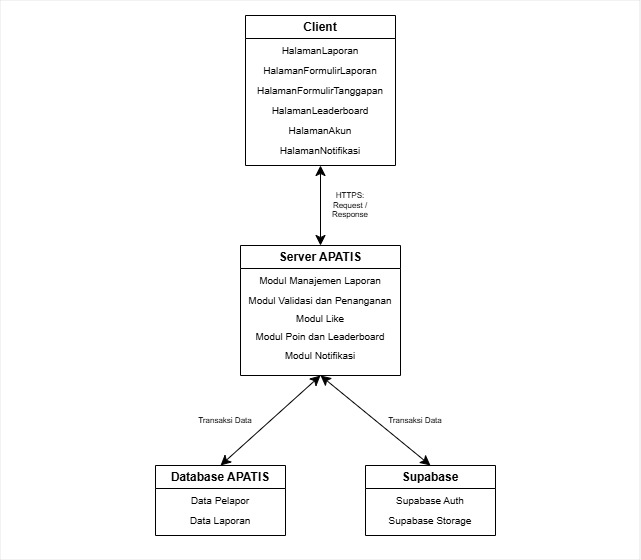
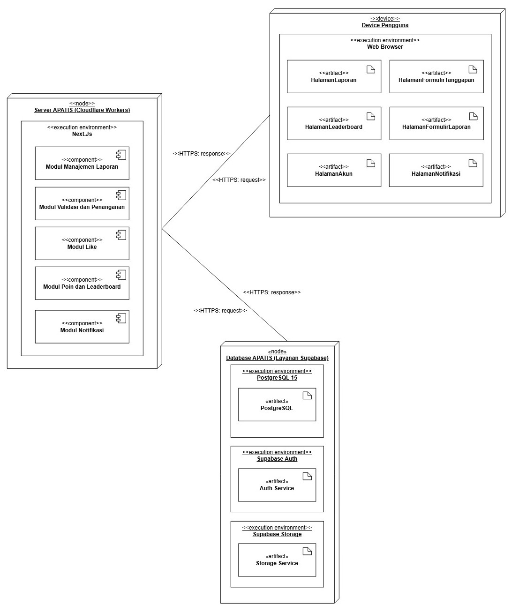
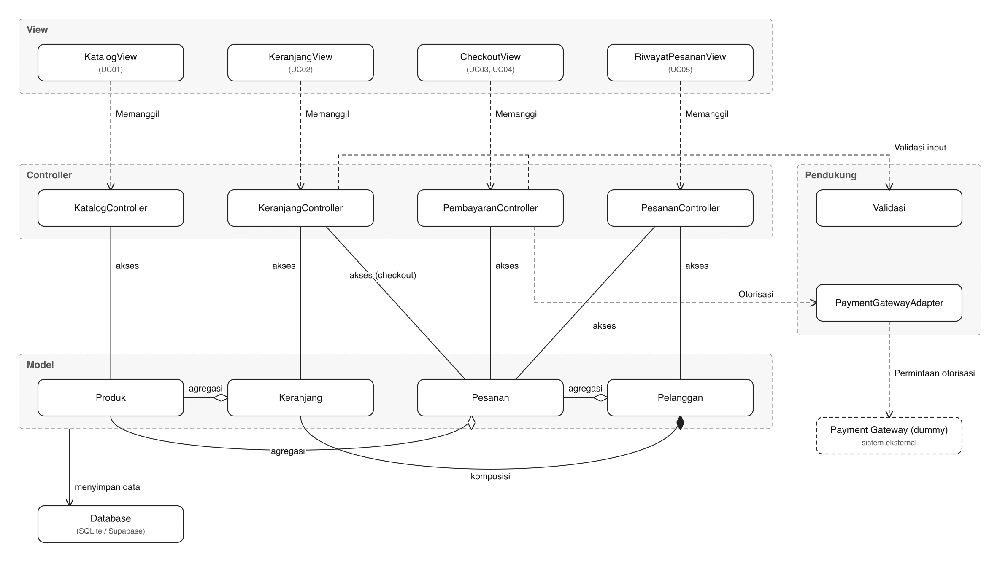
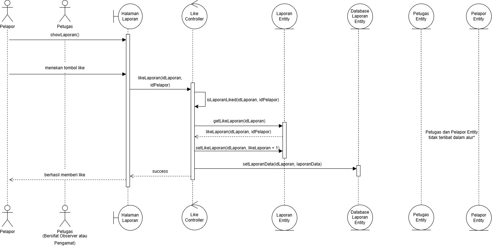
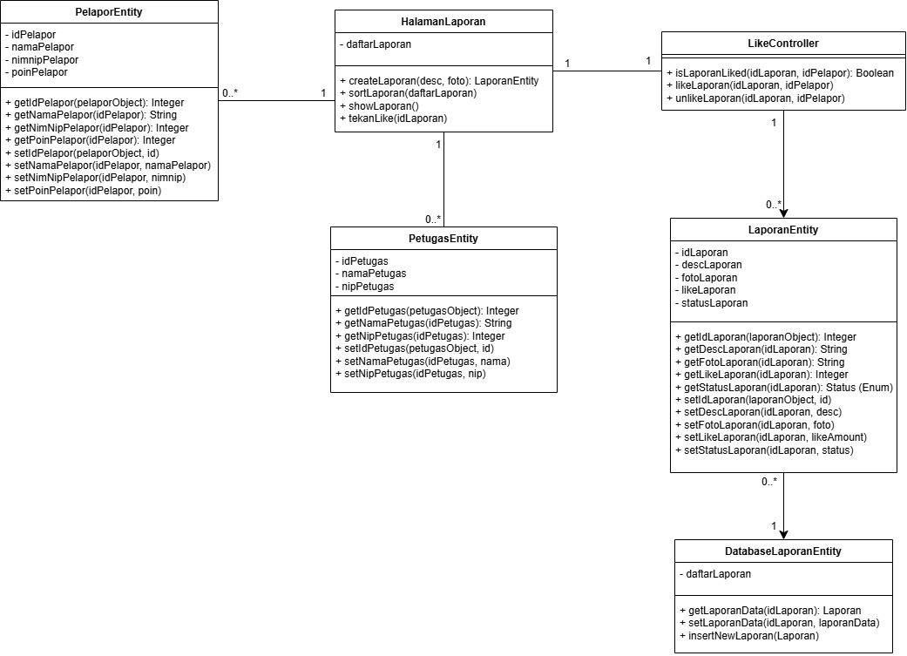
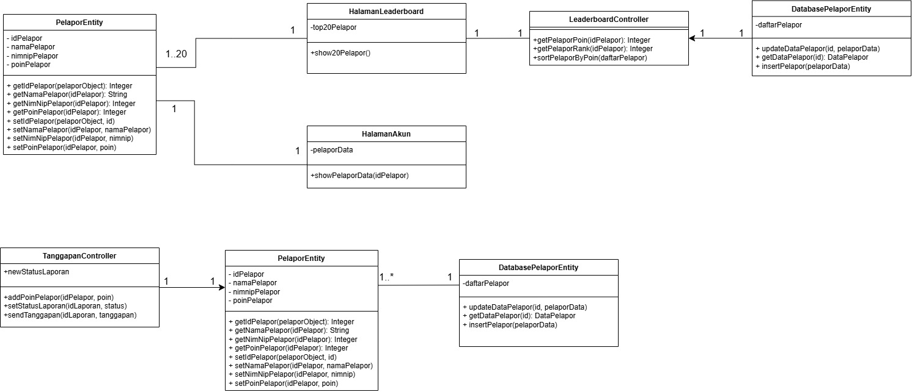
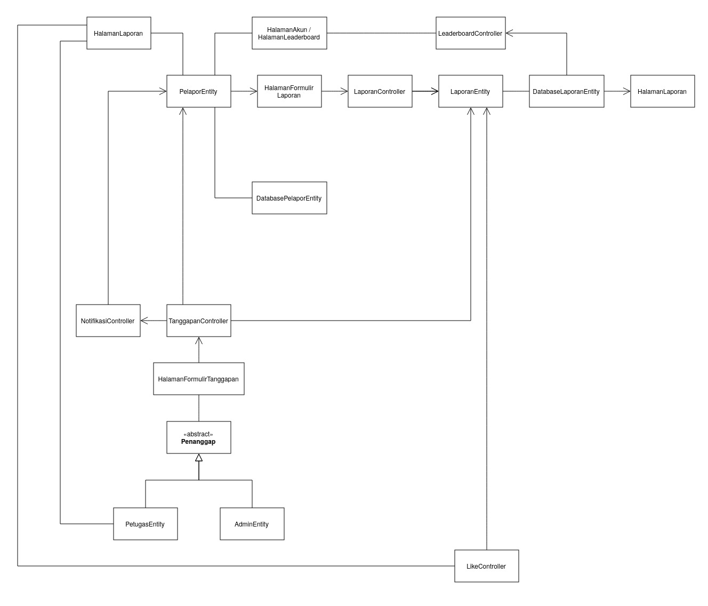

<h1>
IF2150 REKAYASA PERANGKAT LUNAK
 
TUGAS 7
 
DESKRIPSI PERANCANGAN PERANGKAT LUNAK (DPPL)
</h1>
 

## *APATIS: Aplikasi Pelaporan Air dan Sanitasi*

### Untuk: *Made Branenda Jordhy*

Dipersiapkan oleh:
| Informasi | Keterangan |
| --- | --- |
| Kelas | *\[Kelas K01\]* |
| Kelompok | *\[5\]*  |

| NIM | Nama |
|---|---|
| *13525016* | *Kenzo Yo* |
| *13525112* | *Justin Sepvian* |
| *13525142* | *Jessica Audrey Tjahjadi* |
| *13525073* | *Nadia Layla Safira* |
| *13525097* | *Arini Karimatunnikmah* |
---

## Daftar Perubahan

| Revisi | Deskripsi |
| :--- | :--- |

 

# BAB 1: Pendahuluan

## 1.1 Tujuan Penulisan Dokumen

Dokumen Deskripsi Perancangan Perangkat Lunak (DPPL) ini menjelaskan rancangan teknis perangkat lunak APATIS berdasarkan kebutuhan dan model yang telah ditetapkan dalam dokumen Spesifikasi Kebutuhan Perangkat Lunak (SKPL) serta Arsitektur Perangkat Lunak (APL).

Dokumen ini digunakan oleh tim pengembang sebagai acuan dalam mengimplementasikan APATIS. Rancangan yang dijelaskan meliputi lingkungan implementasi, arsitektur perangkat lunak, identifikasi komponen, realisasi setiap use case melalui sequence diagram, serta perancangan kelas beserta atribut, metode, dan relasinya.

Dokumen DPPL juga digunakan untuk memastikan bahwa setiap use case dalam SKPL telah didukung oleh kelas perancangan dan interaksi antarkelas yang sesuai. Dengan demikian, proses implementasi, pengujian, pengembangan lanjutan, dan pemeliharaan APATIS dapat dilakukan secara terarah dan konsisten, termasuk apabila pengembangan perangkat lunak dilanjutkan oleh tim lain.

## 1.2 Lingkup Masalah
Fasilitas air bersih dan sanitasi penting untuk mendukung kegiatan di lingkungan kampus dan berkaitan dengan SDG 6. Namun, proses pelaporan masalah fasilitas masih dapat terkendala karena belum dilakukan secara terpusat, informasi lokasi dapat kurang lengkap, dan pelapor sulit mengetahui apakah suatu masalah sudah pernah dilaporkan. Untuk membantu mengatasi masalah tersebut, APATIS menyediakan pelaporan terpusat yang memungkinkan pengguna mencantumkan foto, deskripsi, dan lokasi masalah, melihat laporan pengguna lain, memberikan like, serta memantau perkembangan penanganan melalui status laporan. Pengguna yang mengirimkan laporan valid akan memperoleh poin yang digunakan untuk menentukan peringkat pada leaderboard, sedangkan pengguna dalam 20 peringkat teratas dapat menjadi calon penerima merchandise apabila hadiah tersedia.

## 1.3 Definisi, Istilah, dan Singkatan
Tabel 1.3. Definisi Istilah dan Singkatan

| Singkatan, Akronim, atau Istilah | Penjelasan |
| :--- | :--- |
| *P/L* | *Singkatan dari Perangkat Lunak, yaitu aplikasi yang memberikan perintah kepada komputer untuk menjalankan tugas tertentu.* |
| *SKPL* | *Singkatan dari Spesifikasi Kebutuhan Perangkat Lunak, yaitu dokumen yang menjelaskan kebutuhan fungsional dan nonfungsional yang harus dipenuhi oleh perangkat lunak.* |
| *KF* | *Singkatan dari Kebutuhan Fungsional.* |
| *KNF* | *Singkatan dari Kebutuhan Non-Fungsional.* |
| *UC* | *Singkatan dari Use Case.* |
| *EARS* | *Easy Approach to Requirements Syntax, yaitu pola penulisan kebutuhan agar konsisten dan mudah diuji.* |
| *SDG* | *Sustainable Development Goals atau Tujuan Pembangunan Berkelanjutan.* |
| *OTP* | *One Time Password, yaitu kode sekali pakai yang digunakan dalam proses autentikasi.* |
| *DBMS* | *Database Management System, yaitu sistem yang digunakan untuk mengelola basis data.* |

## 1.4 Aturan Penomoran
Tabel 1.4. Aturan Penomoran

| Hal/Bagian | Penomoran | Keterangan |
| :--- | :--- | :--- |
| *Kebutuhan Fungsional* | *KFXX* | *Menunjukkan kebutuhan fungsional perangkat lunak.* |
| *Kebutuhan Non-Fungsional* | *KNFXX* | *Menunjukkan kebutuhan non-fungsional perangkat.* |
| *Aktor* | *AXX* | *Menunjukkan aktor-aktor yang akan menggunakan perangkat lunak.* |
| *Use Case* | *UCXX* | *Menunjukkan kegunaan perangkat lunak dari perspektif pengguna.* |
| *Kelas* | *CXX* | *Menunjukkan kelas-kelas pada perangkat lunak.* |

## 1.5 Referensi
Kelompok 5 IF2150 K01, *Spesifikasi Kebutuhan Perangkat Lunak APATIS*, Institut Teknologi Bandung, 2026.
Kelompok 5 IF2150 K01, *Arsitektur Perangkat Lunak APATIS*, Institut Teknologi Bandung, 2026.
Tim Pengajar IF2150, *Model Proses & Cara Kerja Tim: Agile First*, Institut Teknologi Bandung, Semester 1, Tahun Ajaran 2026/2027.
Tim Pengajar IF2150, *Elisitasi Kebutuhan*, Institut Teknologi Bandung, Semester 1, Tahun Ajaran 2026/2027.
Tim Pengajar IF2150, *Perumusan Kebutuhan*, Institut Teknologi Bandung, Semester 1, Tahun Ajaran 2026/2027.
Tim Pengajar IF2150, *Skenario dan Keterlacakan*, Institut Teknologi Bandung, Semester 1, Tahun Ajaran 2026/2027.
Tim Pengajar IF2150, *Objek, Tanggung Jawab, dan Kolaborasi*, Institut Teknologi Bandung, Semester 1, Tahun Ajaran 2026/2027.
Tim Asisten IF2150, *Class Diagram, Institut Teknologi Bandung*, Semester 1, Tahun Ajaran 2026/2027.
Tim Pengajar IF2150, *Stereotipe peran, gaya kendali, dan lapisan*, Institut Teknologi Bandung, Semester 1, Tahun Ajaran 2026/2027.
Tim Pengajar IF2150, SKPL, Institut Teknologi Bandung, Semester 1, Tahun Ajaran 2026/2027.

## 1.6 Deskripsi Umum Dokumen (Ikhtisar)
Dokumen DPPL APATIS terdiri atas lima bab. BAB 1 berisi tujuan penulisan dokumen, lingkup masalah, definisi, istilah dan singkatan, aturan penomoran, serta referensi. BAB 2 menjelaskan rancangan lingkungan implementasi, gaya arsitektur acuan, identifikasi komponen atau subsistem, serta model arsitektur perangkat lunak APATIS. BAB 3 menjelaskan realisasi setiap use case melalui identifikasi kelas perancangan, sequence diagram untuk skenario normal dan alternatif, serta diagram kelas untuk setiap use case. BAB 4 berisi diagram kelas perancangan keseluruhan beserta atribut dan metode setiap kelas. BAB 5 berisi matriks kerunutan antara kelas perancangan dan use case yang didukung.

 

---

# BAB 2: Perancangan Arsitektur

## 2.1 Rancangan Lingkungan Implementasi

Perangkat lunak APATIS berjalan pada lingkungan cross-platform sehingga dapat diakses melalui browser modern seperti Chrome dan Firefox di berbagai sistem operasi, yaitu Windows, Linux, macOS, Android, dan iOS. Pada sisi server, perangkat lunak memanfaatkan Cloudflare Worker sebagai lingkungan komputasi serverless yang menangani logika sistem serta pemrosesan data. Untuk pengelolaan data, sistem menggunakan Supabase dengan PostgreSQL 15 sebagai DBMS yang menyimpan data terstruktur seperti data pelapor dan laporan. Data berukuran besar, seperti foto pada laporan, disimpan pada Supabase Storage yang berperan sebagai filing system atau object storage, sedangkan autentikasi pengguna ditangani oleh Supabase Auth. Pengembangan perangkat lunak APATIS dilakukan menggunakan bahasa pemrograman TypeScript dengan framework React dan Next.js (App Router) pada sisi frontend, serta Tailwind CSS untuk penataan antarmuka. Adapun development tools yang digunakan adalah Git sebagai sistem pengelolaan versi dan GitHub sebagai platform repositori kode program.

## 2.2 Style/Pattern Arsitektur Acuan

<i>Gambar 1. Arsitektur Client-Server</i>

Sistem Perangkat Lunak APATIS menggunakan gaya arsitektur *client-server*, yakni merupakan gaya dengan banyak klien atau entitas yang akan meminta dan mendapatkan data dari suatu server utama sehingga klien hanya mendapatkan antarmuka dan interaksi dengan server, sedangkan server yang akan memproses data dari klien.

Klien atau *client* pada APATIS berupa web pengguna yang dapat dijalankan pada *platform* mana pun. Klien berperan hanya untuk menangani antarmuka web, menangkap interaksi pengguna, melakukan validasi awal (validasi dari sisi klien, misalnya jumlah karakter dalam kolom laporan), dan interaksi dengan server berupa permintaan dan penerimaan HTTP.

Server pada APATIS merupakan lingkungan komputasi *serverless* tanpa server fisik dengan menggunakan Cloudflare workers. Server akan menangani pemrosesan data, logika dari sistem, serta pengiriman dan pengambilan dari basis data ke klien.

Basis data pada perangkat lunak ini akan menyimpan data-data terstruktur seperti data laporan dan data pelapor, serta data berukuran besar seperti foto pada laporan.

Gaya arsitektur *client-server* dipilih karena perangkat lunak APATIS merupakan aplikasi web yang memisahkan klien dengan server, yakni klien pada aplikasi web hanya menyediakan antarmuka dan melakukan permintaan data kepada server. Sebaliknya, server hanya menyediakan data dan pemrosesan atau operasi data yang diperlukan bagi klien. 

Arsitektur *client-server* juga dipilih karena arsitektur ini mendukung kemudahan akses bagi banyak pengguna sekaligus atau secara konkuren. Hal ini juga memungkinkan server memproses dan mengirimkan data yang konsisten kepada banyak pengguna sekaligus.

Tabel 1.1 Lingkungan Operasi Perangkat Lunak

| Komponen | Spesifikasi |
| :--- | :--- |
| *Server* | *Cloudflare Worker* |
| *Client* | *Web Browser modern, seperti Chrome, Firefox terbaru, dan lain-lain* |
| *DBMS* | *Supabase dengan PostgreSQL 15* |
| *OS* | *Cross-platform (Windows/Linux/MacOS/Android/iOS) melalui browser* |
| *Auth* | *Supabase Auth* |
| *Object Storage* | *Supabase Storage* |

Dari tabel tersebut, alasan gaya arsitektur *client-server* dipilih menjadi lebih jelas. Sisi klien berupa web yang digunakan pengguna, sedangkan server berupa Cloudflare Worker yang memungkinkan pemrosesan data secara terpusat. Lalu, *DBMS* dan *Object Storage* digunakan untuk menyimpan data terstruktur seperti data pelapor, laporan, serta data berukuran besar seperti foto. 

---

## 2.3 Identifikasi Komponen / Modul / Subsistem

Tabel 2.1. Identifikasi Komponen/Modul/Subsistem

| Nama Komponen/Modul/Subsistem | Jenis                 | Penjelasan                                                                                                           |
| :---------------------------- | :-------------------- | :------------------------------------------------------------------------------------------------------------------- |
| *HalamanLaporan*                 | *Client*                | *Menampilkan daftar laporan dan mengirim request data laporan serta like ke server.*     |
| *HalamanFormulirLaporan*               | *Client*                | *Menerima input laporan baru dan mengirimkannya ke LaporanController.*                                                       |
| *HalamanFormulirTanggapan*                | *Client*                | *Menerima input tanggapan atas laporan dan mengirimkannya ke TanggapanController.*                                      |
| *HalamanLeaderboard*          | *Client*                | *Menampilkan peringkat yang diminta dari LeaderboardController* |
| *HalamanAkun*           | *Client*          | *Menampilkan dan mengelola data akun pengguna.*                                             |
| *HalamanNotifikasi*         | *Client*          | *Menampilkan notifikasi yang diminta dari NotifikasiController.*       |
| *Server APATIS* | *Server* | *Menerima permintaan HTTP dari Aplikasi Web APATIS, menjalankan logika aplikasi, mengatur hak akses, dan berkomunikasi dengan Database APATIS serta layanan eksternal.* |
| *Modul Manajemen Laporan* | *Server* | *Menangani validasi data, pembuatan, penyimpanan, pengambilan, dan pembaruan laporan. Modul ini mewadahi LaporanController, LaporanEntity, dan DatabaseLaporanEntity.* |
| *Modul Validasi dan Penanganan* | *Server* | *Menangani moderasi administratif oleh Admin, penerimaan atau penolakan laporan oleh Petugas, pencatatan tanggapan, dan perubahan status penanganan. Modul ini menggunakan TanggapanController serta data AdminEntity dan PetugasEntity.* |
| *Modul Like* | *Server* | *Memeriksa, menyimpan, dan membatalkan like serta memastikan seorang Pelapor hanya memiliki satu like pada setiap laporan. Modul ini mewadahi LikeController.* |
| *Modul Poin dan Leaderboard* | *Server* | *Memberikan poin untuk laporan yang memenuhi ketentuan, memperbarui poin Pelapor, menghitung peringkat, dan mengambil data 20 peringkat teratas. Modul ini mewadahi LeaderboardController serta menggunakan data PelaporEntity dan DatabasePelaporEntity.* |
| *Modul Notifikasi* | *Server* | *Membuat dan mengirimkan notifikasi ketika status laporan atau jumlah poin Pelapor berubah. Modul ini mewadahi NotifikasiController.* |
| *Database APATIS*        | *Database*          | *Menyimpan data pelapor dan laporan secara terpusat.*                |
| *Supabase Auth*           | *Layanan eksternal*          | *Menangani autentikasi pengguna.*                                                              |
| *Supabase Storage*                      | *Layanan eksternal*               | *Menyimpan berkas lampiran laporan.*                        |
| *Cloudflare Workers* | *Layanan Eksternal* | *Menyediakan lingkungan komputasi serverless untuk menjalankan Server APATIS dan menerima permintaan dari Aplikasi Web APATIS melalui internet.* |

---

## 2.4 Model Arsitektur Perangkat Lunak

## 3.1 Physical View

Physical view dipilih karena menggambarkan pemetaan komponen perangkat lunak ke infrastruktur perangkat keras atau cloud. Aplikasi APATIS menggunakan model Client-Server Architecture. Pada model ini komponen berjalan di lingkungan secara terpisah secara fisik, yakni client yang dijalankan pengguna, server yang menjalankan logika, dan database server yang menyimpan data  sehingga deployment diagram (salah satu diagram physical view) kami nilai tepat untuk merepresentasikan model kami.

<i>Gambar 2. Physical View untuk APATIS</i>

---

### 2.4.1 View [Nama View]

Tuliskan secara singkat model arsitektur yang dipilih dan alasan model tersebut cocok untuk aplikasi.

<i>Gambar 3. Contoh Logical View pada P/L E-Commerce</i>

### 2.4.X View [Nama View]
*[Lakukan hal yang sama dengan bagian sebelumnya]*

 

---

# BAB 3: Realisasi Use Case

## 3.1 Use Case Melakukan pelaporan

**ID Use Case:** *UC01*  
**Nama Use Case:** *Melakukan pelaporan*

### 3.1.1 Identifikasi Kelas

Tabel 3.1. Identifikasi Kelas Use Case [UC01]

| No | Nama Kelas Perancangan | Nama Kelas Analisis Terkait |
|:--- | :--- | :--- |
| 1 | *PelaporEntity* | *PelaporEntity* |
| 2 | *LaporanEntity* | *LaporanEntity* |
| 3 | *HalamanFormulirLaporan* | *HalamanFormulirLaporan* |
| 4 | *LaporanController* | *LaporanController* |
| 5 | *DatabaseLaporanEntity* | *DatabaseLaporanEntity* |

### 3.1.2 Sequence Diagram

Buat *sequence diagram* untuk **setiap skenario use case**, mencakup skenario normal dan alternatif pada subbab 4.4 SKPL. Diagram melibatkan kelas-kelas yang telah diidentifikasi pada SKPL. 

- **Skenario Normal**

<i>Gambar 4. Sequence Diagram UC01</i>

- **Skenario Alternatif 1: Laporan Tidak Valid Secara Teknis**

<i>Gambar 5. Sequence Diagram UC01 - Laporan Tidak Valid Secara Teknis</i>

### 3.1.3 Diagram Kelas

Buatlah diagram kelas untuk use case ini yang terdiri atas kelas-kelas dari 3.1.1. **Setiap kelas pada diagram wajib menampilkan atribut dan metode/operasi langsung di dalam kotak kelasnya**, sehingga tidak perlu membuat tabel daftar atribut dan metode per kelas pada subbab ini. Daftar lengkap atribut dan metode seluruh kelas disajikan pada Tabel 4.1 (Bab 4).

<i>Gambar 6. Diagram Kelas Melakukan pelaporan</i>

## 3.2 Use Case Memberikan status laporan

**ID Use Case:** *UC02*  
**Nama Use Case:** *Memberikan status laporan*

### 3.2.1 Identifikasi Kelas

Tabel 3.2. Identifikasi Kelas Use Case [UC02]

| No | Nama Kelas Perancangan | Nama Kelas Analisis Terkait |
|:--- | :--- | :--- |
| 1 | *AdminEntity* | *AdminEntity* |
| 2 | *PetugasEntity* | *PetugasEntity* |
| 3 | *HalamanFormulirTanggapan* | *HalamanFormulirTanggapan* |
| 4 | *TanggapanController* | *TanggapanController* |
| 5 | *DatabaseLaporanEntity* | *DatabaseLaporanEntity* |
| 6 | *HalamanNotifikasi* | *HalamanNotifikasi* |
| 7 | *NotifikasiController* | *NotifikasiController* |

### 3.2.2 Sequence Diagram

Buat *sequence diagram* untuk **setiap skenario use case**, mencakup skenario normal dan alternatif pada subbab 4.4 SKPL. Diagram melibatkan kelas-kelas yang telah diidentifikasi pada SKPL. 

- **Skenario Normal**

<i>Gambar 7. Sequence Diagram UC02</i>

- **Skenario Alternatif 1: Admin Melakukan Validasi Administratif / Moderasi**

<i>Gambar 8. Sequence Diagram UC02 - Admin Melakukan Validasi Administratif / Moderasi</i>

### 3.2.3 Diagram Kelas

Buatlah diagram kelas untuk use case ini yang terdiri atas kelas-kelas dari 3.1.1. **Setiap kelas pada diagram wajib menampilkan atribut dan metode/operasi langsung di dalam kotak kelasnya**, sehingga tidak perlu membuat tabel daftar atribut dan metode per kelas pada subbab ini. Daftar lengkap atribut dan metode seluruh kelas disajikan pada Tabel 4.1 (Bab 4).

<i>Gambar 9. Diagram Kelas Memberikan status laporan</i>

## 3.3 Use Case Memberikan dan membatalkan Like

**ID Use Case:** *UC03*  
**Nama Use Case:** *Memberikan dan membatalkan Like*

### 3.3.1 Identifikasi Kelas

Tabel 3.3 Identifikasi Kelas Use Case [UC03]

| No | Nama Kelas Perancangan | Nama Kelas Analisis Terkait |
|:--- | :--- | :--- |
| 1 | *PelaporEntity* | *PelaporEntity* |
| 2 | *LaporanEntity* | *LaporanEntity* |
| 3 | *HalamanLaporan* | *HalamanLaporan* |
| 4 | *LikeController* | *LikeController* |
| 5 | *DatabaseLaporanEntity* | *DatabaseLaporanEntity* |
| 6 | *PetugasEntity* | *PetugasEntity* |

### 3.3.2 Sequence Diagram

- **Skenario Normal**

<i>Gambar 10. Sequence Diagram UC03 Memberikan Like</i>

- **Skenario Alternatif 1: Membatalkan Like**

<i>Gambar 11. Sequence Diagram UC03 - Membatalkan Like</i>

### 3.3.3 Diagram Kelas

<i>Gambar 12. Diagram Kelas UC03</i>

## 3.4 Use Case Memperoleh poin

**ID Use Case:** *UC04*  
**Nama Use Case:** *Memperoleh poin*

### 3.4.1 Identifikasi Kelas

Tabel 3.4 Identifikasi Kelas Use Case [UC04]

| No | Nama Kelas Perancangan | Nama Kelas Analisis Terkait |
|:--- | :--- | :--- |
| 1 | *PelaporEntity* | *PelaporEntity* |
| 2 | *HalamanAkun* | *HalamanAkun* |
| 3 | *HalamanLeaderboard* | *HalamanLeaderboard* |
| 4 | *LeaderboardController* | *LeaderboardController* |
| 5 | *DatabasePelaporEntity* | *DatabasePelaporEntity* |
| 6 | *TanggapanController* | *TanggapanController* |

### 3.4.2 Sequence Diagram

- **Skenario Normal**

<i>Gambar 13. Sequence Diagram UC04 Memberikan Like</i>

- **Skenario Alternatif 1: Laporan Tidak Lolos Validasi oleh Admin atau Petugas**

<i>Gambar 14. Sequence Diagram UC04 - Membatalkan Like</i>

### 3.4.3 Diagram Kelas

<i>Gambar 15. Diagram Kelas UC04</i>

 

---

# BAB 4: Diagram Kelas Keseluruhan

## 4.1 Diagram Kelas

<i> Gambar 16. Diagram Kelas Perancangan Keseluruhan Perangkat Lunak APATIS</i>

Tabel 4.1. Daftar Kelas Perancangan Keseluruhan

| ID Kelas | Nama Kelas | Atribut | Metode/Operasi |
| :--- | :--- | :--- | :--- |
| *C01* | *PelaporEntity* | *idPelapor, namaPelapor, nimnipPelapor, poinPelapor* | *getIdPelapor(), getNamaPelapor(), getNimNipPelapor(), getPoinPelapor(), setIdPelapor(), setNamaPelapor(), setNimNipPelapor(), setPoinPelapor()* |
| *C02* | *LaporanEntity* | *idLaporan, descLaporan, fotoLaporan, likeLaporan, statusLaporan* | *getIdLaporan(), getDescLaporan(), getFotoLaporan(), getLikeLaporan(), getStatusLaporan(), setIdLaporan(), setDescLaporan(), setFotoLaporan(), setLikeLaporan(), setStatusLaporan()* |
| *C03* | *HalamanLaporan* | *daftarLaporan* | *createLaporan(), sortLaporan(), showLaporan(), TekanLike* |
| *C04* | *HalamanFormulirLaporan* | *maxKarakter, maxUkuranFoto, laporanValid* | *isJumlahKarakterValid(), isUkuranFotoValid(), isLaporanValid(),showFormulirLaporan* |
| *C05* | *LaporanController* | *laporanValid* | *isLaporanValid(), setStatusLaporan(), getValidLaporan()* |
| *C06* | *AdminEntity* | *idAdmin, namaAdmin, nipAdmin* | *getIdAdmin(), getNamaAdmin(), getNipAdmin(), setIdAdmin(), setNamaAdmin(), setNipAdmin()* |
| *C07* | *PetugasEntity* | *idPetugas, namaPetugas, nipPetugas* | *getIdPetugas(), getNamaPetugas(), getNipPetugas(), setIdPetugas(), setNamaPetugas(), setNipPetugas()* |
| *C08* | *HalamanFormulirTanggapan* | *statusLaporan, statusTuntasLaporan* | *getStatusLaporan(), getStatusTuntasLaporan(), setStatusLaporan(), setStatusTuntasLaporan(), showFormulirTanggapan()* |
| *C09* | *TanggapanController* | *newStatusLaporan* | *addPoinPelapor(), setStatusLaporan(), sendTanggapan()* |
| *C10* | *LikeController* | *-* | *isLaporanLiked(), likeLaporan(), unlikeLaporan()* |
| *C11* | *HalamanLeaderboard* | *top20Pelapor* | *sortPelaporByPoin(), show20Pelapor()* |
| *C12* | *DatabaseLaporanEntity* | *daftarLaporan* | *getLaporanData(), setLaporanData(), insertNewLaporan()* |
| *C13* | *DatabasePelaporEntity* | *daftarPelapor* | *updateDataPelapor()* |
| *C14* | *LeaderboardController* | *-* | *getPelaporPoin(), getPelaporRank()* |
| *C15* | *HalamanAkun* | *pelaporData* | *showPelaporData()* |
| *C16* | *HalamanNotifikasi* | *listNotifikasi* | *showListNotifikasi()* |
| *C17* | *NotifikasiController* | *statusNotifikasi* | *createNotifikasi(), sendNotifikasi()* |

---

# BAB 5: Matriks Kerunutan

Petakan kelas perancangan dengan use case yang terkait. Gunakan **BAB 6 Traceability pada dokumen SKPL** sebagai acuan keterkaitan kelas analisis dan use case, lalu sesuaikan dengan realisasi use case dan kelas perancangan pada BAB 3–BAB 5 DPPL.

Tabel 5.1. Matriks Kerunutan Kelas terhadap Use Case

| Kelas | Use Case Terkait |
| :--- | :--- |
| **C01 - PelaporEntity** | *UC01 - Melakukan pelaporan, UC02 - Memberikan Status Laporan, UC03 - Memberikan dan Membatalkan _Like_, UC04 - Memperoleh Poin* |
| **C02 - LaporanEntity** | *UC01 - Melakukan pelaporan, UC02 - Memberikan Status Laporan, UC03 - Memberikan dan Membatalkan _Like_* |
| **C03 - HalamanLaporan** | *UC03 - Memberikan dan Membatalkan _Like_* |
| **C04 - HalamanFormulirLaporan** | *UC01 - Melakukan pelaporan* |
| **C05 - LaporanController** | *UC01 - Melakukan pelaporan* |
| **C06 - AdminEntity** | *UC02 - Memberikan Status Laporan* |
| **C07 - PetugasEntity** | *UC02 - Memberikan Status Laporan* |
| **C08 - HalamanFormulirTanggapan** | *UC02 - Memberikan Status Laporan* |
| **C09 - TanggapanController** | *UC02 - Memberikan Status Laporan, UC04 - Memperoleh Poin* |
| **C10 - LikeController** | *UC03 - Memberikan dan Membatalkan _Like_* |
| **C11 - HalamanLeaderboard** | *UC04 - Memperoleh Poin* |
| **C12 - DatabaseLaporanEntity** | *UC01 - Melakukan pelaporan, UC02, UC03* |
| **C13 - DatabasePelaporEntity** | *UC04 - Memperoleh Poin* |
| **C14 - LeaderboardController** | *UC04 - Memperoleh Poin* |
| **C15 - HalamanAkun** | *UC04 - Memperoleh Poin* |
| **C16 - HalamanNotifikasi** | *UC02 - Memberikan Status Laporan, UC04 - Memperoleh Poin* |
| **C17 - NotifikasiController** | *UC02 - Memberikan Status Laporan, UC04 - Memperoleh Poin* |
