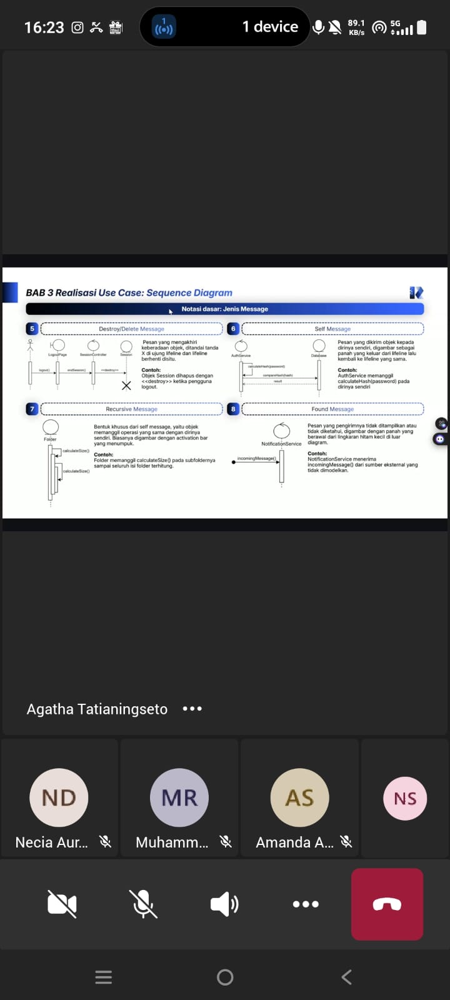

# Form Asistensi

## Tugas Besar IF2150 - Rekayasa Perangkat Lunak

| Informasi | Keterangan |
| --- | --- |
| **Hari** | *\[Jumat\]* |
| **Tanggal** | *\[09/10/2006\]* |
| **Kelas** | *\[K01\]* |
| **Nomor Kelompok** | *\[5\]*  |
| **Nama Kelompok** | *\[Furina: Forum RPL Indonesia Jaya\]*  |
| **Nama Perangkat Lunak** | *\[APATIS: Aplikasi Pelaporan Air dan Sanitasi\]*  |
| **Dokumen** | *\[K01_G05_DPPL\]*  |

### Anggota Kelompok

| NIM | Nama |
| --- | --- |
| *13525016* | *Kenzo Yo* |
| *13525112* | *Justin Sepvian* |
| *13525142* | *Jessica Audrey Tjahjadi* |
| *13525073* | *Nadia Layla Safira* |
| *13525097* | *Arini Karimatunnikmah* |

### Catatan

| Catatan |
| --- |
| 1. *Deskripsi Perancangan Perangkat Lunak (DPPL) merupakan dokumen teknis yang berisi penjelasan mengenai rancangan suatu perangkat lunak.*  |
| 2. *DPPL terdiri dari lima bab, yaitu pendahuluan, perancangan arsitektur, realisasi use case, diagram kelas keseluruhan, dan matriks kerunutan.* |
| 3. *Sequence diagram adalah diagram interaksi UML yang menunjukkann bagaimana objek atau komponen saling bertukar pesan, diurutkan dari atas ke bawah berdasarkan waktu.* |

**Notes for this section:**  
*Catatan dapat dituliskan dalam bentuk paragraf atau poin-poin, disesuaikan saja.* 
*Asistensi diatas merupakan asistensi akbar.*

## Dokumentasi

<!--  -->

  

  <i>Gambar 1. Dokumentasi kegiatan asistensi.</i>

