<h1>
IF2150 REKAYASA PERANGKAT LUNAK
<br>
TUGAS 8
<br>
DESKRIPSI PERANCANGAN PERANGKAT LUNAK (DPPL)
</h1>
<br>

## *APATIS: Aplikasi Pelaporan Air dan Sanitasi*
### *[Logo Perangkat Lunak]*

### Untuk: *Made Branenda Jordhy*

Dipersiapkan oleh:
| Informasi | Keterangan |
| --- | --- |
| Kelas | *\[K01\]* |
| Kelompok | *\[5\]*  |

| NIM | Nama |
|---|---|
| *13525016* | *Kenzo Yo* |
| *13525112* | *Justin Sepvian* |
| *13525142* | *Jessica Audrey Tjahjadi* |
| *13525073* | *Nadia Layla Safira* |
| *13525097* | *Arini Karimatunnikmah* |
---

## Daftar Perubahan

| Revisi | Deskripsi |
| :--- | :--- |
| *A* | *Menambahkan kelas-kelas yang relevan dan harus ada karena berupa prasyarat pada UC tertentu, yakni HalamanLogin dan LoginController* |
| *B* | *Menambahkan atribut dan metode yang bersesuaian karena penambahan kelas HalamanLogin dan LoginController* |
| *C* | *Menambahkan atribut judulLaporan pada kelas LaporanEntity akibat pembuatan UI/UX yang masih terasa kurang tanpa atribut tersebut* |
| ... |  |

---

<br>

> **Petunjuk pengerjaan:** *[Silahkan hapus bagian ini setelah selesai mengerjakan]*
>
> Dokumen ini melanjutkan **Deskripsi Perancangan Perangkat Lunak**. Gunakan nama, ID, kebutuhan, dan use case yang konsisten dengan kedua dokumen tersebut. Contoh pola ID baru di bawah dapat disesuaikan dengan kesepakatan kelompok, ID yang sudah ada tetap dipertahankan.

<br>

---


# BAB 1: Pendahuluan

## 1.1 Tujuan Penulisan Dokumen

Dokumen Deskripsi Perancangan Perangkat Lunak (DPPL-2) ini menjelaskan rancangan teknis perangkat lunak APATIS berdasarkan kebutuhan dan model yang telah ditetapkan dalam dokumen Spesifikasi Kebutuhan Perangkat Lunak (SKPL) serta Arsitektur Perangkat Lunak (APL).

Dokumen ini digunakan oleh tim pengembang sebagai acuan dalam mengimplementasikan APATIS. Rancangan yang dijelaskan meliputi lingkungan implementasi, arsitektur perangkat lunak, identifikasi komponen, realisasi setiap use case melalui sequence diagram, serta perancangan kelas beserta atribut, metode, dan relasinya.

Dokumen DPPL juga digunakan untuk memastikan bahwa setiap use case dalam SKPL telah didukung oleh kelas perancangan dan interaksi antarkelas yang sesuai. Dengan demikian, proses implementasi, pengujian, pengembangan lanjutan, dan pemeliharaan APATIS dapat dilakukan secara terarah dan konsisten, termasuk apabila pengembangan perangkat lunak dilanjutkan oleh tim lain.


## 1.2 Lingkup Masalah
Fasilitas air bersih dan sanitasi penting untuk mendukung kegiatan di lingkungan kampus dan berkaitan dengan SDG 6. Namun, proses pelaporan masalah fasilitas masih dapat terkendala karena belum dilakukan secara terpusat, informasi lokasi dapat kurang lengkap, dan pelapor sulit mengetahui apakah suatu masalah sudah pernah dilaporkan. Untuk membantu mengatasi masalah tersebut, APATIS menyediakan pelaporan terpusat yang memungkinkan pengguna mencantumkan foto, deskripsi, dan lokasi masalah, melihat laporan pengguna lain, memberikan like, serta memantau perkembangan penanganan melalui status laporan. Pengguna yang mengirimkan laporan valid akan memperoleh poin yang digunakan untuk menentukan peringkat pada leaderboard, sedangkan pengguna dalam 20 peringkat teratas dapat menjadi calon penerima merchandise apabila hadiah tersedia.

## 1.3 Definisi, Istilah, dan Singkatan

Tabel 1.3. Definisi Istilah dan Singkatan

| Singkatan, Akronim, atau Istilah | Penjelasan |
| :--- | :--- |
| *P/L* | *Singkatan dari Perangkat Lunak, yaitu aplikasi yang memberikan perintah kepada komputer untuk menjalankan tugas tertentu.* |
| *SKPL* | *Singkatan dari Spesifikasi Kebutuhan Perangkat Lunak, yaitu dokumen yang menjelaskan kebutuhan fungsional dan nonfungsional yang harus dipenuhi oleh perangkat lunak.* |
| *KF* | *Singkatan dari Kebutuhan Fungsional.* |
| *KNF* | *Singkatan dari Kebutuhan Non-Fungsional.* |
| *UC* | *Singkatan dari Use Case.* |
| *EARS* | *Easy Approach to Requirements Syntax, yaitu pola penulisan kebutuhan agar konsisten dan mudah diuji.* |
| *SDG* | *Sustainable Development Goals atau Tujuan Pembangunan Berkelanjutan.* |
| *OTP* | *One Time Password, yaitu kode sekali pakai yang digunakan dalam proses autentikasi.* |
| *DBMS* | *Database Management System, yaitu sistem yang digunakan untuk mengelola basis data.* |
| *DPPL* | *Deskripsi Perancangan Perangkat Lunak* |
| *APL* | *Arsitektur Perangkat Lunak* |
| *APATIS* | *Aplikasi Pelaporan Air dan Sanitasi* |


## 1.4 Aturan Penomoran

Tabel 1.4. Aturan Penomoran

| Hal/Bagian | Penomoran | Keterangan |
| :--- | :--- | :--- |
| *Kebutuhan Fungsional* | *KFXX* | *Menunjukkan kebutuhan fungsional perangkat lunak.* |
| *Kebutuhan Non-Fungsional* | *KNFXX* | *Menunjukkan kebutuhan non-fungsional perangkat.* |
| *Aktor* | *AXX* | *Menunjukkan aktor-aktor yang akan menggunakan perangkat lunak.* |
| *Use Case* | *UCXX* | *Menunjukkan kegunaan perangkat lunak dari perspektif pengguna.* |
| *Kelas* | *CXX* | *Menunjukkan kelas-kelas pada perangkat lunak.* |
| *Algoritma* | *ALGO-XX* | *Menunjukkan algoritma-algoritma signature yang digunakan setiap kelas* |
| *Query* | *Q-XX* | *Menunjukkan query yang digunakan oleh suatu kelas* |
| *Interface* | *I-XX* | *Menunjukkan interface atau antarmuka pada APATIS* |
| *Object* | *O-XX* | *Elemen atau objek setiap interface pada APATIS* |

## 1.5 Referensi
Kelompok 5 IF2150 K01, *Spesifikasi Kebutuhan Perangkat Lunak APATIS*, Institut Teknologi Bandung, 2026.

Kelompok 5 IF2150 K01, *Arsitektur Perangkat Lunak APATIS*, Institut Teknologi Bandung, 2026.

Tim Pengajar IF2150, *Model Proses & Cara Kerja Tim: Agile First*, Institut Teknologi Bandung, Semester 1, Tahun Ajaran 2026/2027.

Tim Pengajar IF2150, *Elisitasi Kebutuhan*, Institut Teknologi Bandung, Semester 1, Tahun Ajaran 2026/2027.

Tim Pengajar IF2150, *Perumusan Kebutuhan*, Institut Teknologi Bandung, Semester 1, Tahun Ajaran 2026/2027.

Tim Pengajar IF2150, *Skenario dan Keterlacakan*, Institut Teknologi Bandung, Semester 1, Tahun Ajaran 2026/2027.

Tim Pengajar IF2150, *Objek, Tanggung Jawab, dan Kolaborasi*, Institut Teknologi Bandung, Semester 1, Tahun Ajaran 2026/2027.

Tim Asisten IF2150, *Class Diagram*, Institut Teknologi Bandung, Semester 1, Tahun Ajaran 2026/2027.

Tim Pengajar IF2150, *Stereotipe peran, gaya kendali, dan lapisan*, Institut Teknologi Bandung, Semester 1, Tahun Ajaran 2026/2027.

Tim Pengajar IF2150, *SKPL*, Institut Teknologi Bandung, Semester 1, Tahun Ajaran 2026/2027.

Tim Asisten IF2150, *Deskripsi Perancangan Perangkat Lunak*, Institut Teknologi Bandung, Semester 1, Tahun Ajaran 2026/2027.

Kelompok Furina: Forum RPL Indonesia Jaya, *K01_G05_SKPL*, Institut Teknologi Bandung, Semester 1, Tahun Ajaran 2026/2027.

Kelompok Furina: Forum RPL Indonesia Jaya, *K01_G05_APL*, Institut Teknologi Bandung, Semester 1, Tahun Ajaran 2026/2027.


## 1.6 Deskripsi Umum Dokumen (Ikhtisar)
Dokumen DPPL-2 APATIS terdiri atas lima bab. BAB 1 berisi tujuan penulisan dokumen, lingkup masalah, definisi, istilah dan singkatan, aturan penomoran, serta referensi. BAB 2 menjelaskan rancangan lingkungan implementasi, gaya arsitektur acuan, identifikasi komponen atau subsistem, serta model arsitektur perangkat lunak APATIS. BAB 3 menjelaskan realisasi setiap use case melalui identifikasi kelas perancangan, *sequence diagram* untuk skenario normal dan alternatif, serta diagram kelas untuk setiap use case. BAB 4 berisi diagram kelas perancangan keseluruhan beserta atribut dan metode setiap kelas. BAB 5 berisi daftar seluruh kelas beserta operasi, atribut, dan algoritma atau query dari setiap kelas pada subbab-subbabnya. BAB 6 berisi rancangan setiap dan seluruh antarmuka serta spesifikasi setiap rancangan dan seluruh antarmuka. BAB 7 berisi matriks kerunutan yang memetakan kelas perancangan dengan UC terkait.


<br>

---

# BAB 2: Perancangan Arsitektur

## 2.1 Rancangan Lingkungan Implementasi

Perangkat lunak APATIS berjalan pada lingkungan cross-platform sehingga dapat diakses melalui browser modern seperti Chrome dan Firefox di berbagai sistem operasi, yaitu Windows, Linux, macOS, Android, dan iOS. Pada sisi server, perangkat lunak memanfaatkan Cloudflare Worker sebagai lingkungan komputasi serverless yang menangani logika sistem serta pemrosesan data. Untuk pengelolaan data, sistem menggunakan Supabase dengan PostgreSQL 15 sebagai DBMS yang menyimpan data terstruktur seperti data pelapor dan laporan. Data berukuran besar, seperti foto pada laporan, disimpan pada Supabase Storage yang berperan sebagai filing system atau object storage, sedangkan autentikasi pengguna ditangani oleh Supabase Auth. Pengembangan perangkat lunak APATIS dilakukan menggunakan bahasa pemrograman TypeScript dengan framework React dan Next.js (App Router) pada sisi frontend, serta Tailwind CSS untuk penataan antarmuka. Adapun development tools yang digunakan adalah Git sebagai sistem pengelolaan versi dan GitHub sebagai platform repositori kode program.

## 2.2 Style/Pattern Arsitektur Acuan

<p align="center">
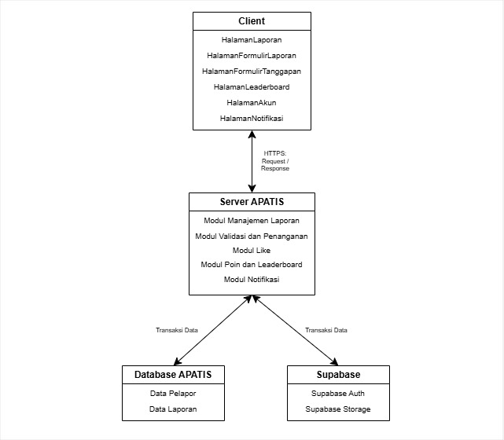
</p>
<p align="center">
<i>Gambar 1. Arsitektur Client-Server</i>
</p>

Sistem Perangkat Lunak APATIS menggunakan gaya arsitektur *client-server*, yakni merupakan gaya dengan banyak klien atau entitas yang akan meminta dan mendapatkan data dari suatu server utama sehingga klien hanya mendapatkan antarmuka dan interaksi dengan server, sedangkan server yang akan memproses data dari klien.

Klien atau *client* pada APATIS berupa web pengguna yang dapat dijalankan pada *platform* mana pun. Klien berperan hanya untuk menangani antarmuka web, menangkap interaksi pengguna, melakukan validasi awal (validasi dari sisi klien, misalnya jumlah karakter dalam kolom laporan), dan interaksi dengan server berupa permintaan dan penerimaan HTTP.

Server pada APATIS merupakan lingkungan komputasi *serverless* tanpa server fisik dengan menggunakan Cloudflare workers. Server akan menangani pemrosesan data, logika dari sistem, serta pengiriman dan pengambilan dari basis data ke klien.

Basis data pada perangkat lunak ini akan menyimpan data-data terstruktur seperti data laporan dan data pelapor, serta data berukuran besar seperti foto pada laporan.

Gaya arsitektur *client-server* dipilih karena perangkat lunak APATIS merupakan aplikasi web yang memisahkan klien dengan server, yakni klien pada aplikasi web hanya menyediakan antarmuka dan melakukan permintaan data kepada server. Sebaliknya, server hanya menyediakan data dan pemrosesan atau operasi data yang diperlukan bagi klien. 

Arsitektur *client-server* juga dipilih karena arsitektur ini mendukung kemudahan akses bagi banyak pengguna sekaligus atau secara konkuren. Hal ini juga memungkinkan server memproses dan mengirimkan data yang konsisten kepada banyak pengguna sekaligus.

Tabel 1.1 Lingkungan Operasi Perangkat Lunak

| Komponen | Spesifikasi |
| :--- | :--- |
| *Server* | *Cloudflare Worker* |
| *Client* | *Web Browser modern, seperti Chrome, Firefox terbaru, dan lain-lain* |
| *DBMS* | *Supabase dengan PostgreSQL 15* |
| *OS* | *Cross-platform (Windows/Linux/MacOS/Android/iOS) melalui browser* |
| *Auth* | *Supabase Auth* |
| *Object Storage* | *Supabase Storage* |

Dari tabel tersebut, alasan gaya arsitektur *client-server* dipilih menjadi lebih jelas. Sisi klien berupa web yang digunakan pengguna, sedangkan server berupa Cloudflare Worker yang memungkinkan pemrosesan data secara terpusat. Lalu, *DBMS* dan *Object Storage* digunakan untuk menyimpan data terstruktur seperti data pelapor, laporan, serta data berukuran besar seperti foto. 

---


## 2.3 Identifikasi Komponen / Modul / Subsistem

Tabel 2.3. Identifikasi Komponen/Modul/Subsistem

| Nama Komponen/Modul/Subsistem | Jenis                 | Penjelasan                                                                                                           |
| :---------------------------- | :-------------------- | :------------------------------------------------------------------------------------------------------------------- |
| *HalamanLogin*                 | *Client*                | *Menampilkan halaman login untuk pengguna yang akan mengakses web APATIS.*     |
| *HalamanLaporan*                 | *Client*                | *Menampilkan daftar laporan dan mengirim request data laporan serta like ke server.*     |
| *HalamanFormulirLaporan*               | *Client*                | *Menerima input laporan baru dan mengirimkannya ke LaporanController.*                                                       |
| *HalamanFormulirTanggapan*                | *Client*                | *Menerima input tanggapan atas laporan dan mengirimkannya ke TanggapanController.*                                      |
| *HalamanLeaderboard*          | *Client*                | *Menampilkan peringkat yang diminta dari LeaderboardController* |
| *HalamanAkun*           | *Client*          | *Menampilkan dan mengelola data akun pengguna.*                                             |
| *HalamanNotifikasi*         | *Client*          | *Menampilkan notifikasi yang diminta dari NotifikasiController.*       |
| *Server APATIS* | *Server* | *Menerima permintaan HTTP dari Aplikasi Web APATIS, menjalankan logika aplikasi, mengatur hak akses, dan berkomunikasi dengan Database APATIS serta layanan eksternal.* |
| *Modul Manajemen Laporan* | *Server* | *Menangani validasi data, pembuatan, penyimpanan, pengambilan, dan pembaruan laporan. Modul ini mewadahi LaporanController, LaporanEntity, dan DatabaseLaporanEntity.* |
| *Modul Validasi dan Penanganan* | *Server* | *Menangani moderasi administratif oleh Admin, penerimaan atau penolakan laporan oleh Petugas, pencatatan tanggapan, dan perubahan status penanganan. Modul ini menggunakan TanggapanController serta data AdminEntity dan PetugasEntity.* |
| *Modul Like* | *Server* | *Memeriksa, menyimpan, dan membatalkan like serta memastikan seorang Pelapor hanya memiliki satu like pada setiap laporan. Modul ini mewadahi LikeController.* |
| *Modul Poin dan Leaderboard* | *Server* | *Memberikan poin untuk laporan yang memenuhi ketentuan, memperbarui poin Pelapor, menghitung peringkat, dan mengambil data 20 peringkat teratas. Modul ini mewadahi LeaderboardController serta menggunakan data PelaporEntity dan DatabasePelaporEntity.* |
| *Modul Notifikasi* | *Server* | *Membuat dan mengirimkan notifikasi ketika status laporan atau jumlah poin Pelapor berubah. Modul ini mewadahi NotifikasiController.* |
| *Modul Login* | *Server* | *Melakukan validasi login menggunakan layanan eksternal autentikasi beserta mengubah ke halaman laporan yang sesuai dengan peran pengguna jika login berhasil. Modul ini mewadahi LoginController.* |
| *Database APATIS*        | *Database*          | *Menyimpan data pelapor dan laporan secara terpusat.*                |
| *Supabase Auth*           | *Layanan eksternal*          | *Menangani autentikasi pengguna.*                                                              |
| *Supabase Storage*                      | *Layanan eksternal*               | *Menyimpan berkas lampiran laporan.*                        |
| *Cloudflare Workers* | *Layanan Eksternal* | *Menyediakan lingkungan komputasi serverless untuk menjalankan Server APATIS dan menerima permintaan dari Aplikasi Web APATIS melalui internet.* |

---

## 2.4 Model Arsitektur Perangkat Lunak

Physical view dipilih karena menggambarkan pemetaan komponen perangkat lunak ke infrastruktur perangkat keras atau cloud. Aplikasi APATIS menggunakan model Client-Server Architecture. Pada model ini komponen berjalan di lingkungan secara terpisah secara fisik, yakni client yang dijalankan pengguna, server yang menjalankan logika, dan database server yang menyimpan data  sehingga deployment diagram (salah satu diagram physical view) kami nilai tepat untuk merepresentasikan model kami.

<p align="center">
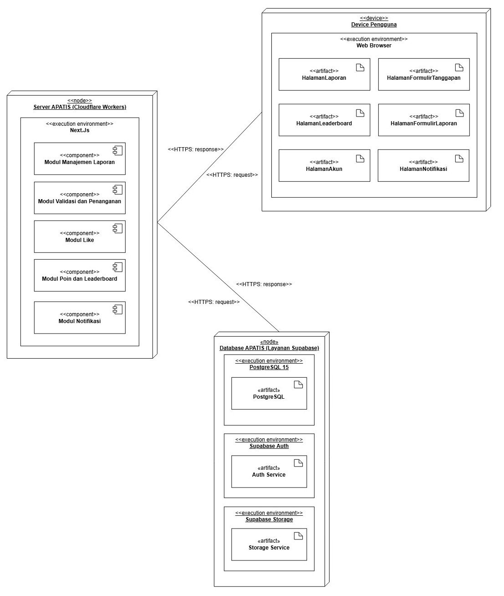
</p>
<p align="center">
<i>Gambar 2. Physical View untuk APATIS</i>
</p>

<br>

---


# BAB 3: Realisasi Use Case

## 3.1 Use Case Melakukan pelaporan

**ID Use Case:** *UC01*  
**Nama Use Case:** *Melakukan pelaporan*

### 3.1.1 Identifikasi Kelas

Tabel 3.1. Identifikasi Kelas Use Case [UC01]

| No | Nama Kelas Perancangan | Nama Kelas Analisis Terkait |
|:--- | :--- | :--- |
| 1 | *PelaporEntity* | *PelaporEntity* |
| 2 | *LaporanEntity* | *LaporanEntity* |
| 3 | *HalamanFormulirLaporan* | *HalamanFormulirLaporan* |
| 4 | *LaporanController* | *LaporanController* |
| 5 | *DatabaseLaporanEntity* | *DatabaseLaporanEntity* |

### 3.1.2 Sequence Diagram

- **Skenario Normal**

<p align="center">
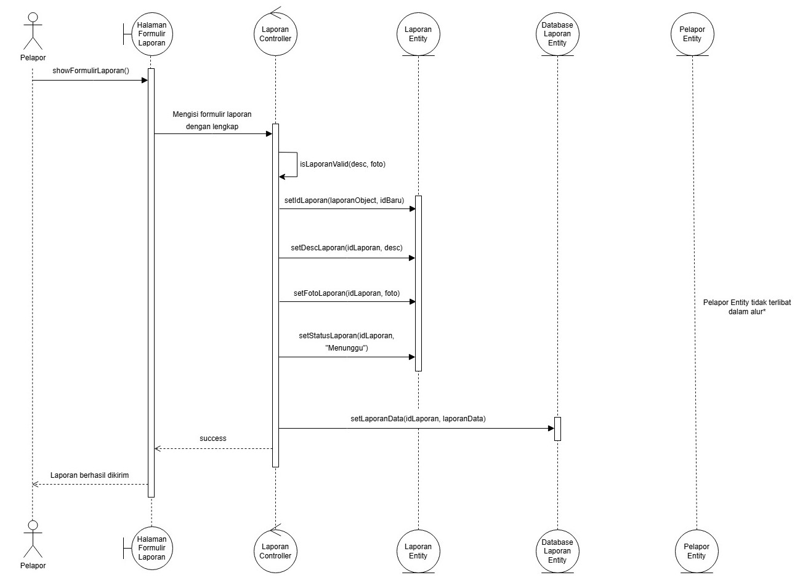
</p>
<p align="center">
<i>Gambar 3. Sequence Diagram UC01</i>
</p>

- **Skenario Alternatif 1: Laporan Tidak Valid Secara Teknis**

<p align="center">
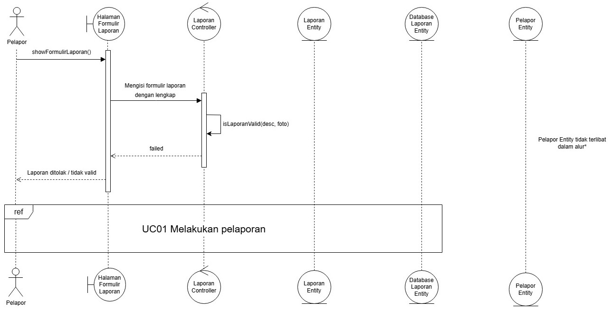
</p>
<p align="center">
<i>Gambar 4. Sequence Diagram UC01 - Laporan Tidak Valid Secara Teknis</i>
</p>

### 3.1.3 Diagram Kelas

<p align="center">
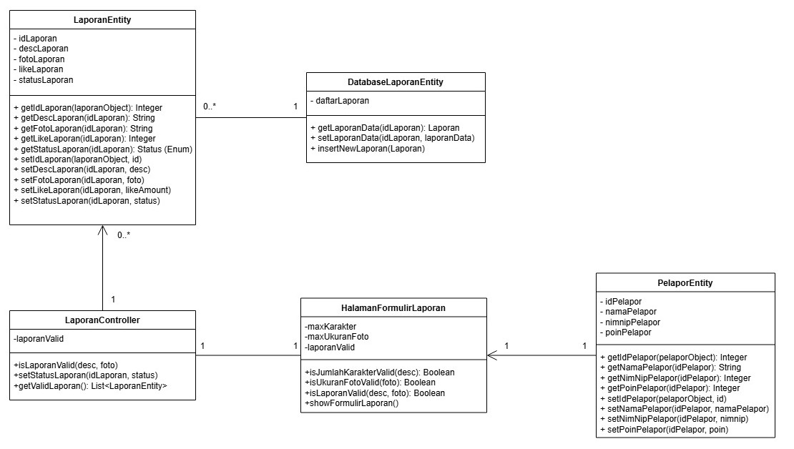
</p>
<p align="center">
<i>Gambar 5. Diagram Kelas Melakukan pelaporan</i>
</p>

## 3.2 Use Case Memberikan status laporan

**ID Use Case:** *UC02*  
**Nama Use Case:** *Memberikan status laporan*

### 3.2.1 Identifikasi Kelas

Tabel 3.2. Identifikasi Kelas Use Case [UC02]

| No | Nama Kelas Perancangan | Nama Kelas Analisis Terkait |
|:--- | :--- | :--- |
| 1 | *AdminEntity* | *AdminEntity* |
| 2 | *PetugasEntity* | *PetugasEntity* |
| 3 | *HalamanFormulirTanggapan* | *HalamanFormulirTanggapan* |
| 4 | *TanggapanController* | *TanggapanController* |
| 5 | *DatabaseLaporanEntity* | *DatabaseLaporanEntity* |
| 6 | *HalamanNotifikasi* | *HalamanNotifikasi* |
| 7 | *NotifikasiController* | *NotifikasiController* |

### 3.2.2 Sequence Diagram

- **Skenario Normal**

<p align="center">
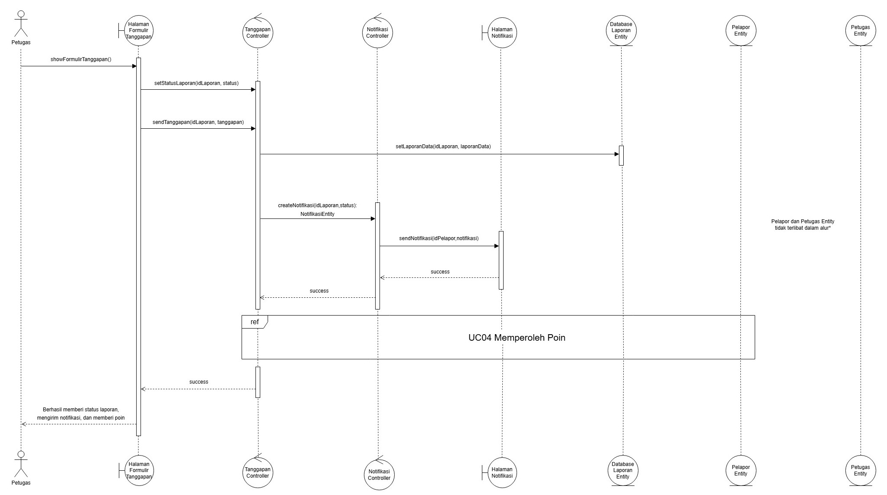
</p>
<p align="center">
<i>Gambar 6. Sequence Diagram UC02</i>
</p>

- **Skenario Alternatif 1: Admin Melakukan Validasi Administratif / Moderasi**

<p align="center">
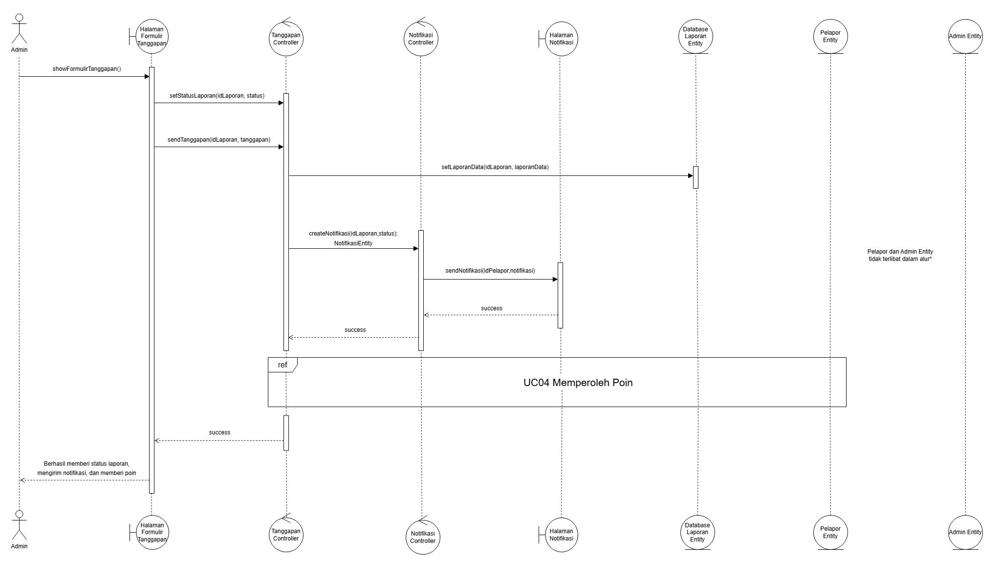
</p>
<p align="center">
<i>Gambar 7. Sequence Diagram UC02 - Admin Melakukan Validasi Administratif / Moderasi</i>
</p>

### 3.2.3 Diagram Kelas

<p align="center">
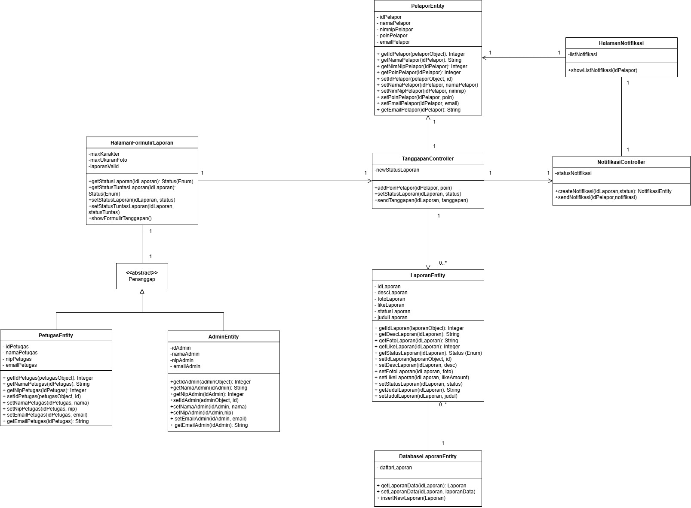
</p>
<p align="center">
<i>Gambar 8. Diagram Kelas Memberikan status laporan</i>
</p>

## 3.3 Use Case Memberikan dan membatalkan Like

**ID Use Case:** *UC03*  
**Nama Use Case:** *Memberikan dan membatalkan Like*

### 3.3.1 Identifikasi Kelas

Tabel 3.3 Identifikasi Kelas Use Case [UC03]

| No | Nama Kelas Perancangan | Nama Kelas Analisis Terkait |
|:--- | :--- | :--- |
| 1 | *PelaporEntity* | *PelaporEntity* |
| 2 | *LaporanEntity* | *LaporanEntity* |
| 3 | *HalamanLaporan* | *HalamanLaporan* |
| 4 | *LikeController* | *LikeController* |
| 5 | *DatabaseLaporanEntity* | *DatabaseLaporanEntity* |
| 6 | *PetugasEntity* | *PetugasEntity* |

### 3.3.2 Sequence Diagram

- **Skenario Normal**

<p align="center">
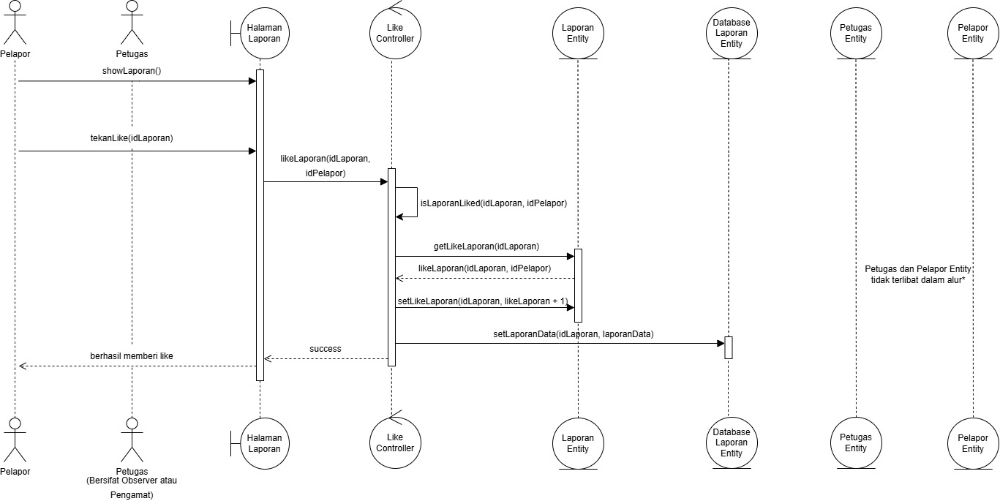
</p>
<p align="center">
<i>Gambar 9. Sequence Diagram UC03 Memberikan Like</i>
</p>

- **Skenario Alternatif 1: Membatalkan Like**

<p align="center">
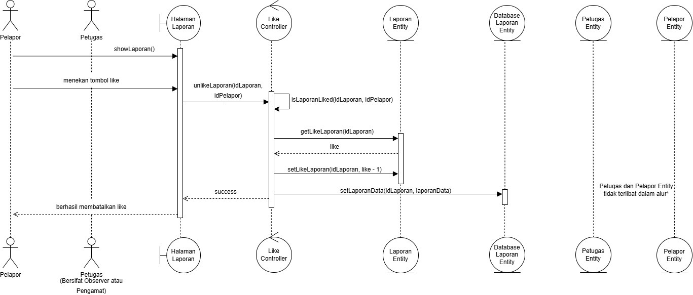
</p>
<p align="center">
<i>Gambar 10. Sequence Diagram UC03 - Membatalkan Like</i>
</p>

### 3.3.3 Diagram Kelas

<p align="center">
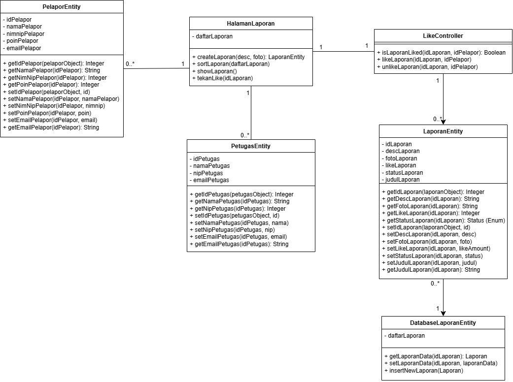
</p>
<p align="center">
<i>Gambar 11. Diagram Kelas UC03: Memberikan dan Membatalkan Like</i>
</p>

## 3.4 Use Case Memperoleh poin

**ID Use Case:** *UC04*  
**Nama Use Case:** *Memperoleh poin*

### 3.4.1 Identifikasi Kelas

Tabel 3.4 Identifikasi Kelas Use Case [UC04]

| No | Nama Kelas Perancangan | Nama Kelas Analisis Terkait |
|:--- | :--- | :--- |
| 1 | *PelaporEntity* | *PelaporEntity* |
| 2 | *HalamanAkun* | *HalamanAkun* |
| 3 | *HalamanLeaderboard* | *HalamanLeaderboard* |
| 4 | *LeaderboardController* | *LeaderboardController* |
| 5 | *DatabasePelaporEntity* | *DatabasePelaporEntity* |
| 6 | *TanggapanController* | *TanggapanController* |

### 3.4.2 Sequence Diagram

- **Skenario Normal**

<p align="center">
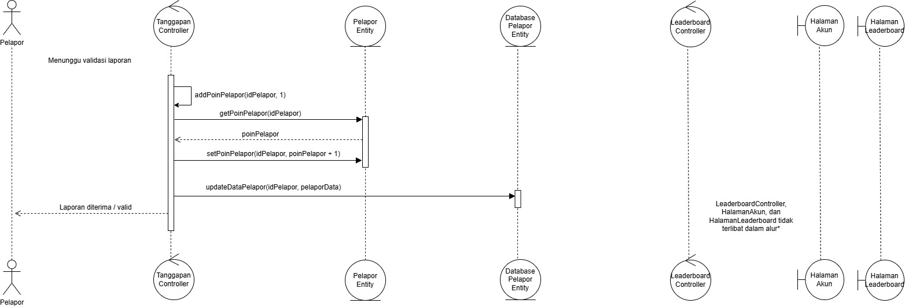
</p>
<p align="center">
<i>Gambar 12. Sequence Diagram UC04 Memperoleh Poin</i>
</p>

- **Skenario Alternatif 1: Laporan Tidak Lolos Validasi oleh Admin atau Petugas**

<p align="center">
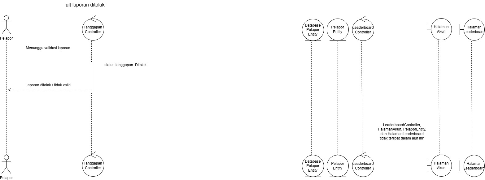
</p>
<p align="center">
<i>Gambar 13. Sequence Diagram UC04 - Laporan Tidak Lolos Validasi oleh Admin atau Petugas</i>
</p>

### 3.4.3 Diagram Kelas

<p align="center">
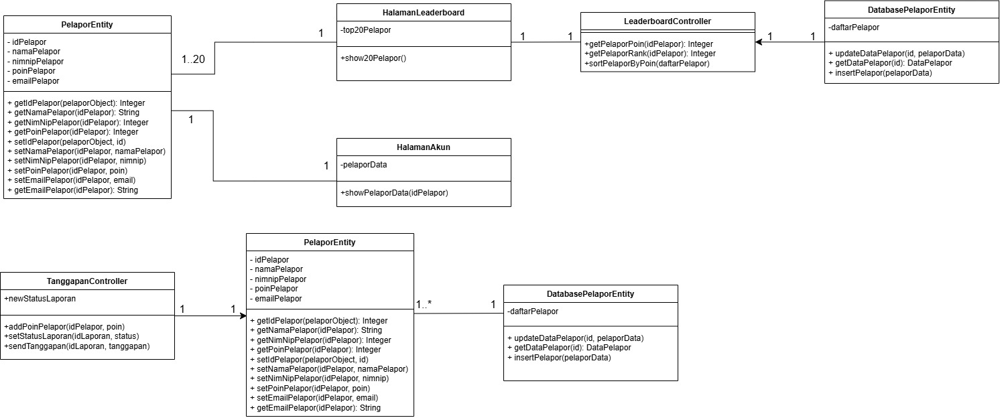
</p>
<p align="center">
<i>Gambar 14. Diagram Kelas UC04: Memperoleh Poin</i>
</p>

---

# BAB 4: Diagram Kelas Keseluruhan

## 4.1 Diagram Kelas

<p align="center">
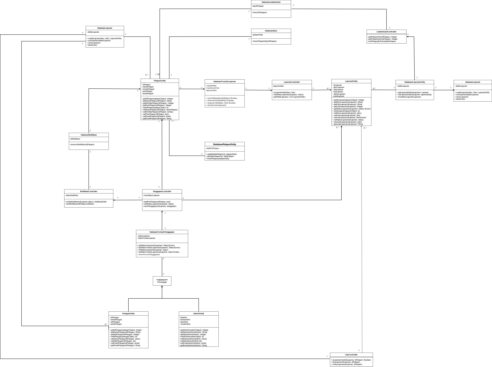
</p>
<p align="center">
<i> Gambar 15. Diagram Kelas Perancangan Keseluruhan Perangkat Lunak APATIS</i>
</p>

Tabel 4.1. Daftar Kelas Perancangan Keseluruhan

| ID Kelas | Nama Kelas | Atribut | Metode/Operasi |
| :--- | :--- | :--- | :--- |
| *C01* | *PelaporEntity* | *idPelapor, namaPelapor, nimnipPelapor, poinPelapor, emailPelapor* | *getIdPelapor(), getNamaPelapor(), getNimNipPelapor(), getPoinPelapor(), setIdPelapor(), setNamaPelapor(), setNimNipPelapor(), setPoinPelapor(), getEmailPelapor(), setEmailPelapor()* |
| *C02* | *LaporanEntity* | *idLaporan, descLaporan, fotoLaporan, likeLaporan, statusLaporan, judulLaporan* | *getIdLaporan(), getDescLaporan(), getFotoLaporan(), getLikeLaporan(), getStatusLaporan(), setIdLaporan(), setDescLaporan(), setFotoLaporan(), setLikeLaporan(), setStatusLaporan(), getJudulLaporan(), setJudulLaporan()* |
| *C03* | *HalamanLaporan* | *daftarLaporan* | *createLaporan(), sortLaporan(), showLaporan(), TekanLike()* |
| *C04* | *HalamanFormulirLaporan* | *maxKarakter, maxUkuranFoto, laporanValid* | *isJumlahKarakterValid(), isUkuranFotoValid(), isLaporanValid(),showFormulirLaporan()* |
| *C05* | *LaporanController* | *laporanValid* | *isLaporanValid(), setStatusLaporan(), getValidLaporan()* |
| *C06* | *AdminEntity* | *idAdmin, namaAdmin, nipAdmin, emailAdmin* | *getIdAdmin(), getNamaAdmin(), getNipAdmin(), setIdAdmin(), setNamaAdmin(), setNipAdmin(), getEmailAdmin(), setEmailAdmin()* |
| *C07* | *PetugasEntity* | *idPetugas, namaPetugas, nipPetugas, emailPetugas* | *getIdPetugas(), getNamaPetugas(), getNipPetugas(), setIdPetugas(), setNamaPetugas(), setNipPetugas(), getEmailPetugas(), setEmailPetugas()* |
| *C08* | *HalamanFormulirTanggapan* | *statusLaporan, statusTuntasLaporan* | *getStatusLaporan(), getStatusTuntasLaporan(), setStatusLaporan(), setStatusTuntasLaporan(), showFormulirTanggapan()* |
| *C09* | *TanggapanController* | *newStatusLaporan* | *addPoinPelapor(), setStatusLaporan(), sendTanggapan()* |
| *C10* | *LikeController* | *-* | *isLaporanLiked(), likeLaporan(), unlikeLaporan()* |
| *C11* | *HalamanLeaderboard* | *top20Pelapor* | *show20Pelapor()* |
| *C12* | *DatabaseLaporanEntity* | *daftarLaporan* | *getLaporanData(), setLaporanData(), insertNewLaporan()* |
| *C13* | *DatabasePelaporEntity* | *daftarPelapor* | *updateDataPelapor(), getDataPelapor(), insertPelapor()* |
| *C14* | *LeaderboardController* | *-* | *getPelaporPoin(), getPelaporRank(), sortPelaporByPoin()* |
| *C15* | *HalamanAkun* | *pelaporData* | *showPelaporData()* |
| *C16* | *HalamanNotifikasi* | *listNotifikasi* | *showListNotifikasi()* |
| *C17* | *NotifikasiController* | *statusNotifikasi* | *createNotifikasi(), sendNotifikasi()* |
| *C18* | *HalamanLogin* | *-* | *loginByITBEmail(), loginByNormalEmail(), showLoginGagal(), showLoginBerhasil()* |
| *C19* | *LoginController* | *-* | *validateITBLogin(), validateNormalLogin(), getRole(), getEmailFromPage()* |

---

# BAB 5: Perancangan Rinci Kelas

Bagian ini diisi dengan daftar seluruh kelas dalam tabel berikut:

Tabel 5.1. Daftar Kelas Perancangan dan Kelas Analisis Terkait

| No | Nama Kelas Perancangan | Nama Kelas Analisis Terkait |
| :--- | :--- | :--- |
| 1 | *PelaporEntity* | *PelaporEntity* |
| 2 | *LaporanEntity* | *LaporanEntity* |
| 3 | *HalamanLaporan* | *HalamanLaporan* |
| 4 | *HalamanFormulirLaporan* | *HalamanFormulirLaporan* |
| 5 | *LaporanController* | *LaporanController* |
| 6 | *AdminEntity* | *AdminEntity* | 
| 7 | *PetugasEntity* | *PetugasEntity* |
| 8 | *HalamanFormulirTanggapan* | *HalamanFormulirTanggapan* |
| 9 | *TanggapanController* | *TanggapanController* |
| 10 | *LikeController* | *LikeController* |
| 11 | *HalamanLeaderboard* | *HalamanLeaderboard* |
| 12 | *DatabaseLaporanEntity* | *DatabaseLaporanEntity* |
| 13 | *DatabasePelaporEntity* | *DatabasePelaporEntity* |
| 14 | *LeaderboardController* | *LeaderboardController* |
| 15 | *HalamanAkun* | *HalamanAkun* |
| 16 | *HalamanNotifikasi* | *HalamanNotifikasi* |
| 17 | *NotifikasiController* | *NotifikasiController* |
| 18 | *HalamanLogin* | *HalamanLogin* |
| 19 | *LoginController* | *LoginController* |


## 5.1 Kelas PelaporEntity

**Nama Kelas:** *PelaporEntity*  
**ID Kelas:** *C01*

Tabel 5.1.1. Operasi Kelas PelaporEntity

| Nama Operasi | Visibility (private, public) | Keterangan |
| :--- | :--- | :--- |
| *-* | *-* | *-* |
PelaporEntity tidak memiliki operasi kelas *signature* karena berupa kumpulan data, getter, dan setter.

Tabel 5.1.2. Atribut Kelas PelaporEntity

| Nama Atribut | Visibility (private, public) | Tipe |
| :--- | :--- | :--- |
| *idPelapor* | *private* | *number* |
| *namaPelapor* | *private* | *string* |
| *nimnipPelapor* | *private* | *string* |
| *poinPelapor* | *private* | *number* |

### 5.1.1 Algoritma/Query
Kelas ini tidak memiliki algoritma atau query yang bersifat *signature* karena merupakan kelas entity kumpulan data dan metode berupa *setter* atau *getter*


## 5.2 Kelas PelaporEntity

**Nama Kelas:** *LaporanEntity*  
**ID Kelas:** *C02*

Tabel 5.2.1. Operasi Kelas PelaporEntity

| Nama Operasi | Visibility (private, public) | Keterangan |
| :--- | :--- | :--- |
| ** | ** | ** |
Tabel kosong karena kelas hanya berupa data, *setter*, dan *getter* sehingga tidak memiliki *signature operation*

Tabel 5.2.2. Atribut Kelas LaporanEntity

| Nama Atribut | Visibility (private, public) | Tipe |
| :--- | :--- | :--- |
| *idLaporan* | *private* | *number* |
| *descLaporan* | *private* | *string* |
| *fotoLaporan* | *private* | *string* |
| *likeLaporan* | *private* | *number* |
| *statusLaporan* | *private* | *string* |

### 5.2.1 Algoritma/Query
Algoritma/Query kosong karena kelas ini hanya berupa kelas entity yang terdiri atas kumpulan data dan operasi *get* atau *set* saja sehingga tidak memiliki *signature operation*.

## 5.3 Kelas HalamanLaporan

**Nama Kelas:** *HalamanLaporan*  
**ID Kelas:** *C03*


Tabel 5.3.1. Operasi Kelas HalamanLaporan

| Nama Operasi | Visibility (private, public) | Keterangan |
| :--- | :--- | :--- |
| *showLaporan* | *public* | *Menampilkan daftar laporan ke halaman berdasarkan data daftarLaporan* |

Tabel 5.3.2. Atribut Kelas HalamanLaporan

| Nama Atribut | Visibility (private, public) | Tipe |
| :--- | :--- | :--- |
| *daftarLaporan* | *private* | *<List>Laporan* |

### 5.3.1 Algoritma/Query


**Nama Kelas:** *HalamanLaporan*  
**Nama Operasi:** *showLaporan()*  
**ID Algoritma:** *[Algo-001]*

```text
{ ALGORITMA MENAMPILKAN DAFTAR LAPORAN }
{ KAMUS }
{ ALGORITMA }
procedure showLaporan():
    if isEmpty(daftarLaporan) then
        return <div>"Belum ada laporan!"<div>
    {kondisi tidak kosong}
    return(
        <div>
            for laporan in showLaporan
            <div class="kartu-laporan" key={laporan.idLaporan}>
                <h3>{laporan.judulLaporan}</h3>
                <p>{laporan.desc}</p>
                <StatusLaporan status={laporan.statusLaporan}/>
                <LikeLaporan like={laporan.likeLaporan}/>
                <Image url={laporan.fotoLaporan}/>
            <div>     
        <div>
    )
```

Tabel 5.3.3. Query Operasi Mengambil Daftar Laporan

| No Query | Query | Keterangan |
| :--- | :--- | :--- |
| *[Q-001]* | *[SELECT * FROM laporan ORDER BY created_at DESC LIMIT 10 OFFSET 0]* | *[Mengambil 10 laporan untuk ditampilkan]* |

## 5.4 Kelas HalamanFormulirLaporan

**Nama Kelas:** *HalamanFormulirLaporan*  
**ID Kelas:** *C04*

Tabel 5.4.1. Operasi Kelas HalamanFormulirLaporan

| Nama Operasi | Visibility (private, public) | Keterangan |
| :--- | :--- | :--- |
| *showFormulirLaporan()* | *public* | *Menampilkan formulir laporan ke halaman untuk diisi pengguna* |

Tabel 5.4.2. Atribut Kelas HalamanFormulirLaporan

| Nama Atribut | Visibility (private, public) | Tipe |
| :--- | :--- | :--- |
| *maxKarakter* | *private* | *number* |
| *maxUkuranFoto* | *private* | *number* |
| *laporanValid* | *private* | *number* |

### 5.4.1 Algoritma/Query

**Nama Kelas:** *HalamanFormulirLaporan*  
**Nama Operasi:** *showFormulirLaporan()*  
**ID Algoritma:** *[Algo-002]*

```text
{ ALGORITMA MENAMPILKAN HALAMAN FORMULIR LAPORAN }
{ KAMUS }
    judulLaporan: string
    descLaporan: string
    fotoLaporan: File
{ ALGORITMA }
procedure showFormulirLaporan():
    return(
        <form>
            <input type="text" name="Judul Laporan"/>
            <input type="text" name="Deskripsi Laporan"/>
            <input type="file" name="Foto Laporan"/>
            <button>Kirim<button/>
        </form>
    )
```

Tabel 5.4.3. Query Operasi Menambah Laporan

| No Query | Query | Keterangan |
| :--- | :--- | :--- |
| *[Q-002]* | *INSERT INTO laporan (judul, deskripsi, foto, status) VALUES ($1, $2, $3, 'diproses')* | *Menambahkan laporan baru ke dalam database* |

## 5.5 Kelas LaporanController

**Nama Kelas:** *LaporanController*  
**ID Kelas:** *C05*

Tabel 5.5.1. Operasi Kelas LaporanController

| Nama Operasi | Visibility (private, public) | Keterangan |
| :--- | :--- | :--- |
| *isLaporanValid(desc, foto) -> Boolean:* | *public* | *Mengecek validitas laporan* |

Tabel 5.5.2. Atribut Kelas LaporanController

| Nama Atribut | Visibility (private, public) | Tipe |
| :--- | :--- | :--- |
| *laporanValid* | *private* | *Boolean* |

### 5.5.1 Algoritma/Query

**Nama Kelas:** *LaporanController*  
**Nama Operasi:** *isLaporanValid(desc, foto) -> Boolean:*  
**ID Algoritma:** *[Algo-003]*

```text
{ ALGORITMA VALIDASI LAPORAN }
{ KAMUS }
    maxDescChar: number
    maxFotoSize: number
{ ALGORITMA }
function isLaporanValid(desc, foto) -> Boolean:
    if (countChar(desc) < maxDescChar and size(foto) < maxFotoSize) 
        return true
    else 
        return false
```

## 5.6 Kelas AdminEntity

**Nama Kelas:** *AdminEntity*  
**ID Kelas:** *C06*

Tabel 5.6 Operasi Kelas AdminEntity

| Nama Operasi | Visibility (private, public) | Keterangan |
| :--- | :--- | :--- |
| *-* | *-* | *-* |

Kelas tidak memiliki signature operation karena hanya berupa data, fungsi *setter*, dan fungsi *getter* sehingga tidak memiliki *signature operation* apa pun.

Tabel 5.6 Atribut Kelas AdminEntity

| Nama Atribut | Visibility (private, public) | Tipe |
| :--- | :--- | :--- |
| *idAdmin* | *private* | *number* |
| *namaAdmin* | *private* | *string* |
| *nipAdmin* | *private* | *string* |
| *emailAdmin* | *private* | *string* |

### 5.6.1 Algoritma/Query
Kelas tidak memiliki algoritma atau query yang bersifat *signature* karena hanya berupa kumpulan data, *setter*, dan *getter*.

## 5.7 Kelas PetugasEntity
**Nama Kelas:** *PetugasEntity*  
**ID Kelas:** *C07*

Tabel 5.7.1. Operasi Kelas PetugasEntity
| Nama Operasi | Visibility (private, public) | Keterangan |
| :--- | :--- | :--- |
| *getIdPetugas(petugasObject): Integer* | *Public* | *Mengembalikan idPetugas bertipe Integer dari petugasObject* |
| *getNamaPetugas(idPetugas): String* | *Public* | *Mengembalikan namaPetugas bertipe String dari IdPetugas bertipe Integer* |
| *getNipPetugas(idPetugas): Integer* | *Public* | *Mengembalikan nipPetugas bertipe Integer dari petugasObject* |
| *setIdPetugas(petugasObject, id)* | *Public* | *Mengubah idPetugas bertipe Integer dalam petugasObject menjadi id bertipe Integer* |
| *setNamaPetugas(idPetugas, nama)* | *Public* | *Mengubah namaPetugas bertipe String dalam petugasObject menjadi nama bertipe String yang idPetugasnya sesuai* |
| *setNipPetugas(idPetugas, nip)* | *Public* | *Mengubah idPetugas bertipe Integer dalam petugasObject menjadi id bertipe Integer yang idPetugasnya sesuai* |

Tabel 5.7.2. Atribut Kelas PetugasEntity
| Nama Atribut | Visibility (private, public) | Tipe |
| :--- | :--- | :--- |
| *idPetugas* | *private* | *number* |
| *namaPetugas* | *private* | *String* |
| *nipPetugas* | *private* | *number* |

### 5.7.1 Algoritma/Query
Kelas ini hanya berisi getter dan setter sederhana tanpa logika proses, sehingga tidak memerlukan pseudocode. Jika ada query yang mengambil data petugas dari database, query tersebut ditulis pada kelas control, bukan di kelas entity ini.

## 5.8 Kelas HalamanFormulirTanggapan
**Nama Kelas:** *HalamanFormulirTanggapan*  
**ID Kelas:** *C08*

Tabel 5.8.1. Operasi Kelas HalamanFormulirTanggapan
| Nama Operasi | Visibility (private, public) | Keterangan |
| :--- | :--- | :--- |
| *getStatusLaporan(idLaporan): Status(Enum)* | *Public* | *Mengembalikan statusLaporan yaitu diterima, ditolak, maupun ditangguhkan* |
| *getStatusTuntasLaporan(idLaporan): Status(Enum)* | *Public* | *Mengembalikan statusTuntasLaporan yaitu tuntas, menunggu, ataupun proses* |
| *setStatusLaporan(idLaporan, status)* | *Public* | *Mengubah statusLaporan berdasarkan idLaporan menjadi status* |
| *setStatusTuntasLaporan(idLaporan, statusTuntas)* | *Public* | *Mengubah statusTuntasLaporan berdasarkan idLaporan menjadi statusTuntas* |
| *showFormulirTanggapan()* | *Public* | *Menampilkan halaman formulir tanggapan yang siap menerima input* |

Tabel 5.8.2. Atribut Kelas HalamanFormulirTanggapan
| Nama Atribut | Visibility (private, public) | Tipe |
| :--- | :--- | :--- |
| *statusLaporan* | *private* | *Enumerate* |
| *statusTuntasLaporan* | *private* | *Enumerate* |

### 5.8.1 Algoritma/Query showFormulirTanggapan()

Bagian ini diisi untuk kerangka algoritma proses yang dianggap cukup penting. Algoritma dapat dituliskan sebagai *pseudocode*. Implementasi *skeleton code* juga dapat digunakan untuk kelas yang sudah terdefinisi pada bahasa pemrograman tertentu.

**Nama Kelas:** *HalamanFormulirTanggapan*  
**Nama Operasi:** *showFormulirTanggapan()*  
**ID Algoritma:** *[Algo-004]*

```text
{ ALGORITMA MENAMPILKAN FORMULIR TANGGAPAN }

{ KAMUS }
daftarLaporan : LaporanEntity[]
laporan       : LaporanEntity
StatusLaporan : enum {diterima, ditolak, ditangguhkan}
StatusTuntasLaporan : enum {tuntas, belum tuntas, dalam penanganan}

{ ALGORITMA }
procedure showFormulirTanggapan():
    if isEmpty(daftarLaporan) then
        return <div>Belum ada laporan!</div>
    {kondisi tidak kosong}
    for laporan in daftarLaporan
        if laporan.statusLaporan = "ditangguhkan"
        or laporan.statusTuntasLaporan = "belum tuntas" then
            laporanPrioritas.push(laporan)
        else
            laporanLainnya.push(laporan)
    daftarLaporan <- laporanPrioritas.concat(laporanLainnya)

    return (
        <div>
            for laporan in daftarLaporan
            <div className="LaporanEntity" key={laporan.idLaporan}>
                <h3>{laporan.judulLaporan}</h3>
                <p>{laporan.deskripsiLaporan}</p>
                <DropdownEnum nilai={laporan.statusLaporan}
                              tanggapan={StatusLaporan}
                              sendTanggapan(idLaporan, tanggapan)/>
                <DropdownEnum nilai={laporan.statusTuntasLaporan}
                              tanggapanTuntas={StatusTuntasLaporan}
                              sendTanggapan(idLaporan,tanggapanTuntas)/>
            </div>
        </div>
    )
```
## 5.9 Kelas TanggapanController
**Nama Kelas:** *TanggapanController*  
**ID Kelas:** *C09*

Tabel 5.9.1. Operasi Kelas TanggapanController
| Nama Operasi | Visibility (private, public) | Keterangan |
| :--- | :--- | :--- |
| *addPoinPelapor(idPelapor, poin)* | *Public* | *Menambahkan poin bertipe number ke perolehan poin Pelapor dengan idPelapor terkait* |
| *sendTanggapan(idLaporan, tanggapan)* | *Public* | *Mengirimkan tanggapan ke database dan menampilkan status pengiriman tanggapan* |

Tabel 5.9.2. Atribut Kelas TanggapanController
| Nama Atribut | Visibility (private, public) | Tipe |
| :--- | :--- | :--- |
| *newStatusLaporan* | *private* | *Enumerate* |

### 5.9.1 Algoritma/Query addPoinPelapor()
**Nama Kelas:** *TanggapanController*  
**Nama Operasi:** *addPoinPelapor(idPelapor, poin)*  
**ID Algoritma:** *[Algo-005]*

```text
{ ALGORITMA MENAMBAHKAN POIN PELAPOR }

{ KAMUS }
idPelapor : number   
poin      : number    
poinLama  : number    
poinBaru  : number       

{ ALGORITMA }
procedure addPoinPelapor(idPelapor, poin): boolean
    poinLama <- getPoinPelapor(idPelapor)          
    poinBaru <- poinLama + poin
    setPoinPelapor(idPelapor, poinBaru)   
    return 
```

Tabel 5.9.1. Query Operasi addPoinPelapor()
| No Query | Query | Keterangan |
| :--- | :--- | :--- |
| *[Q-003]* | *SELECT poin_Pelapor FROM pelapor WHERE id_Pelapor = idPelapor;* | *Mengambil data poin yang dimiliki pelapor dengan idPelapor* |
| *[Q-004]* | *UPDATE pelapor SET poin_Pelapor = poinBaru WHERE id_Pelapor = idPelapor;* | *mengubah data poin yang dimiliki pelapor dengan idPelapor* |

### 5.9.3 Algoritma/Query sendTanggapan()
**Nama Kelas:** *TanggapanController*  
**Nama Operasi:** *sendTanggapan(idLaporan, tanggapan)*  
**ID Algoritma:** *[Algo-006]*

```text
{ ALGORITMA MENGIRIM TANGGAPAN }

{ KAMUS }
idLaporan : number
tanggapan : StatusLaporan
komentar  : String | null
idPelapor : number

{ ALGORITMA }
procedure sendTanggapan(idLaporan, tanggapan): boolean
    setStatusLaporan(idLaporan, tanggapan)
    idPelapor ← ambil idPelapor dari laporan idLaporan
    addPoinPelapor(idPelapor, 1)
    return
```

Tabel 5.9.1. Query Operasi [Nama Operasi]
| No Query | Query | Keterangan |
| :--- | :--- | :--- |
| *[Q-005]* | *UPDATE Laporan SET tanggapan_Laporan = tanggapan WHERE id_Laporan = idLaporan;* | *Mengubah tanggapan di database* |
## 5.10 Kelas LikeController
**Nama Kelas:** *LikeController*  
**ID Kelas:** *C10*

Tabel 5.10.1. Operasi Kelas LikeController
| Nama Operasi | Visibility (private, public) | Keterangan |
| :--- | :--- | :--- |
| *isLaporanLiked(idLaporan, idPelapor): Boolean* | *Public* | *Mengembalikan true jika Pelapor dengan idPelapor sudah tekan like untuk laporan dengan idLaporan dan belum pernah membatalkannya. Menghasilkan false jika kondisinya sebaliknya* |
| *likeLaporan(idLaporan, idPelapor)* | *Public* | *Mengubah status like pada idLaporan dan idPelapor terkait menjadi true* |
| *unlikeLaporan(idLaporan, idPelapor)* | *Public* | *Mengubah status like pada idLaporan dan idPelapor terkait menjadi false* |

### 5.10.1 Algoritma isLaporanLiked()
**Nama Kelas:** *LikeController*  
**Nama Operasi:** *isLaporanLiked(idLaporan, idPelapor): Boolean*  
**ID Algoritma:** *[Algo-007]*

```text
{ ALGORITMA MENGECEK STATUS LIKE LAPORAN }

{ KAMUS }
idLaporan : number
idPelapor : number
hasil     : Boolean

{ ALGORITMA }
procedure isLaporanLiked(idLaporan, idPelapor): boolean
    hasil <- ambil status like untuk idLaporan dan idPelapor
    return hasil
```

Tabel 5.10.1. Query Operasi [Nama Operasi]

| No Query | Query | Keterangan |
| :--- | :--- | :--- |
| *[Q-006]* | *SELECT status_like FROM Laporan WHERE id_laporan = :idLaporan AND id_Pelapor_Like = :idPelapor;* | *Mengambil data status like dari database* |

### 5.10.2 Algoritma likeLaporan()
**Nama Kelas:** *LikeController*  
**Nama Operasi:** *likeLaporan(idLaporan, idPelapor)*  
**ID Algoritma:** *[Algo-008]*

```text
{ ALGORITMA MELAKUKAN LIKE LAPORAN }

{ KAMUS }
idLaporan :number
idPelapor :number

{ ALGORITMA }
procedure likeLaporan(idLaporan, idPelapor): boolean
    statusLike <- ambil status like dari database
    if statusLike = True
        unlikeLaporan(idLaporan, idPelapor)
    {kondisi belum like}
    statusLike <- ubah status like = True untuk idLaporan dan idPelapor
    return
```
| No Query | Query | Keterangan |
| :--- | :--- | :--- |
| *[Q-007]* | *SELECT status_Like FROM Laporan WHERE id_laporan = :idLaporan AND id_Pelapor_Like = :idPelapor;* | *Mengambil status like sesui idPelapor dan idLaporan* |
| *[Q-008]* | *UPDATE Laporan SET status_Like = poinBaru WHERE id_laporan = :idLaporan AND id_Pelapor_Like = :idPelapor;* | *Mengubah status like sesui idPelapor dan idLaporan* |

### 5.10.3 Algoritma/Query unlikeLaporan()

**Nama Kelas:** *LikeController*  
**Nama Operasi:** *unlikeLaporan(idLaporan, idPelapor)*  
**ID Algoritma:** *[Algo-009]*

```text
{ ALGORITMA MELAKUKAN LIKE LAPORAN }

{ KAMUS }
idLaporan :number
idPelapor :number

{ ALGORITMA }
procedure likeLaporan(idLaporan, idPelapor): boolean
    statusLike <- ambil status like dari database
    if statusLike = False
        likeLaporan(idLaporan, idPelapor)
    {kondisi sudah like}
    statusLike <- ubah status like = False untuk idLaporan dan idPelapor
    return
```

| No Query | Query | Keterangan |
| :--- | :--- | :--- |
| *[Q-009]* | *SELECT status_Like FROM Laporan WHERE id_laporan = :idLaporan AND id_Pelapor_Like = :idPelapor;* | *Mengambil status like sesui idPelapor dan idLaporan* |
| *[Q-010]* | *UPDATE Laporan SET status_Like = poinBaru WHERE id_laporan = :idLaporan AND id_Pelapor_Like = :idPelapor;* | *Mengubah status like sesui idPelapor dan idLaporan* |
## 5.11 Kelas HalamanLeaderboard
**Nama Kelas:** *HalamanLeaderboard*  
**ID Kelas:** *C11*

Tabel 5.11.1. Operasi Kelas HalamanLeaderboard
| Nama Operasi | Visibility (private, public) | Keterangan |
| :--- | :--- | :--- |
| *sortPelaporByPoin(daftarPelapor)* | *Public* | *Mengurutkan daftarPelapor berdasarkan perolehan poin* |
| *show20Pelapor()* | *Public* | *Menampilkan list 20 pelapor dengan perolehan poin tertinggi* |

Tabel 5.11.2. Atribut Kelas HalamanLeaderboard
| Nama Atribut | Visibility (private, public) | Tipe |
| :--- | :--- | :--- |
| *top20Pelapor* | *private* | *list of pelaporObject* |

### 5.11.1 Algoritma/Query sortPelaporByPoin()
**Nama Kelas:** *HalamanLeaderboard*  
**Nama Operasi:** *sortPelaporByPoin(daftarPelapor)*  
**ID Algoritma:** *[Algo-010]*

```text
{ ALGORITMA MENGURUTKAN PELAPOR BERDASARKAN POIN }

{ KAMUS }
daftarPelapor : PelaporEntity[]
hasil         : PelaporEntity[]
i, j          : number
pelapor1         : PelaporEntity

{ ALGORITMA }
procedure sortPelaporByPoin(daftarPelapor): PelaporEntity[]
    hasil <- salin daftarPelapor
    for i <- 1 to length(hasil) - 1 do
        pelapor1 <- hasil[i]
        j <- i - 1
        while j >= 0 and hasil[j].getPoinPelapor() < kunci.getPoinPelapor() do
            hasil[j + 1] <- hasil[j]
            j <- j - 1
        hasil[j + 1] <- pelapor1
    return
```
### 5.11.2 Algoritma/Query show20Pelapor()
**Nama Kelas:** *HalamanLeaderboard*  
**Nama Operasi:** *show20Pelapor()*  
**ID Algoritma:** *[Algo-011]*

```text
{ ALGORITMA MENAMPILKAN 20 PELAPOR POIN TERTINGGI }

{ KAMUS }
daftarPelapor : PelaporEntity[]
top20Pelapor  : PelaporEntity[]
pelapor       : PelaporEntity
peringkat     : number

{ ALGORITMA }
procedure show20Pelapor():
    daftarPelapor <- ambil seluruh data pelapor dari database
    if isEmpty(daftarPelapor) then
        return <div>Belum ada pelapor!</div>
    {kondisi tidak kosong}
    daftarPelapor <- sortPelaporByPoin(daftarPelapor)
    top20Pelapor <- daftarPelapor.slice(0, 20)
    return (
        <div>
            for pelapor in top20Pelapor
            peringkat <- indeks pelapor + 1
            <div className="baris-leaderboard" key={pelapor.getIdPelapor()}>
                <span>{peringkat}</span>
                <span>{pelapor.getNamaPelapor()}</span>
                <span>{pelapor.getPoinPelapor()}</span>
            </div>
        </div>
    )
```

Tabel 5.11.1. Query Operasi show20Pelapor()
| No Query | Query | Keterangan |
| :--- | :--- | :--- |
| *[Q-011]* | *SELECT id_pelapor, nama_pelapor, poin FROM Pelapor;* | *Mengambil data seluruh pelapor untuk diurutkan dan diambil 20 teratas* |

## 5.12 Kelas DatabaseLaporanEntity

**Nama Kelas:** *DatabaseLaporanEntity*  
**ID Kelas:** *C12*

Kelas `DatabaseLaporanEntity` bertanggung jawab menyediakan akses terhadap data laporan pada basis data. Kelas ini digunakan untuk mengambil daftar laporan, memperbarui data laporan, serta menyimpan laporan baru.

### Tabel 5.12.1 Operasi Kelas DatabaseLaporanEntity

| Nama Operasi | Visibility | Keterangan |
| :--- | :--- | :--- |
| *getLaporanData(idLaporan?: number): Promise<LaporanEntity \| List<LaporanEntity&gt;&gt;* | *public* | *Mengambil satu laporan berdasarkan ID atau mengambil seluruh laporan apabila ID tidak diberikan.* |
| *setLaporanData(idLaporan: number, dataLaporan: Partial&lt;LaporanEntity&gt;): Promise&lt;boolean&gt;* | *public* | *Memperbarui data laporan berdasarkan ID laporan dan mengembalikan status keberhasilan operasi.* |
| *insertNewLaporan(laporan: LaporanEntity): Promise&lt;LaporanEntity&gt;* | *public* | *Menyimpan laporan baru dan mengembalikan data laporan yang berhasil disimpan.* |

### Tabel 5.12.2 Atribut Kelas DatabaseLaporanEntity

| Nama Atribut | Visibility | Tipe |
| :--- | :--- | :--- |
| *daftarLaporan* | *private* | *List<LaporanEntity>* |

### 5.12.1 Algoritma/Query Operasi `getLaporanData()`

**Nama Kelas:** *DatabaseLaporanEntity*  
**Nama Operasi:** *getLaporanData(idLaporan?: number): Promise&lt;LaporanEntity&gt;*  
**ID Algoritma:** *Algo-012*

```
function getLaporanData(idLaporan):
    if idLaporan is invalid then
      return <div>"IdLaporan tidak valid"</div>
    found <- execute Q-C12 using idLaporan
    if found = NULL then
      return <div>"Laporan tidak ditemukan"</div>
    else
      return map result into LaporanEntity
```
**Tabel 5.12.3 Query Operasi `getLaporanData()`**

| No Query | Query | Keterangan |
| :--- | :--- | :--- |
| *[Q-C12]* | *SELECT id_laporan, deskripsi, foto_url, jumlah_like, status_laporan FROM laporan WHERE id_laporan = :idLaporan* | *Mengambil satu laporan berdasarkan ID laporan.* |

### 5.2.2 Algoritma/Query Operasi `setLaporanData()`

**Nama Kelas:** *DatabaseLaporanEntity*  
**Nama Operasi:** *setLaporanData(idLaporan: number, dataLaporan: Partial&lt;LaporanEntity&gt;): Promise&lt;string&gt;*  
**ID Algoritma:** *Algo-013*

```text
FUNCTION setLaporanData(idLaporan, dataLaporan): Boolean
  if IdLaporan is invalid or dataLaporan is invalid then
    return False
  else
    laporanUpdate <- execute Q-013 using idLaporan and dataLaporan
    if laporanUpdate is not null then
      return True
    else
      return False
```

**Tabel 5.12.4 Query Operasi `setLaporanData()`**

| No Query | Query | Keterangan |
| :--- | :--- | :--- |
| *Q-013* | *UPDATE laporan SET deskripsi = COALESCE(:deskripsi, deskripsi), foto_url = COALESCE(:fotoUrl, foto_url), jumlah_like = COALESCE(:jumlahLike, jumlah_like), status_laporan = COALESCE(:statusLaporan, status_laporan) WHERE id_laporan = :idLaporan;* | *Memperbarui atribut laporan yang diberikan tanpa mengubah atribut lain.* |


### 5.12.3 Algoritma/Query Operasi `insertNewLaporan()`

**Nama Kelas:** *DatabaseLaporanEntity*  
**Nama Operasi:** *insertNewLaporan(laporan: LaporanEntity): Promise&lt;LaporanEntity&gt;*  
**ID Algoritma:** *Algo-014*

```text
FUNCTION insertNewLaporan(laporan): LaporanEntity
  if laporan is invalid then
    THROW new Error('Invalid laporan')

  result <- execute Q-014 using report data
  return map result into LaporanEntity
```
**Tabel 5.12.5 Query Operasi `insertNewLaporan()`**

| No Query | Query | Keterangan |
| :--- | :--- | :--- |
| *[Q-014]* | *INSERT INTO laporan (id_pelapor, deskripsi, foto_url, jumlah_like, status_laporan) VALUES (:idPelapor, :deskripsi, :fotoUrl, 0, 'Submitted') RETURNING id_laporan, deskripsi, foto_url, jumlah_like, status_laporan;* | *Menyimpan laporan baru dengan jumlah like awal nol dan status awal Submitted.* |

---

## 5.13 Kelas DatabasePelaporEntity

**Nama Kelas:** *DatabasePelaporEntity*  
**ID Kelas:** *C13*

Kelas `DatabasePelaporEntity` bertanggung jawab mengakses dan memperbarui data Pelapor, terutama data identitas dan poin yang digunakan pada halaman akun dan leaderboard.

### Tabel 5.13.1 Operasi Kelas DatabasePelaporEntity

| Nama Operasi | Visibility | Keterangan |
| :--- | :--- | :--- |
| *getDataPelapor(idPelapor: number): PelaporEntity \| null* | *public* | *Mengambil satu Pelapor berdasarkan ID Pelapor.* |
| *updateDataPelapor(idPelapor: number, pelaporData: PelaporEntity): boolean* | *public* | *Memperbarui poin satu Pelapor.* |
| *insertPelapor(pelapor: PelaporEntity): PelaporEntity* | *public* | *Menyimpan Pelapor baru dan mengembalikan data yang berhasil disimpan.* |

### Tabel 5.13.2 Atribut Kelas DatabasePelaporEntity

| Nama Atribut | Visibility | Tipe |
| :--- | :--- | :--- |
| *daftarPelapor* | *private* | *PelaporEntity[]* |

### 5.13.1 Algoritma/Query Operasi `getDataPelapor()`

**Nama Kelas:** *DatabasePelaporEntity*  
**Nama Operasi:** *getDataPelapor(idPelapor: number): PelaporEntity | null*  
**ID Algoritma:** *Algo-015*

```text
FUNCTION getDataPelapor(idPelapor): PelaporEntity | null
  result <- execute Q-014 using idPelapor

  if result is empty then
    return null

  return map result into PelaporEntity
```

**Tabel 5.13.3 Query Operasi `getDataPelapor()`**

| No Query | Query | Keterangan |
| :--- | :--- | :--- |
| *[Q-014]* | *SELECT id_pelapor, nama_pelapor, nim_nip, poin FROM pelapor WHERE id_pelapor = :idPelapor;* | *Mengambil satu Pelapor berdasarkan ID yang unik.* |


### 5.13.2 Algoritma/Query Operasi `updateDataPelapor()`

**Nama Kelas:** *DatabasePelaporEntity*  
**Nama Operasi:** *updateDataPelapor(idPelapor: number, pelaporData: PelaporEntity): boolean*  
**ID Algoritma:** *Algo-016*

```text
function updateDataPelapor(idPelapor: number, pelaporData: PelaporEntity): boolean
  if idPelapor is invalid or pelaporData is invalid then
    return false

  affectedRows <- execute Q-015 using idPelapor and pelaporData
  return true
```

**Tabel 5.13.4 Query Operasi `updateDataPelapor()`**

| No Query | Query | Keterangan |
| :--- | :--- | :--- |
| *[Q-015]* | *UPDATE pelapor SET nama_pelapor = :namaPelapor, nim_nip = :nimNipPelapor, poin = :poinPelapor WHERE id_pelapor = :idPelapor;* | *Memperbarui poin satu Pelapor berdasarkan ID.* |


### 5.13.3 Algoritma/Query Operasi `insertPelapor()`

**Nama Kelas:** *DatabasePelaporEntity*  
**Nama Operasi:** *insertPelapor(pelapor: PelaporEntity): PelaporEntity*  
**ID Algoritma:** *Algo-017*

```text
FUNCTION insertPelapor(pelapor): PelaporEntity
  if pelapor is invalid then
    THROW new Error('Invalid pelapor')

  result <- execute Q-016 using pelapor data
  return map result into PelaporEntity
```

**Tabel 5.13.5 Query Operasi `insertPelapor()`**

| No Query | Query | Keterangan |
| :--- | :--- | :--- |
| *[Q-016]* | *INSERT INTO pelapor (nama_pelapor, nim_nip, poin) VALUES (:namaPelapor, :nimNipPelapor, 0) RETURNING id_pelapor, nama_pelapor, nim_nip, poin;* | *Menyimpan Pelapor baru dengan poin awal nol.* |


## 5.14 Kelas LeaderboardController

**Nama Kelas:** *LeaderboardController*  
**ID Kelas:** *C14*

Kelas `LeaderboardController` bertanggung jawab mengambil poin, mengurutkan Pelapor, dan menentukan peringkat Pelapor.

### Tabel 5.14.1 Operasi Kelas LeaderboardController

| Nama Operasi | Visibility | Keterangan |
| :--- | :--- | :--- |
| *getPelaporPoin(idPelapor: number): number* | *public* | *Mengambil jumlah poin Pelapor berdasarkan ID.* |
| *getPelaporRank(idPelapor: number): number* | *public* | *Menentukan peringkat Pelapor berdasarkan poin.* |
| *sortPelaporByPoin(): PelaporEntity[]* | *public* | *Mengurutkan seluruh Pelapor berdasarkan poin dari tertinggi ke terendah.* |

### Tabel 5.14.2 Atribut Kelas LeaderboardController

| Nama Atribut | Visibility | Tipe |
| :--- | :--- | :--- |
| *databasePelapor* | *private* | *DatabasePelaporEntity* |

### 5.14.1 Algoritma Operasi `getPelaporPoin()`

**Nama Kelas:** *LeaderboardController*  
**Nama Operasi:** *getPelaporPoin(idPelapor: number): number*  
**ID Algoritma:** *Algo-018*

```text
FUNCTION getPelaporPoin(idPelapor): number
  pelapor <- databasePelapor.getDataPelapor(idPelapor)

  if pelapor is null then
    return 0

  return pelapor.poinPelapor
```

### 5.14.2 Algoritma Operasi `sortPelaporByPoin()`

**Nama Kelas:** *LeaderboardController*  
**Nama Operasi:** *sortPelaporByPoin(): PelaporEntity[]*  
**ID Algoritma:** *Algo-019*

```text
FUNCTION sortPelaporByPoin(): PelaporEntity[]
  daftarPelapor <- databasePelapor.getAllPelapor()
  sort daftarPelapor by poinPelapor descending
  return daftarPelapor
```

### 5.14.3 Algoritma Operasi `getPelaporRank()`

**Nama Kelas:** *LeaderboardController*  
**Nama Operasi:** *getPelaporRank(idPelapor: number): number*  
**ID Algoritma:** *Algo-020*

```text
FUNCTION getPelaporRank(idPelapor): number
  daftarPelapor <- sortPelaporByPoin()

  for index <- 0 to length(daftarPelapor) - 1
    if daftarPelapor[index].idPelapor = idPelapor then
      return index + 1

  return 0
```

## 5.15 Kelas HalamanAkun

**Nama Kelas:** *HalamanAkun*  
**ID Kelas:** *C15*

Kelas `HalamanAkun` merupakan kelas *boundary* yang menampilkan identitas dan jumlah poin Pelapor.

### Tabel 5.15.1 Operasi Kelas HalamanAkun

| Nama Operasi | Visibility | Keterangan |
| :--- | :--- | :--- |
| *showPelaporData(pelaporData: PelaporEntity): void* | *public* | *Menampilkan data Pelapor pada halaman akun.* |

### Tabel 5.15.2 Atribut Kelas HalamanAkun

| Nama Atribut | Visibility | Tipe |
| :--- | :--- | :--- |
| *pelaporData* | *private* | *PelaporEntity \| null* |

### 5.15.1 Algoritma Operasi `showPelaporData()`

**Nama Kelas:** *HalamanAkun*  
**Nama Operasi:** *showPelaporData(pelaporData: PelaporEntity): void*  
**ID Algoritma:** *Algo-021*

```text
function showPelaporData(pelaporData): void
  if pelaporData is null then
    DISPLAY 'Data akun tidak ditemukan'
    return

  DISPLAY pelaporData.namaPelapor
  DISPLAY pelaporData.nimnipPelapor
  DISPLAY pelaporData.poinPelapor
```

## 5.16 Kelas HalamanNotifikasi

**Nama Kelas:** *HalamanNotifikasi*  
**ID Kelas:** *C16*

Kelas `HalamanNotifikasi` merupakan kelas *boundary* yang menampilkan daftar notifikasi kepada Pelapor.

### Tabel 5.16.1 Operasi Kelas HalamanNotifikasi

| Nama Operasi | Visibility | Keterangan |
| :--- | :--- | :--- |
| *showListNotifikasi(listNotifikasi: Notifikasi[]): void* | *public* | *Menampilkan daftar notifikasi kepada Pelapor.* |

### Tabel 5.16.2 Atribut Kelas HalamanNotifikasi

| Nama Atribut | Visibility | Tipe |
| :--- | :--- | :--- |
| *listNotifikasi* | *private* | *Notifikasi[]* |

### 5.16.1 Algoritma Operasi `showListNotifikasi()`

**Nama Kelas:** *HalamanNotifikasi*  
**Nama Operasi:** *showListNotifikasi(listNotifikasi: Notifikasi[]): void*  
**ID Algoritma:** *Algo-022*

```text
function showListNotifikasi(listNotifikasi): void
  if listNotifikasi is empty then
    DISPLAY 'Belum ada notifikasi'
    return

  for each notifikasi in listNotifikasi
    DISPLAY notifikasi.pesan
    DISPLAY notifikasi.statusNotifikasi
```


## 5.17 Kelas NotifikasiController

**Nama Kelas:** *NotifikasiController*  
**ID Kelas:** *C17*

Kelas `NotifikasiController` bertanggung jawab membuat dan mengirimkan notifikasi kepada Pelapor.

### Tabel 5.17.1 Operasi Kelas NotifikasiController

| Nama Operasi | Visibility | Keterangan |
| :--- | :--- | :--- |
| *createNotifikasi(idPelapor: number, pesan: string): Notifikasi* | *public* | *Membuat dan menyimpan notifikasi baru untuk Pelapor.* |
| *sendNotifikasi(notifikasi: Notifikasi): boolean* | *public* | *Mengirim atau menyediakan notifikasi agar dapat ditampilkan.* |

### Tabel 5.17.2 Atribut Kelas NotifikasiController

| Nama Atribut | Visibility | Tipe |
| :--- | :--- | :--- |
| *statusNotifikasi* | *private* | *string* |

### 5.17.1 Algoritma/Query Operasi `createNotifikasi()`

**Nama Kelas:** *NotifikasiController*  
**Nama Operasi:** *createNotifikasi(idPelapor: number, pesan: string): Notifikasi*  
**ID Algoritma:** *Algo-023*

```text
function createNotifikasi(idPelapor, pesan): Notifikasi
  if idPelapor is invalid or pesan is empty then
    THROW new Error('Invalid notifikasi')

  result <- execute Q-017 using idPelapor and pesan
  return map result into Notifikasi
```

**Tabel 5.17.3 Query Operasi `createNotifikasi()`**

| No Query | Query | Keterangan |
| :--- | :--- | :--- |
| *[Q-17]* | *INSERT INTO notifikasi (id_pelapor, pesan, status_notifikasi, created_at) VALUES (:idPelapor, :pesan, 'Belum Dibaca', CURRENT_TIMESTAMP) RETURNING id_notifikasi, id_pelapor, pesan, status_notifikasi, created_at;* | *Menyimpan notifikasi baru untuk Pelapor.* |

### 5.17.2 Algoritma Operasi `sendNotifikasi()`

**Nama Kelas:** *NotifikasiController*  
**Nama Operasi:** *sendNotifikasi(notifikasi: Notifikasi): boolean*  
**ID Algoritma:** *Algo-024*

```text
FUNCTION sendNotifikasi(notifikasi): boolean
  if notifikasi is null then
    return false

  statusNotifikasi <- 'Terkirim'
  return true
```


## 5.18 Kelas HalamanLogin

**Nama Kelas:** *HalamanLogin*  
**ID Kelas:** *C18*

Tabel 5.18.1. Operasi Kelas HalamanLogin

| Nama Operasi | Visibility (private, public) | Keterangan |
| :--- | :--- | :--- |
| *loginByITBEmail()* | *public* | *Memproses pengguna untuk login melalui email ITB* |
| *loginByNormalEmail()* | *public* | *Memproses pengguna untuk login menggunakan email pribadinya* |

Tabel 5.18.2. Atribut Kelas HalamanLogin

| Nama Atribut | Visibility (private, public) | Tipe |
| :--- | :--- | :--- |
| *email* | *private* | *string* |

### 5.18.1 Algoritma

**Nama Kelas:** *HalamanLogin*  
**Nama Operasi:** *loginByITBEmail()*  
**ID Algoritma:** *[Algo-025]*

```text
{ ALGORITMA LOGIN EMAIL ITB }
{ KAMUS }
    berhasil: Boolean
    role: string
    email: string
{ ALGORITMA }
function loginByITBEmail():
    email <- LoginController.getEmailFromPage()
    berhasil <- LoginController.validateITBLogin() {note: memanggil service autentikasi eksternal}
    if berhasil then:
        role <- getRole(email)
        showLoginBerhasil()
    else:
        showLoginGagal()
```

### 5.18.2 Algoritma

**Nama Kelas:** *HalamanLogin*  
**Nama Operasi:** *loginByNormalEmail()*  
**ID Algoritma:** *[Algo-026]*

```text
{ ALGORITMA LOGIN EMAIL ITB }
{ KAMUS }
    berhasil: Boolean
    role: string
    email: string
{ ALGORITMA }
function loginByITBEmail():
    email <- LoginController.getEmailFromPage()
    berhasil <- LoginController.validateNormalLogin() {note: memanggil service autentikasi eksternal}
    if berhasil then:
        role <- getRole(email)
        showLoginBerhasil()
    else:
        showLoginGagal()
```


## 5.19 Kelas LoginController

**Nama Kelas:** *LoginController*  
**ID Kelas:** *C19*

Tabel 5.19.1. Operasi Kelas HalamanLogin

| Nama Operasi | Visibility (private, public) | Keterangan |
| :--- | :--- | :--- |
| *validateITBLogin(): Boolean* | *public* | *Validasi pengguna untuk login melalui email ITB* |
| *validateNormalLogin(): Boolean* | *public* | *Validasi pengguna untuk login menggunakan email pribadinya* |

Tabel 5.19.2. Atribut Kelas HalamanLogin

| Nama Atribut | Visibility (private, public) | Tipe |
| :--- | :--- | :--- |
| *-* | *-* | *-* |

### 5.19.1 Algoritma

**Nama Kelas:** *LoginController*  
**Nama Operasi:** *validateITBLogin(): Boolean*  
**ID Algoritma:** *[Algo-027]*

```text
{ ALGORITMA VALIDASI LOGIN EMAIL ITB }
{ KAMUS }
    email: string
    valid: boolean
{ ALGORITMA }
function validateITBLogin():
    email <- LoginController.getEmailFromPage()
    valid <- LayananSSO.verifikasiEmail(email) {layanan eksternal}
    return valid
```

### 5.19.2 Algoritma

**Nama Kelas:** *LoginController*  
**Nama Operasi:** *validateNormalLogin(): Boolean*  
**ID Algoritma:** *[Algo-028]*

```text
{ ALGORITMA VALIDASI LOGIN EMAIL PRIBADI }
{ KAMUS }
    email: string
    respons: ResponsSupabase
{ ALGORITMA }
function validateITBLogin():
    email <- LoginController.getEmailFromPage()
    respons <- LayananSupabase.kirimOTP(email) {layanan eksternal}
    if respons == TIMEOUT or respons == ERROR:
        return false
    return true
```

---

# BAB 6: Perancangan Antarmuka

## 6.1 Rancangan Antarmuka I-01

Masukkan versi awal prototipe antarmuka, dimana untuk setiap antarmuka/layar, tuliskan spesifikasi rinci objek yang ditampilkan dan reaksi sistem terhadap interaksi pengguna.

**Antarmuka:** *I-01*  
**Nama Layar:** *Halaman Login*

<p align="center">
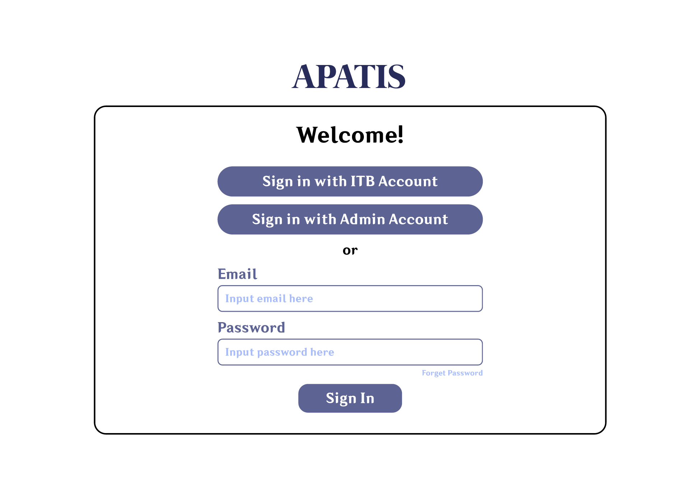
</p>
<p align="center">
<i>Gambar 6.1 Rancangan Antarmuka I-01 - Halaman Login</i>
</p>

Tabel 6.1 Spesifikasi Objek Antarmuka I-01

| Id_Objek | Jenis | Konten | Keterangan |
| :--- | :--- | :--- | :--- |
| *O-01* | *Rich Label* | *APATIS* | *Text yang menunjukkan nama web app.* |
| *O-02* | *Container* | *Objek lain untuk login* | *Mengandung objek-objek di halaman login seperti label, text field, dan button.* |
| *O-03* | *Rich Label* | *Welcome!* | *Text welcome login.* |
| *O-04* | *Button* | *Sign in with ITB Account* | *Button untuk SSO login dengan ITB Account.* |
| *O-05* | *Rich Label* | *or* | *Text mempisahkan cara login.* |
| *O-06* | *Rich Label* | *Email* | *Text label untuk input email.* |
| *O-07* | *Rich Text Input Field* | *Input email here* | *Text field untuk mengisi email akun pengguna.* |
| *O-08* | *Rich Label* | *Password* | *Text label untuk input password.* |
| *O-09* | *Rich Text Input Field* | *Input password here* | *Text field untuk mengisi password akun pengguna.* |
| *O-10* | *Rich Text Link* | *Forget Password* | *Link untuk recover password akun jika pengguna lupa.* |
| *O-11* | *Button* | *Sign In* | *Button untuk sign in setelah pengguna mengisi email dan password.* |


## 6.2 Rancangan Antarmuka I-02

Masukkan versi awal prototipe antarmuka, dimana untuk setiap antarmuka/layar, tuliskan spesifikasi rinci objek yang ditampilkan dan reaksi sistem terhadap interaksi pengguna.

**Antarmuka:** *I-02*  
**Nama Layar:** *Halaman Laporan Pelapor*

<p align="center">
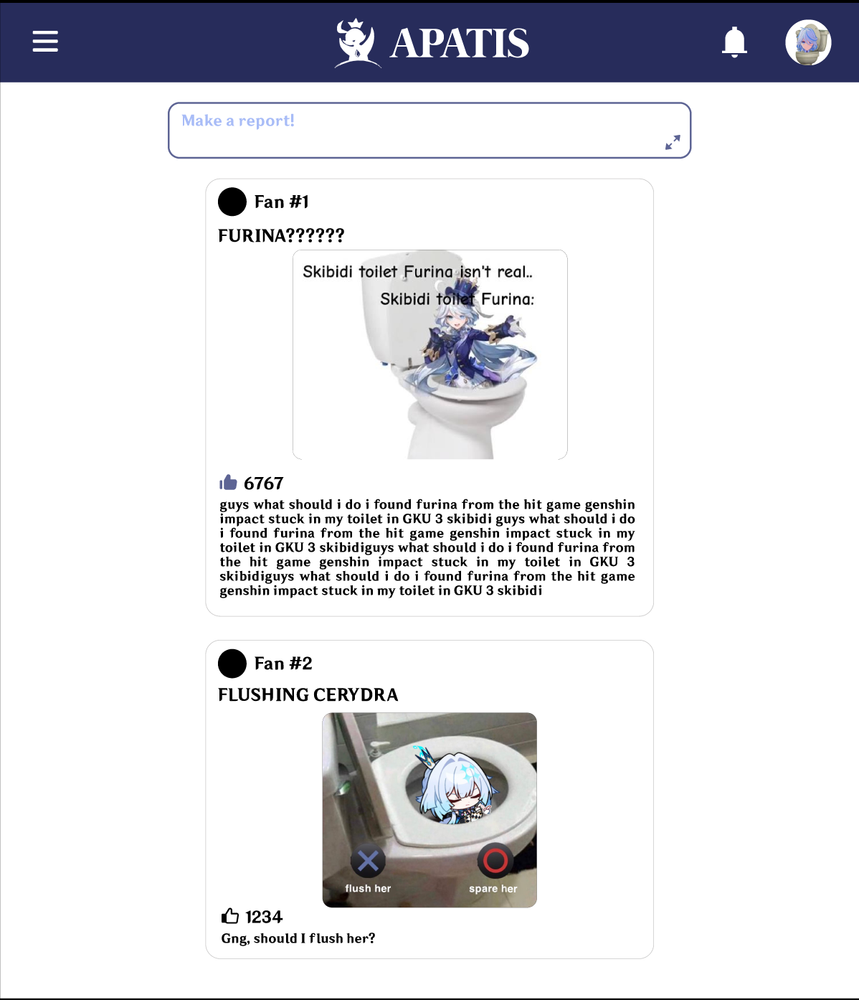
</p>
<p align="center">
<i>Gambar 6.2.1 Rancangan Antarmuka I-02 - Halaman Laporan Pelapor</i>
</p>

<p align="center">
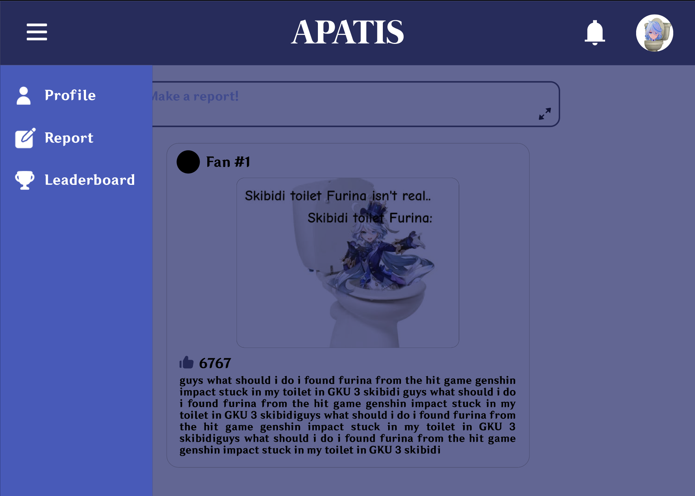
</p>
<p align="center">
<i>Gambar 6.2.2 Rancangan Antarmuka I-02 - Halaman Laporan Pelapor</i>
</p>


Tabel 6.2 Spesifikasi Objek Antarmuka I-02

| Id_Objek | Jenis | Konten | Keterangan |
| :--- | :--- | :--- | :--- |
| *O-12* | *Rich Label* | *APATIS* | *Text yang menunjukkan nama web app.* |
| *O-13* | *Drawer Menu* | *Tautan menuju halaman akun, halaman formulir laporan, halaman formulir tanggapan, dan halaman leaderboard* | *Membuka side bar yang berisi tautan ke halaman-halaman lain.* |
| *O-14* | *Button* | *Icon profil dan rich label Profile* | *Button untuk menuju ke halaman akun.* |
| *O-15* | *Button* | *Icon report dan rich label Report* | *Button untuk menuju ke halaman formulir laporan.* |
| *O-16* | *Button* | *Icon leaderboard dan rich label Leaderboard* | *Button untuk menuju ke halaman leaderboard.* |
| *O-17* | *Icon* | *Daftar notifikasi* | *Untuk membuka halaman notfikasi.* |
| *O-18* | *Avatar Component* | *Profil akun* | *Untuk membuka halaman akun.* |
| *O-19* | *Container* | *Header web* | *Mengandung objek-objek header web, seperti nama web, side bar, bel notfikasi, profil akun.* |
| *O-20* | *Button* | *Make a Report!* | *Button untuk menuju ke halaman formulir laporan.* |
| *O-21* | *Container* | *Laporan* | *Mengandung objek-objek untuk sebuah laporan seperti foto profil, nama, title, foto pendukung, deskripsi, dan jumlah like.* |
| *O-22* | *Avatar Component* | *Foto akun yang membuat laporan* | *Memperliatkan foto profil akun yang membuat laporan.* |
| *O-23* | *Rich Label* | *Nama akun yang membuat laporan* | *Text label nama akun yang membuat laporan.* |
| *O-24* | *Rich Label* | *Title laporan* | *Text label untuk judul laporan.* |
| *O-25* | *Image* | *Foto pendukung laporan* | *Foto yang mendukung dalam laporan.* |
| *O-26* | *Icon* | *Like icon* | *Icon jempol yang berarti like di laporan.* |
| *O-27* | *Rich Label* | *Jumlah like laporan* | *Text yang menunjukkan jumlah like di laporan.* |
| *O-28* | *Rich Label* | *Deskripsi laporan* | *Text deskripsi pada laporan.* |


## 6.3 Rancangan Antarmuka I-03

Masukkan versi awal prototipe antarmuka, dimana untuk setiap antarmuka/layar, tuliskan spesifikasi rinci objek yang ditampilkan dan reaksi sistem terhadap interaksi pengguna.

**Antarmuka:** *I-03*  
**Nama Layar:** *Halaman Laporan Petugas*

<p align="center">
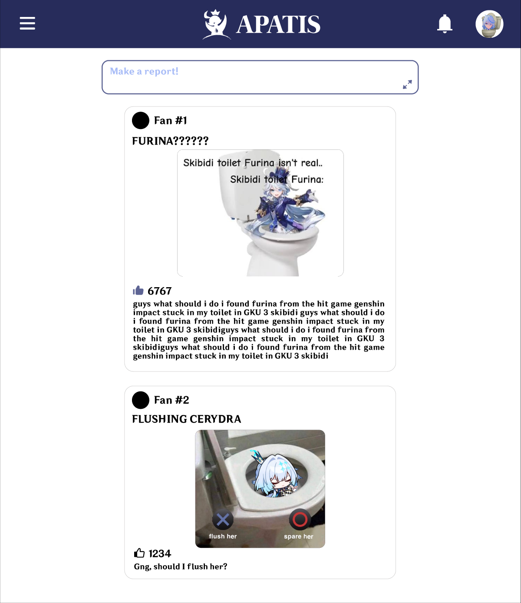
</p>
<p align="center">
<i>Gambar 6.3.1 Rancangan Antarmuka I-03 - Halaman Laporan Petugas</i>
</p>

<p align="center">
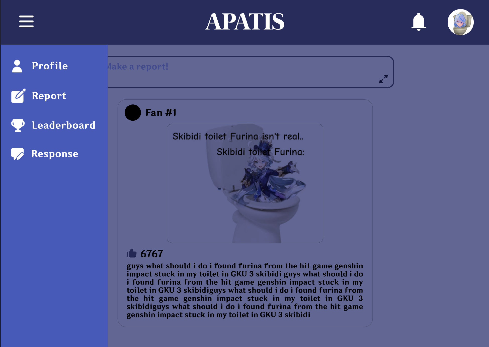
</p>
<p align="center">
<i>Gambar 6.3.2 Rancangan Antarmuka I-03 - Halaman Laporan Petugas</i>
</p>

<p align="center">
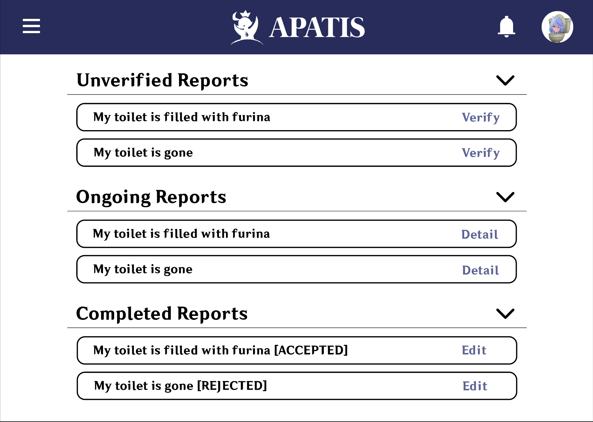
</p>
<p align="center">
<i>Gambar 6.3.3 Rancangan Antarmuka I-03 - Halaman Laporan Petugas</i>
</p>

Tabel 6.3 Spesifikasi Objek Antarmuka I-03

| Id_Objek | Jenis | Konten | Keterangan |
| :--- | :--- | :--- | :--- |
| *O-29* | *Button* | *Icon tanggapan dan label Response* | *Button untuk menuju ke halaman laporan petugas. Hanya dapat dilihat oleh petugas atau admin.* |
| *O-30* | *Rich Label* | *Status laporan* | *Label untuk menunjukkan laporan dengan status menunggu (unverified), sedang diperbaiki (ongoing), atau selesai (completed report).* |
| *O-31* | *Dropdown* | *List laporan dengan status tertentu* | *Expand list laporan dengan status tertentu.* |
| *O-32* | *Separator* | *Garis pembatas* | *Pembatas antara tipe laporan dan list laporan tersebut.* |
| *O-33* | *Container* | *Tanggapan* | *Mengandung title laporan dan button tergantung status laporan.* |
| *O-34* | *Rich Label* | *Title laporan, dengan statusnya jika termasuk dalam status selesai* | *Menunjukkan title laporan.* |
| *O-35* | *Button* | *Verify* | *Button untuk menuju ke halaman formulir tanggapan untuk memberi status pertama kali.* |
| *O-36* | *Button* | *Detail* | *Button untuk menuju ke halaman formulir tanggapan untuk melihat laporan dengan status sedang diperbaiki (ongoing).* |
| *O-37* | *Button* | *Edit* | *Button untuk menuju ke halaman formulir tanggapan untuk laporan dengan status selesai.* |


## 6.4 Rancangan Antarmuka I-04

Masukkan versi awal prototipe antarmuka, dimana untuk setiap antarmuka/layar, tuliskan spesifikasi rinci objek yang ditampilkan dan reaksi sistem terhadap interaksi pengguna.

**Antarmuka:** *I-04*  
**Nama Layar:** *Halaman Akun*

<p align="center">
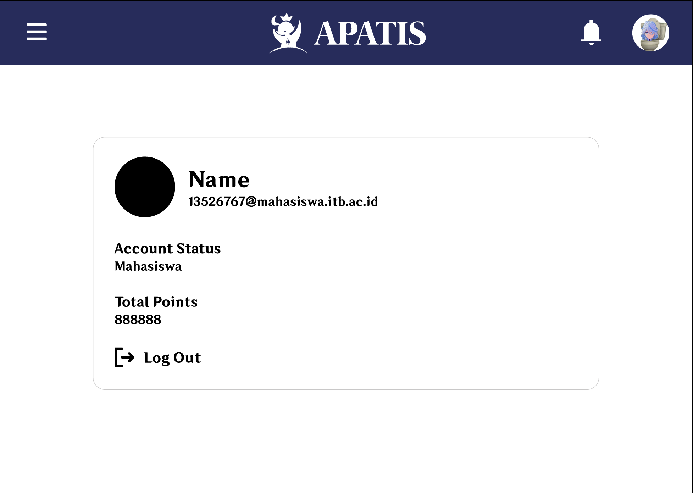
</p>
<p align="center">
<i>Gambar 6.4 Rancangan Antarmuka I-04 - Halaman Akun</i>
</p>

Tabel 6.4 Spesifikasi Objek Antarmuka I-04

| Id_Objek | Jenis | Konten | Keterangan |
| :--- | :--- | :--- | :--- |
| *O-38* | *Container* | *Objek lain untuk info akun* | *Mengandung info nama, email, status account, total poin, dan button log out.* |
| *O-39* | *Avatar Component* | *Foto profil akun* | *Menunjukkan foto dari profil akun.* |
| *O-40* | *Rich Label* | *Nama* | *Text nama panjang akun sekarang.* |
| *O-41* | *Rich Label* | *Email akun* | *Text email akun sekarang.* |
| *O-42* | *Rich Label* | *Account Status* | *Text Account Status.* |
| *O-43* | *Rich Label* | *Tipe akun* | *Menunjukkan tipe akun seperti mahasiswa, petugas, atau admin.* |
| *O-44* | *Rich Label* | *Total Points* | *Text Total Points* |
| *O-45* | *Rich Label* | *Total poin akun* | *Menunjukkan total poin yang dipunyai sekarang oleh akun.* |
| *O-46* | *Button* | *Icon log out dan rich label Log Out* | *Button untuk log out dari akun dan kembali ke halaman login.* |


## 6.5 Rancangan Antarmuka I-05

**Antarmuka:** *I-05*  
**Nama Layar:** *Halaman Notifikasi*

<p align="center">
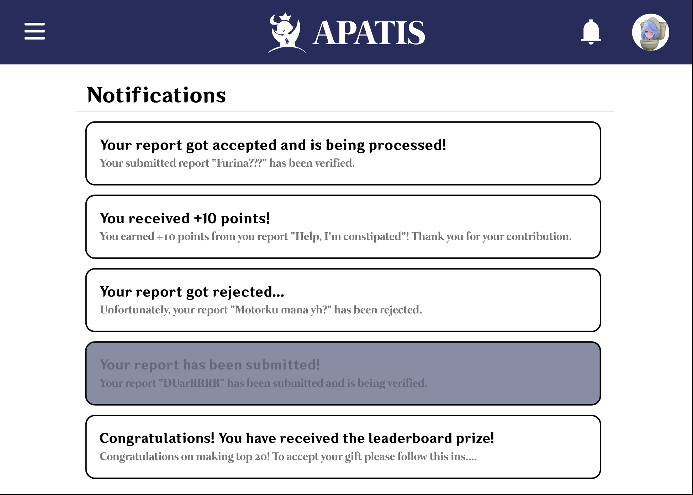
</p>
<p align="center">
<i>Gambar 6.5 Rancangan Antarmuka I-05 - Halaman Notifikasi</i>
</p>

Tabel 6.5 Spesifikasi Objek Antarmuka I-05

| Id_Objek | Jenis | Konten | Keterangan |
| :--- | :--- | :--- | :--- |
| *O-48* | *Rich Label* | *Notifications* | *Text yang menunjukkan nama halaman.* |
| *O-49* | *Rich Label* | *Judul notifikasi* | *Text yang menunjukkan judul notfikasi.* |
| *O-50* | *Container* | *Seluruh field untuk formulir laporan* | *Mengkelompokkan objek-objek yang dibutuhkan dalam formulir laporan.* |
| *O-51* | *Rich Label* | *Deskripsi notifikasi* | *Text yang menunjukkan deskripsi notifikasi.* |
| *O-52* | *Container* | *Notifikasi* | *Mengandung judul dan deskripsi notfikasi.* |
| *O-53* | *Separator* | *Garis pembatas* | *Pembatas antara judul halaman dan daftar notifikasi.* |


## 6.6 Rancangan Antarmuka I-06

**Antarmuka:** *I-06*  
**Nama Layar:** *Halaman Formulir Laporan*

<p align="center">
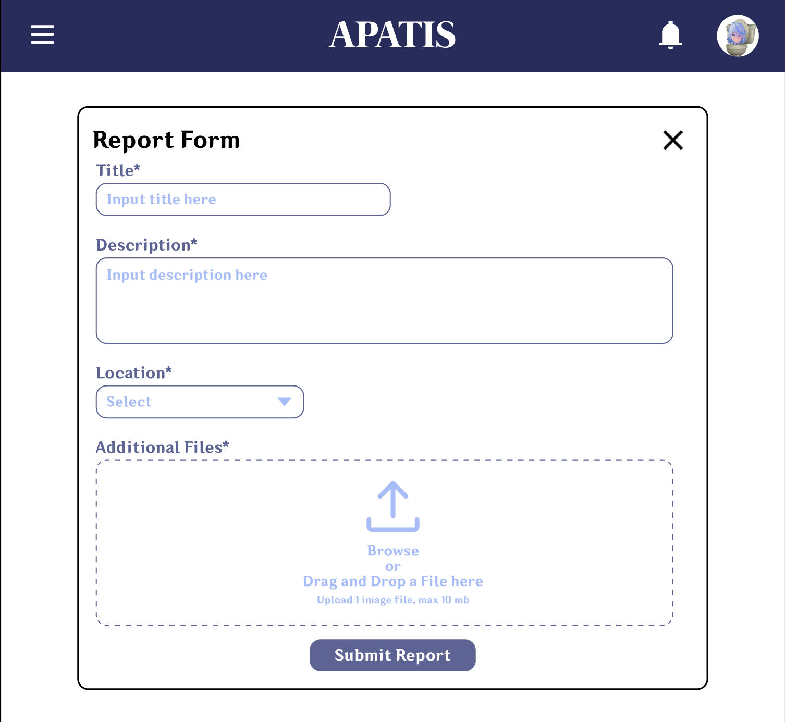
</p>
<p align="center">
<i>Gambar 6.6 Rancangan Antarmuka I-06 - Halaman Formulir Laporan</i>
</p>

Tabel 6.6 Spesifikasi Objek Antarmuka I-06

| Id_Objek | Jenis | Konten | Keterangan |
| :--- | :--- | :--- | :--- |
| *O-54* | *Rich Label* | *Report Form* | *Text yang menunjukkan nama halaman.* |
| *O-55* | *Rich Label* | *Title'*'* | *Text yang menunjukkan tempat input judul laporan.* |
| *O-56* | *Rich Text Input Field* | *Judul laporan* | *Tempat input judul laporan.* |
| *O-57* | *Rich Label* | *Description'*'* | *Text yang menunjukkan tempat input deskripsi masalah.* |
| *O-58* | *Rich Text Input Field* | *Deskripsi masalah* | *Tempat pengisian deskripsi masalah.* |
| *O-59* | *Rich Label* | *Location'*'* | *Text yang menunjukkan tempat pemilihan lokasi masalah.* |
| *O-60* | *Drop down* | *Lokasi-lokasi permasalah air dan sanitasi di ITB* | *Memilih lokasi permasalahan terjadi.* |
| *O-61* | *Rich Label* | *Additional Files'*'* | *Text yang menunjukkan tempat pengunggahan foto pendukung.* |
| *O-62* | *File input* | *Unggahan foto pendukung* | *Tempat pengunggahan foto pendukung.* |
| *O-63* | *Separator* | *Garis pembatas tempat unggahan* | *Membedakan tempat untuk menggungah foto pendukung.* |
| *O-64* | *Button* | *Submit Report* | *Mengirim laporan yang sudah terisi.* |
| *O-65* | *Container* | *Seluruh field untuk formulir laporan* | *Mengkelompokkan objek-objek yang dibutuhkan dalam formulir laporan.* |
| *O-66* | *Icon* | *Close* | *Menutup formulir laporan.* |


## 6.7 Rancangan Antarmuka I-07

**Antarmuka:** *I-07*  
**Nama Layar:** *Halaman Formulir Tanggapan*

<p align="center">
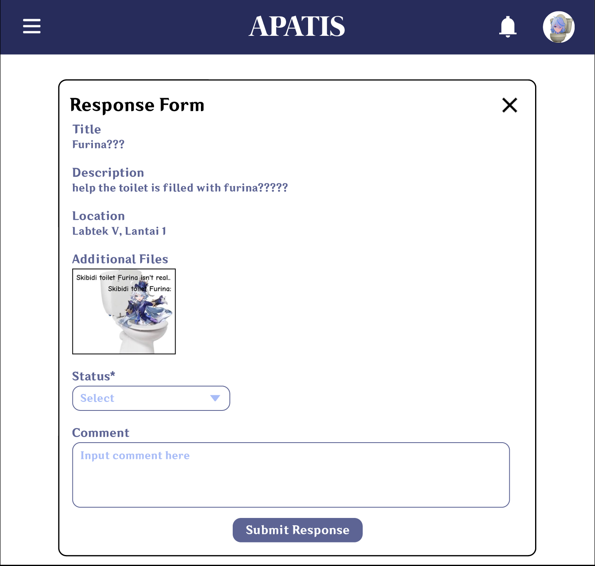
</p>
<p align="center">
<i>Gambar 6.7 Rancangan Antarmuka I-07 - Halaman Formulir Tanggapan</i>
</p>

Tabel 6.7 Spesifikasi Objek Antarmuka I-07

| Id_Objek | Jenis | Konten | Keterangan |
| :--- | :--- | :--- | :--- |
| *O-67* | *Rich Label* | *Response Form* | *Text yang menunjukkan nama halaman.* |
| *O-68* | *Rich Label* | *Title* | *Text yang menunjukkan tempat judul laporan.* |
| *O-69* | *Rich Label* | *Judul laporan* | *Text yang menunjukkan judul laporan.* |
| *O-70* | *Rich Label* | *Description* | *Text yang menunjukkan tempat deskripsi masalah.* |
| *O-71* | *Rich Label* | *Deskripsi masalah* | *Text yang menunjukkan deskripsi masalah laporan.* |
| *O-72* | *Rich Label* | *Location* | *Text yang menunjukkan tempat lokasi masalah.* |
| *O-73* | *Rich Label* | *Lokasi masalah yang dilaporkan* | *Text yang menunjukkan lokasi permasalahan terjadi.* |
| *O-74* | *Rich Label* | *Additional Files'*'* | *Text yang menunjukkan tempat pengunggahan foto pendukung.* |
| *O-75* | *Image* | *Unggahan foto pendukung* | *Menunjukkan foto pendukung yang diunggah.* |
| *O-76* | *Rich Label* | *Status'*'* | *Text yang menunjukkan tempat pemilihan status laporan.* |
| *O-77* | *Drop down* | *Status laporan* | *Memilih status laporan.* |
| *O-78* | *Rich Label* | *Comment* | *Text yang menunjukkan tempat input komentar.* |
| *O-79* | *Rich Text Input Field* | *Komentar laporan* | *Tempat pengisian komentar laporan.* |
| *O-80* | *Container* | *Seluruh field untuk formulir tanggapan* | *Mengkelompokkan objek-objek yang dibutuhkan dalam formulir tanggapan.* |
| *O-81* | *Icon* | *Close* | *Menutup formulir tanggapan.* |


## 6.8 Rancangan Antarmuka I-08

**Antarmuka:** *I-08*  
**Nama Layar:** *Halaman Leaderboard*

<p align="center">
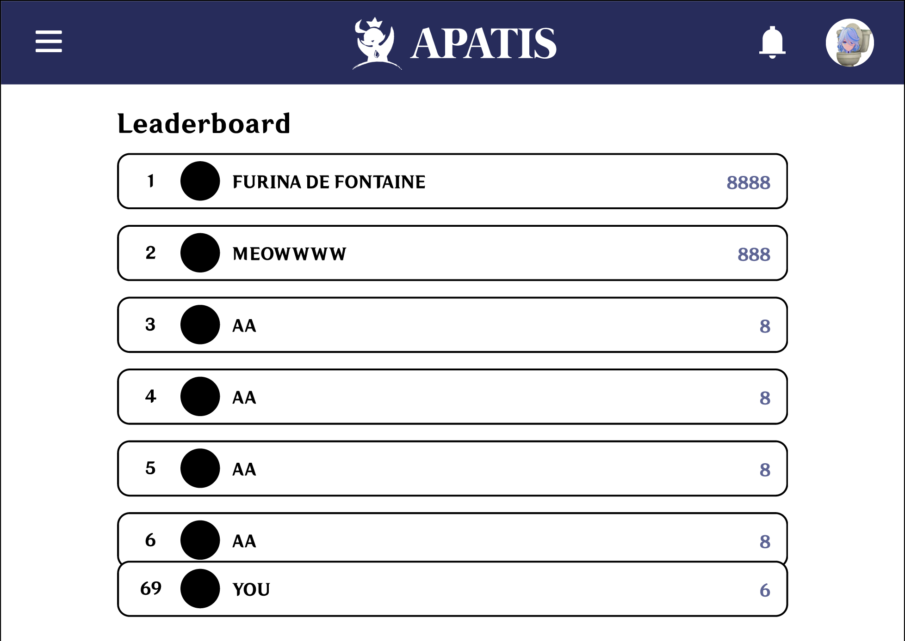
</p>
<p align="center">
<i>Gambar 6.8 Rancangan Antarmuka I-08 - Halaman Leaderboard</i>
</p>

Tabel 6.8 Spesifikasi Objek Antarmuka I-08

| Id_Objek | Jenis | Konten | Keterangan |
| :--- | :--- | :--- | :--- |
| *O-82* | *Rich Label* | *Leaderboard* | *Text yang menunjukkan nama halaman.* |
| *O-83* | *Rich Label* | *Ranking* | *Text yang menunjukkan nomor ranking di leaderboard.* |
| *O-84* | *Avatar* | *Profil akun* | *Gambar yang menunjukkan profil akun pengguna.* |
| *O-85* | *Rich Label* | *Poin* | *Text yang menunjukkan jumlah poin yang dimiliki pengguna terkait.* |
| *O-86* | *Container* | *Informasi ranking setiap pengguna* | *Mengelompokkan informasi yang dibutuhkan untuk ranking pengguna.* |
| *O-87* | *Icon* | *Titik tiga kebawah* | *Icon yang menunjukkan bahwa ada kelanjutan ranking setelah ranking 20.* |


## 6.9 Rancangan Antarmuka Keseluruhan

Tuliskan daftar gambar seluruh antarmuka. Berikan ID unik untuk setiap tampilan dan gunakan ID yang sama pada subbab perancangan antarmuka masing-masing.

Tabel 6.9 Rancangan Antarmuka Keseluruhan

| No | Tampilan Antarmuka |
| :--- | :--- |
| *[I-01]* |  |
| *[I-02]* | <br> |
| *[I-03]* | <br><br> |
| *[I-04]* |  |
| *[I-05]* |  |
| *[I-06]* |  |
| *[I-07]* |  |
| *[I-08]* |  |

<br>

---

# BAB 7: Matriks Kerunutan

Tabel 7.1. Matriks Kerunutan Kelas terhadap Use Case
| Kelas | Use Case Terkait |
| :--- | :--- |
| **C01 - PelaporEntity** | *UC01 - Melakukan pelaporan, UC02 - Memberikan Status Laporan, UC03 - Memberikan dan Membatalkan _Like_, UC04 - Memperoleh Poin* |
| **C02 - LaporanEntity** | *UC01 - Melakukan pelaporan, UC02 - Memberikan Status Laporan, UC03 - Memberikan dan Membatalkan _Like_* |
| **C03 - HalamanLaporan** | *UC03 - Memberikan dan Membatalkan _Like_* |
| **C04 - HalamanFormulirLaporan** | *UC01 - Melakukan pelaporan* |
| **C05 - LaporanController** | *UC01 - Melakukan pelaporan* |
| **C06 - AdminEntity** | *UC02 - Memberikan Status Laporan* |
| **C07 - PetugasEntity** | *UC02 - Memberikan Status Laporan* |
| **C08 - HalamanFormulirTanggapan** | *UC02 - Memberikan Status Laporan* |
| **C09 - TanggapanController** | *UC02 - Memberikan Status Laporan, UC04 - Memperoleh Poin* |
| **C10 - LikeController** | *UC03 - Memberikan dan Membatalkan _Like_* |
| **C11 - HalamanLeaderboard** | *UC04 - Memperoleh Poin* |
| **C12 - DatabaseLaporanEntity** | *UC01 - Melakukan pelaporan, UC02, UC03* |
| **C13 - DatabasePelaporEntity** | *UC04 - Memperoleh Poin* |
| **C14 - LeaderboardController** | *UC04 - Memperoleh Poin* |
| **C15 - HalamanAkun** | *UC04 - Memperoleh Poin* |
| **C16 - HalamanNotifikasi** | *UC02 - Memberikan Status Laporan, UC04 - Memperoleh Poin* |
| **C17 - NotifikasiController** | *UC02 - Memberikan Status Laporan, UC04 - Memperoleh Poin* |
| **C18 - HalamanLogin** | *UC01 - Melakukan pelaporan (prekondisi)* |
| **C19 - LoginController** | *UC01 - Melakukan pelaporan (prekondisi)* |
