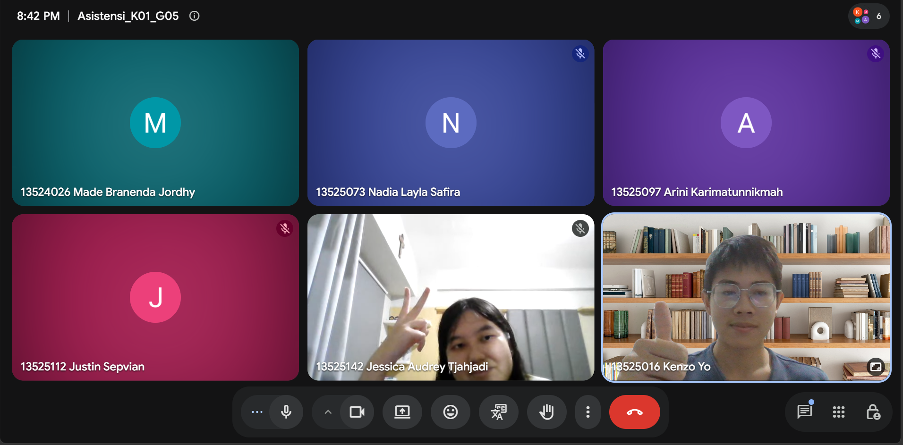

# Form Asistensi

## Tugas Besar IF2150 - Rekayasa Perangkat Lunak

| Informasi | Keterangan |
| --- | --- |
| **Hari** | *\[Selasa\]* |
| **Tanggal** | *\[27/10/2026\]* |
| **Kelas** | *\[K01\]* |
| **Nomor Kelompok** | *\[5\]*  |
| **Nama Kelompok** | *\[Furina: Forum RPL Indonesia Jaya\]*  |
| **Nama Perangkat Lunak** | *\[APATIS: Aplikasi Pelaporan Air dan Sanitasi\]*  |
| **Dokumen** | *\[DPPL2\]*  |

### Anggota Kelompok

| NIM | Nama |
| --- | --- |
| *13525016* | *Kenzo Yo* |
| *13525112* | *Justin Sepvian* |
| *13525142* | *Jessica Audrey Tjahjadi* |
| *13525073* | *Nadia Layla Safira* |
| *13525097* | *Arini Karimatunnikmah* |

### Catatan

| Catatan |
| --- |
| 1. Pertanyaan: Apakah masih bisa menambahkan metode or attribute? Jawab: Boleh, memang dppl buat itu, tapi jangan sampe ubah fitur. Login screen boleh, notif read gak bisa |
| 2. Pertanyaan: Apakah setiap kelas wajib ada signature operation? Gimana untuk entities yang hanya getter dan setter? Jawab: Getter setter gak perlu tulis algonya (gak usah tulis pseudocode yang kecil), tulis yang penting aja. Tulis yang unik di classnya. |
| 3. Pertanyaan: Penerapan query itu gimana ya kak? Apakah dia perlu jika dan hanya jika dia terhubung dengan database dan pasti meminta data gitu? Jawab: 
Betul memang buat itu, syntaxnya harus bentuk query harus sama |
| 4. Pertanyaan: Kalau pseudocodenya gini, bentuk setengah react dan typescript aman ga kak? Jawab: Gak ada ketentuan tentang ini, bisa cuman words doang gak perlu aritmatika banget, tapi gapapa gini soalnya deket dengan nantinya |

**Notes for this section:**  
*Catatan dapat dituliskan dalam bentuk paragraf atau poin-poin, disesuaikan saja.* 

## Dokumentasi

<!--  -->

  

  <i>Gambar 1. Dokumentasi kegiatan asistensi.</i>

