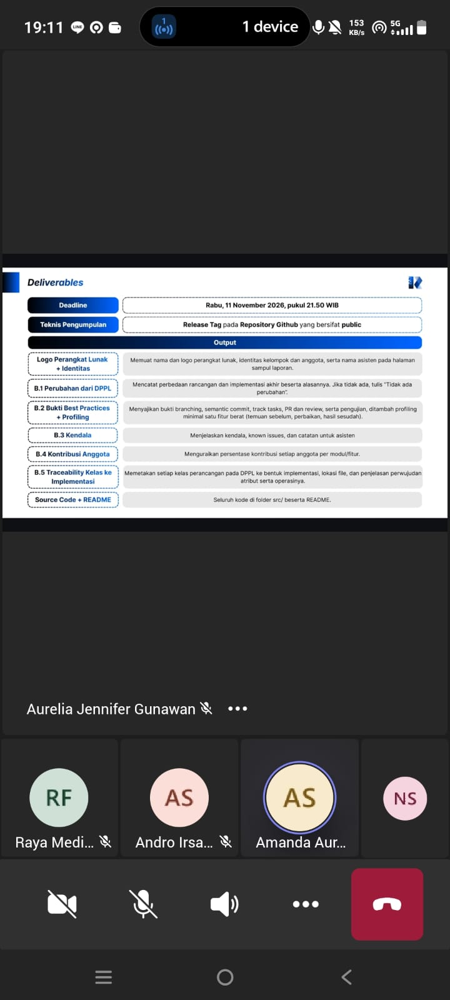

# Form Asistensi

## Tugas Besar IF2150 - Rekayasa Perangkat Lunak

| Informasi | Keterangan |
| --- | --- |
| **Hari** | *\[Senin\]* |
| **Tanggal** | *\[02/11/2026\]* |
| **Kelas** | *\[K01\]* |
| **Nomor Kelompok** | *\[5\]*  |
| **Nama Kelompok** | *\[Furina: Forum RPL Indonesia Jaya\]*  |
| **Nama Perangkat Lunak** | *\[APATIS: Aplikasi Pelaporan Air dan Sanitasi\]*  |
| **Dokumen** | *\[K01_G05_Implementasi\]*  |

### Anggota Kelompok

| NIM | Nama |
|---|---|
| *13525016* | *Kenzo Yo* |
| *13525112* | *Justin Sepvian* |
| *13525142* | *Jessica Audrey Tjahjadi* |
| *13525073* | *Nadia Layla Safira* |
| *13525097* | *Arini Karimatunnikmah* |

### Catatan

| Catatan |
| --- |
| 1. *Teknologi yang digunakan untuk implementasi perangkat lunak selama sesuai dengan DPPL.*  |
| 2. *Arsitektur harus terlihat di struktur kode.* |
| 3. *Code review fokus ke requirement, logic, penamaan, dan code smell. Optimisasi dilakukan * |
| 4. *Hindari god class, hardcore, error handling yang buruk, dan logika yang tercampur antar layer.*|

**Notes for this section:**  
*Catatan dapat dituliskan dalam bentuk paragraf atau poin-poin, disesuaikan saja.* 
*Asistensi diatas merupakan asistensi akbar.*

## Dokumentasi

<!--  -->

  

  <i>Gambar 1. Dokumentasi kegiatan asistensi.</i>

